# Linear Algebra and Its Applications (5th Edition) 双语精读
# 《线性代数及其应用（第5版）》双语讲解 · 第1章

> 面向零基础读者。每个概念都先用中文直觉解释，再给英文原文精讲，公式与图片与教材完全一致。
> Based on Lay, Lay & McDonald, *Linear Algebra and Its Applications*, 5th ed., Pearson 2016.

---

## 第一章 线性代数中的线性方程
## Chapter 1 Linear Equations in Linear Algebra

**导入例子：经济学与工程学中的线性模型**
**INTRODUCTORY EXAMPLE: Linear Models in Economics and Engineering**

1949 年，哈佛大学的列昂惕夫（Wassily Leontief，1973 年诺贝尔经济学奖得主）把美国经济划分为 500 个"部门"，为每个部门写出一个线性方程，描述它的产出如何分配给其他部门。由于数据量巨大，他将其化简为 **42 个方程、42 个未知量** 的方程组，交给 Harvard Mark II 计算机求解。计算机嗡嗡作响 56 个小时后得出了答案——这是计算机最早的大规模数学建模应用之一。

> 核心思想：现实问题中变量太多，模型通常是**线性的**（linear），即可以用**线性方程组（systems of linear equations）**来描述。线性代数的重要性，与计算能力的增长同步提升。

---

## 1.1 线性方程组 Systems of Linear Equations

### 什么是线性方程？

**中文讲解**：含有变量 $x_1, \dots, x_n$ 的**线性方程**是可以写成下面形式的方程：

$$
a_1x_1 + a_2x_2 + \cdots + a_nx_n = b
$$

其中 $b$ 和系数 $a_1, \dots, a_n$ 是已知实数或复数。直观判断标准：**变量只以一次幂出现，没有相乘、没有根号**。

是线性的（可整理成标准形式）：

$$
4x_1 - 5x_2 + 2 = x_1 \ \Rightarrow\  3x_1 - 5x_2 = -2,
$$

$$
x_2 = 2(\sqrt{6} - x_1) + x_3 \ \Rightarrow\  2x_1 + x_2 - x_3 = 2\sqrt{6}
$$

不是线性的：

$$
4x_1 - 5x_2 = x_1x_2 \quad (\text{出现 } x_1x_2 \text{ 乘积}),
$$

$$
x_2 = 2\sqrt{x_1} - 6 \quad (\text{出现根号})
$$

**英文原文**：
> A **linear equation** in the variables $x_1, \dots, x_n$ is an equation that can be written in the form $a_1x_1 + a_2x_2 + \cdots + a_nx_n = b$, where $b$ and the **coefficients** $a_1, \dots, a_n$ are real or complex numbers, usually known in advance.

### 什么是线性方程组？

**中文讲解**：**线性方程组**（也叫线性系统 linear system）就是**同一组变量**满足的一个或多个线性方程的集合。例如：

$$
2x_1 - x_2 + 1.5x_3 = 8
$$

$$
x_1 \quad\  - 4x_3 = -7
$$

- **解（solution）**：一组数 $(s_1, s_2, \dots, s_n)$，代入后使每个方程都成立。例如 $(5, 6.5, 3)$ 就是上面方程组的一个解。
- **解集（solution set）**：所有解的集合。
- **等价（equivalent）**：两个方程组解集完全相同，就称它们等价。

### 两个方程、两个变量的几何意义

求两个二元线性方程的解，就是找**两条直线的交点**：

$$
x_1 - 2x_2 = -1
$$

$$
-x_1 + 3x_2 = 3
$$

解是唯一点 $(3, 2)$：

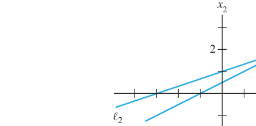

*FIGURE 1 Exactly one solution. 图1 唯一解：两直线相交于一点*

但两条直线也可能**平行**（无解）或**重合**（无穷多解）：

*FIGURE 2 (a) No solution. (b) Infinitely many solutions. 图2 (a) 无解：两直线平行；(b) 无穷多解：两直线重合*

**重要事实（教材黄框，1.2 节将证明）**：
> A system of linear equations has **1.** no solution, or **2.** exactly one solution, or **3.** infinitely many solutions.
> 线性方程组只有三种可能：**无解**、**唯一解**、**无穷多解**。

- **相容（consistent）**：有唯一解或无穷多解
- **不相容（inconsistent）**：无解

### 矩阵记号 Matrix Notation

**中文讲解**：把方程组的核心信息压缩进一个矩形数组——**矩阵（matrix）**。对系统：

$$
x_1 - 2x_2 + \ x_3 = \ 0
$$

$$
2x_2 - 8x_3 = \ 8
$$

$$
5x_1 \quad\  - 5x_3 = 10
$$

系数矩阵与增广矩阵：

$$
\begin{bmatrix} 1 & -2 & 1 \\
0 & 2 & -8 \\
5 & 0 & -5 \end{bmatrix} \qquad \left[\begin{array}{rrrr} 1 & -2 & 1 & 0 \\
0 & 2 & -8 & 8 \\
5 & 0 & -5 & 10 \end{array}\right]
$$

- **系数矩阵（coefficient matrix）**：只装未知数的系数
- **增广矩阵（augmented matrix）**：系数矩阵右边再加一列常数项
- **规模（size）**：$m \times n$ 表示 $m$ 行 $n$ 列。上面的增广矩阵是 $3 \times 4$。

### 解线性方程组：消元思想

**基本策略**：把原系统换成一个**等价的、更容易解的系统**（解集不变）。

**三种基本运算**（对应增广矩阵的三种**初等行变换 elementary row operations**）：

1. **Replacement 替换**：把某一行替换为它自己与另一行的倍数之和
2. **Interchange 交换**：交换两行
3. **Scaling 倍乘**：把某一行所有元素乘以一个非零常数

> 关键性质：初等行变换都是**可逆的（reversible）**。
> 若两个线性系统的增广矩阵**行等价（row equivalent）**，则两系统解集相同。

**例1（Example 1）求解系统**：

$$
\begin{aligned} x_1 - 2x_2 + \ x_3 &= 0 \\
2x_2 - 8x_3 &= 8 \\
5x_1 \quad\  - 5x_3 &= 10 \end{aligned}
$$

**步骤（左边是方程，右边是对应增广矩阵，教材并排列出）**：

第1步：用第1方程消去其他方程的 $x_1$。第3行 += (−5)×第1行：

$$
\left[\begin{array}{rrrr} 1 & -2 & 1 & 0 \\
0 & 2 & -8 & 8 \\
0 & 10 & -10 & 10 \end{array}\right]
$$

第2步：第2行 × $\frac{1}{2}$，使 $x_2$ 系数变为 1：

$$
\left[\begin{array}{rrrr} 1 & -2 & 1 & 0 \\
0 & 1 & -4 & 4 \\
0 & 10 & -10 & 10 \end{array}\right]
$$

第3步：用第2行消去第3行的 $10x_2$。第3行 += (−10)×第2行，得 $30x_3 = -30$，再 × $\frac{1}{30}$：

$$
\left[\begin{array}{rrrr} 1 & -2 & 1 & 0 \\
0 & 1 & -4 & 4 \\
0 & 0 & 1 & -1 \end{array}\right] \quad \text{（三角形式 triangular form）}
$$

第4步（**回代 backward**，从下往上）：用 $x_3$ 消去上方方程中的 $x_3$ 项；再用 $x_2$ 消去第1方程中的 $-2x_2$。最终：

$$
\left[\begin{array}{rrrr} 1 & 0 & 0 & 1 \\
0 & 1 & 0 & 0 \\
0 & 0 & 1 & -1 \end{array}\right] \ \Rightarrow\  x_1 = 1,\quad x_2 = 0,\quad x_3 = -1
$$

**验证**：$1(1) - 2(0) + 1(-1) = 0$；$2(0) - 8(-1) = 8$；$5(1) - 5(-1) = 10$

**几何意义**：每个方程在三维空间中确定一个平面，三个平面交于唯一点 $(1, 0, -1)$：

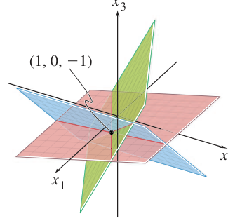

### 存在性与唯一性问题 Existence and Uniqueness Questions

**TWO FUNDAMENTAL QUESTIONS ABOUT A LINEAR SYSTEM 关于线性系统的两个基本问题**：
1. 系统相容吗？即解**存在**吗？（Is the system consistent?）
2. 如果解存在，它是唯一的吗？（Is the solution unique?）

**例2（Example 2）**：例1 的系统已化为三角形式。由 $x_3 = -1$ 可唯一确定 $x_2$，再唯一确定 $x_1$——**解存在且唯一，系统相容**。

**例3（Example 3）判断系统是否相容**：

$$
x_2 - \ 4x_3 = 8
$$

$$
2x_1 - 3x_2 + \ 2x_3 = 1
$$

$$
4x_1 - 8x_2 + 12x_3 = 1
$$

增广矩阵行变换：交换1、2行 → 第3行 += (−2)×第1行 → 第3行 += 2×第2行：

$$
\left[\begin{array}{rrrr} 2 & -3 & 2 & 1 \\
0 & 1 & -4 & 8 \\
0 & 0 & 0 & 15 \end{array}\right] \ \Rightarrow\  0 = 15 \ \text{矛盾！}
$$

最后一行 $0 = 15$ 是 $0x_1+0x_2+0x_3=15$ 的简写，永远不成立。**系统不相容（无解）**。

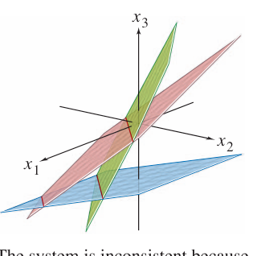

> 记住：三角形式中若出现 $[0\ \cdots\ 0\ b]$（$b\neq0$）这样的行，系统就不相容。

**数值注记（Numerical Note）**：现实中计算机用**浮点算术（floating point arithmetic）**，数字以 ±.d1...dp×10^r 存储，会产生舍入误差（roundoff error），但通常不会造成问题。

### 练习示例（1.1 Exercises 精选）

**判断 $(3,4,-2)$ 是否为下列系统的解**（Practice Problem 3）：

$$
\begin{aligned} 5x_1 - \ x_2 + 2x_3 &= 7 \\
-2x_1 + 6x_2 + 9x_3 &= 0 \\
-7x_1 + 5x_2 - 3x_3 &= -7 \end{aligned}
$$

代入 $x_1=3, x_2=4, x_3=-2$：
- $5(3)-(4)+2(-2) = 15-4-4 = 7$ 成立
- $-2(3)+6(4)+9(-2) = -6+24-18 = 0$ 成立
- $-7(3)+5(4)-3(-2) = -21+20+6 = 5 \neq -7$ 不成立

**不是解**。几何上：该点在前两个平面的交线上，但不在第三个平面上：

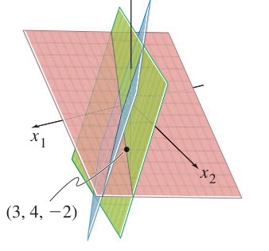

**$h, k$ 取何值时系统相容？**（Practice Problem 4）：
$$
2x_1 - x_2 = h
$$

$$
-6x_1 + 3x_2 = k
$$
第2行 += 3×第1行，得 $0 = k + 3h$。**当且仅当 $k + 3h = 0$ 时系统相容**。

**练习题 1**：
$$
x_1 + 5x_2 = 7
$$

$$
-2x_1 - 7x_2 = -5
$$
第2行 += 2×第1行：$3x_2 = 9 \Rightarrow x_2 = 3$，回代 $x_1 = 7 - 15 = -8$。**解：$(-8, 3)$**

---

## 1.2 行化简与阶梯形 Row Reduction and Echelon Forms

**中文讲解**：上一节的消元法很"手工"，这一节把它升级成一套**标准化算法**，能分析任意线性方程组，并严格回答"解是否存在、是否唯一"两个问题。

### 阶梯形与简化阶梯形 Echelon Form

**DEFINITION 定义**——矩阵是**阶梯形（echelon form / 行阶梯形 row echelon form）**，当且仅当满足：

1. 所有非零行都在全零行之上
2. 每一行的**主元（leading entry）**所在列，严格位于上一行主元的右边
3. 主元下方的元素全为 0

若 additionally 满足下面两条，则为**简化阶梯形（reduced echelon form / RREF）**：

4. 每个非零行的主元是 1
5. 每个主元 1 是它所在列中唯一的非零元

**直觉**：主元呈"阶梯（staircase）"状向右下方排列。

- **阶梯矩阵 / 简化阶梯矩阵**：分别指处于这两种形态的矩阵
- **行化简（row reduced）**：用初等行变换把矩阵变形的过程

**THEOREM 1（Uniqueness of the Reduced Echelon Form 简化阶梯形的唯一性）**：
> Each matrix is row equivalent to **one and only one** reduced echelon matrix.
> 每个矩阵行等价于**唯一一个**简化阶梯矩阵。

### 主元位置 Pivot Positions

**DEFINITION 定义**：矩阵 $A$ 中的**主元位置（pivot position）**是对应其简化阶梯形中主元 1 的位置；包含主元位置的列叫**主元列（pivot column）**。

**例2（Example 2）**：把 $A$ 行化简到阶梯形并找出主元列：

$$
A = \begin{bmatrix} 0 & -3 & -6 & 4 & 9 \\
-1 & -2 & -1 & 3 & 1 \\
-2 & -3 & 0 & 3 & -1 \\
1 & 4 & 5 & -9 & -7 \end{bmatrix}
$$

最左非零列是主元列，把非零主元换到顶部（交换1、4行）→ 主元下方消零 → 对子矩阵重复……最终：

$$
\begin{bmatrix} 1 & 4 & 5 & -9 & -7 \\
0 & 2 & 4 & -6 & -6 \\
0 & 0 & 0 & -5 & 0 \\
0 & 0 & 0 & 0 & 0 \end{bmatrix} \quad\text{一般形式：}\  \begin{bmatrix} \blacksquare & * & * & * & * \\
0 & \blacksquare & * & * & * \\
0 & 0 & 0 & \blacksquare & * \\
0 & 0 & 0 & 0 & 0 \end{bmatrix}
$$

$A$ 的主元列是**第 1、2、4 列**。

> 注意区分：**pivot（主元）** 是化简过程中用于消零的那个非零数（本例为 1, 2, −5），它不一定等于 $A$ 原位置上的元素。

### 行化简算法 The Row Reduction Algorithm（高斯消元）

**前向阶段（forward phase，步骤1–4）→ 阶梯形；后向阶段（backward phase，步骤5）→ 简化阶梯形**

- **STEP 1**：从最左非零列开始，这是主元列，主元位置在顶端
- **STEP 2**：在该列选一个非零元作主元，必要时换行使它位于主元位置
- **STEP 3**：用行替换把主元下方的位置全部化为 0
- **STEP 4**：盖住已处理的行，对剩余子矩阵重复步骤1–3，直到没有非零行可处理
- **STEP 5（后向阶段）**：从最右主元开始，从右往左、从下往上，把每个主元上方也化为 0；若主元不是 1，先用倍乘把它变成 1

**例3（Example 3）完整示范**：

$$
\begin{bmatrix} 0 & 3 & -6 & 6 & 4 & -5 \\
3 & -7 & 8 & -5 & 8 & 9 \\
3 & -9 & 12 & -9 & 6 & 15 \end{bmatrix}
$$

1. 最左非零列是第1列 → 交换1、3行使主元 3 到顶部
2. 第2行 += (−1)×第1行
3. 子矩阵中第2列是新主元列，主元 2；第3行 += (−3/2)×第2行：

$$
\begin{bmatrix} 3 & -9 & 12 & -9 & 6 & 15 \\
0 & 2 & -4 & 4 & 2 & -6 \\
0 & 0 & 0 & 0 & 1 & 4 \end{bmatrix} \ \text{（阶梯形）}
$$

4. 后向阶段：第1行 += (−6)×第3行，第2行 += (−2)×第3行；第2行 ×1/2；第1行 += 9×第2行；第1行 ×1/3：

$$
\begin{bmatrix} 1 & 0 & -2 & 3 & 0 & -24 \\
0 & 1 & -2 & 2 & 0 & -7 \\
0 & 0 & 0 & 0 & 1 & 4 \end{bmatrix} \ \text{（简化阶梯形，唯一）}
$$

> **数值注记**：计算机通常选列中绝对值最大的元素作主元，这叫**部分主元法（partial pivoting）**，可减小舍入误差。

### 线性系统的解 Solutions of Linear Systems

**基本变量与自由变量（核心概念！）**：
- **基本变量（basic variables）**：对应于主元列的变量
- **自由变量（free variables）**：其余变量，可以任意取值

例如增广矩阵化简为：

$$
\left[\begin{array}{rrrr} 1 & 0 & -5 & 1 \\
0 & 1 & 1 & 4 \\
0 & 0 & 0 & 0 \end{array}\right] \ \Rightarrow\  \begin{aligned} x_1 \quad\  - 5x_3 &= 1 \\
x_2 + \ x_3 &= 4 \\
0 &= 0 \end{aligned}
$$

$x_1, x_2$ 是基本变量，$x_3$ 是自由变量。把基本变量用自由变量表示：

$$
\begin{cases} x_1 = 1 + 5x_3 \\
x_2 = 4 - x_3 \\
x_3 \text{ 自由（free）} \end{cases}
$$

$x_3$ 每取一个值就得到一个解：$x_3=0 \Rightarrow (1,4,0)$；$x_3=1 \Rightarrow (6,3,1)$。**不同的 $x_3$ 选择给出不同的解，每个解都由 $x_3$ 的取值决定**——这就是"无穷多解"的具体样子。这种写法叫解集的**参数描述（parametric description）**。

**例4（Example 4）**：增广矩阵（已化到阶梯形）：

$$
\left[\begin{array}{rrrrrr} 1 & 6 & 2 & -5 & -2 & -4 \\
0 & 0 & 2 & -8 & -1 & 3 \\
0 & 0 & 0 & 0 & 1 & 7 \end{array}\right]
$$

继续化成简化阶梯形：

$$
\sim \left[\begin{array}{rrrrrr} 1 & 6 & 0 & 3 & 0 & 0 \\
0 & 0 & 1 & -4 & 0 & 5 \\
0 & 0 & 0 & 0 & 1 & 7 \end{array}\right]
$$

主元列是 1、3、5，基本变量 $x_1, x_3, x_5$；自由变量 $x_2, x_4$。通解：

$$
\begin{cases} x_1 = -6x_2 - 3x_4 \\
x_2 \text{ 自由} \\
x_3 = 5 + 4x_4 \\
x_4 \text{ 自由} \\
x_5 = 7 \end{cases}
$$

> 写通解时必须**每个变量都写出**，并明确标注哪些是自由变量。$\{x_1 = -3+8x_3,\  x_2 = -1+x_3,\  x_3 = 1+x_2\}$ 是**错误**的写法，因为它错误地暗示 $x_2$ 和 $x_3$ 都是自由变量。

**回代（Back-Substitution）**：计算机程序通常只化到（非简化）阶梯形，再用回代求解：从最下方的方程解出最后一个基本变量，逐层向上代入。手算时教材建议**统一使用简化阶梯形**，矩阵格式能大幅减少出错。

**数值注记**：化到阶梯形约需 $2n^3/3$ 次浮点运算（flops），而继续化到简化阶梯形最多只需 $n^2$ 次——前向阶段远比后向阶段耗时。

### 存在性与唯一性定理 THEOREM 2

**Existence and Uniqueness Theorem 存在唯一性定理**：
> 线性系统**相容**，当且仅当增广矩阵的最右列**不是**主元列——即其阶梯形中没有 $[0\ \cdots\ 0\ b]$（$b\neq 0$）这样的行。
> 若系统相容，则解集要么 (i) **唯一**（无自由变量），要么 (ii) **无穷多**（至少有一个自由变量）。

**用行化简解线性系统的标准流程（USING ROW REDUCTION TO SOLVE A LINEAR SYSTEM）**：
1. 写出增广矩阵
2. 行化简到阶梯形，判断相容性；若无解，停止
3. 继续化到简化阶梯形
4. 写出对应的方程组
5. 把每个非零方程改写为：基本变量 = 自由变量的表达式

**几何图示**：两个平面相交于一条直线，通解就是这条交线的参数描述：

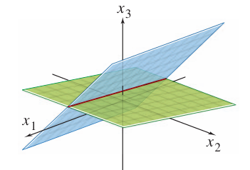

*The general solution of the system of equations is the line of intersection of the two planes. 方程组的通解就是两平面的交线。*

### 练习示例（1.2 精选）

**练习 3**：行化简到简化阶梯形并圈出主元位置。

$$
\begin{bmatrix} 1 & 2 & 3 & 4 \\
4 & 5 & 6 & 7 \\
6 & 7 & 8 & 9 \end{bmatrix} \Rightarrow \begin{bmatrix} 1 & 0 & -1 & -2 \\
0 & 1 & 2 & 3 \\
0 & 0 & 0 & 0 \end{bmatrix}
$$

主元在第1、2列（原矩阵中对应位置圈出）。

**练习 19**：$x_1 + hx_2 = 2,\  4x_1 + 8x_2 = k$
- (a) 无解：第2行是第1行的倍数但常数不符，如 $h = 4$ 且 $k \neq 8$
- (b) 唯一解：$h \neq 4$
- (c) 无穷多解：$h = 4$ 且 $k = 8$（第2行 = 4×第1行）

**真/假判断（T/F）精选**：
- "初等行变换不改变增广矩阵对应线性系统的解集" True
- "阶梯形是唯一的" False（简化阶梯形才唯一，见 Theorem 1）
- "有自由变量则必有无穷多解" 需先相容才成立；若不相容则解集为空，故为 False（需小心！）
- "化到阶梯形叫前向阶段（forward phase）" True

---

## 1.3 向量方程 Vector Equations

**中文讲解**：用**向量（vector）**的概念和记号来描述线性系统的性质，能把"方程组"与"几何"联系起来。本节开始，**向量 = 有序数列（ordered list of numbers）**。

### 二维空间中的向量 Vectors in $\mathbb{R}^2$

**英文原文**：
> A matrix with only one column is called a **column vector**, or simply a **vector**. The set of all vectors with two entries is denoted by $\mathbb{R}^2$ (read "r-two"). The $\mathbb{R}$ stands for the real numbers that appear as entries, and the exponent 2 indicates that each vector contains two entries.

- 只有一列的矩阵叫**列向量（column vector）**，简称**向量**：

$$
\mathbf{u} = \begin{bmatrix} 3 \\
-1 \end{bmatrix}, \qquad \mathbf{v} = \begin{bmatrix} .2 \\
.3 \end{bmatrix}, \qquad \mathbf{w} = \begin{bmatrix} w_1 \\
w_2 \end{bmatrix}
$$

- 所有"两个分量的向量"组成的集合记作 $\mathbb{R}^2$（r-two）
- **相等**：对应分量相等才算相等。$\begin{bmatrix} 4 \\\\ 7 \end{bmatrix} \neq \begin{bmatrix} 7 \\\\ 4 \end{bmatrix}$——向量是**有序**的！

### 向量的几何表示：点还是箭头？

**中文讲解**：向量有两种看图方式，都常用：

1. **看作点**：$\begin{bmatrix} -2 \\\\ 1 \end{bmatrix}$ 就是平面上坐标为 $(-2, 1)$ 的点
2. **看作箭头**：从原点 $(0,0)$ 指向点 $(-2,1)$ 的有向线段

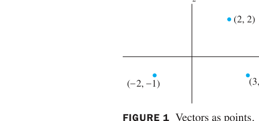

*FIGURE 1 Vectors as points. 图1 把向量看作平面上的点*

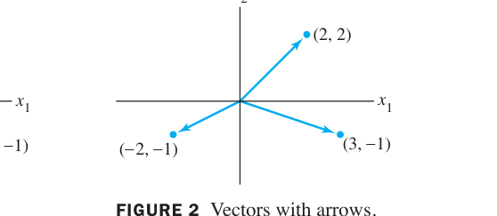

*FIGURE 2 Vectors with arrows. 图2 从原点出发的箭头表示向量*

> 英文原文：Individual numbers in a vector are called **entries** or **components**. Vectors in $\mathbb{R}^2$ can be visualized either as **points** or as **arrows** (directed line segments from the origin).

### 向量的加法与数乘（几何意义）

**中文讲解**：两个向量相加，用**平行四边形法则（parallelogram rule）**：把 $\mathbf{u}$ 和 $\mathbf{v}$ 的起点都放在原点，以它们为邻边作平行四边形，从原点到对角顶点的对角线就是 $\mathbf{u}+\mathbf{v}$。等价地，也可以把 $\mathbf{v}$ 的"尾巴"接到 $\mathbf{u}$ 的"箭头"上（三角形法则）。

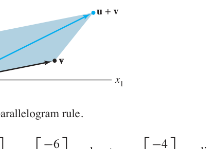

*FIGURE 3 The parallelogram rule. 图3 向量加法的平行四边形法则*

**例1（Example 1）**：

$$
\mathbf{u} = \begin{bmatrix} 1 \\
2 \end{bmatrix}, \quad \mathbf{v} = \begin{bmatrix} 2 \\
-2 \end{bmatrix} \ \Rightarrow\  \mathbf{u} + \mathbf{v} = \begin{bmatrix} 1+2 \\
2+(-2) \end{bmatrix} = \begin{bmatrix} 3 \\
0 \end{bmatrix}
$$

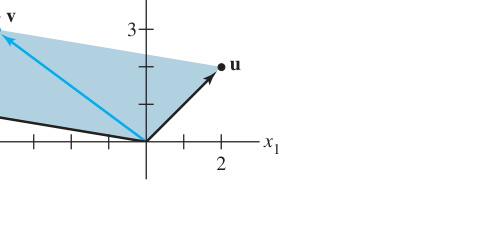

**数乘（Scalar multiples）**：$c\mathbf{u}$ 就是把 $\mathbf{u}$ 的长度放大 $|c|$ 倍；$c>0$ 方向不变，$c<0$ 方向反转。

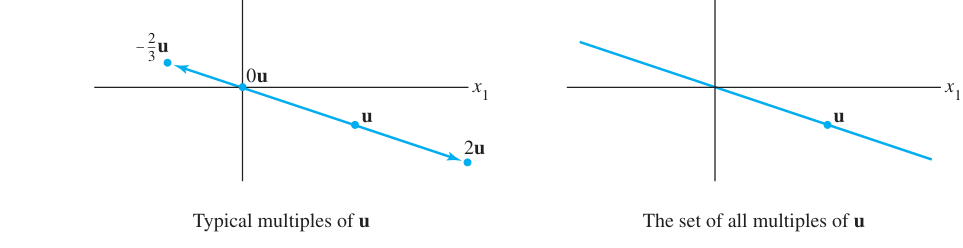

*FIGURE 5 Scalar multiples. 图5 数乘的几何效果：拉伸与反向*

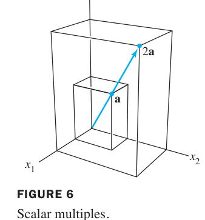

*FIGURE 6 Scalar multiples in $\mathbb{R}^3$. 图6 三维空间中同样成立*

### n 维向量与代数性质

**中文讲解**：完全类似，所有 $n$ 个分量的向量组成 $\mathbb{R}^n$。两个向量**相等**当且仅当对应分量全相等；向量与**标量（scalar）**相乘就是每个分量都乘这个数。

**代数性质 THEOREM 1（Algebraic Properties of $\mathbb{R}^n$）**：对所有 $\mathbf{u},\mathbf{v},\mathbf{w} \in \mathbb{R}^n$ 和标量 $c,d$：

1. $\mathbf{u}+\mathbf{v} = \mathbf{v}+\mathbf{u}$（加法交换律）
2. $(\mathbf{u}+\mathbf{v})+\mathbf{w} = \mathbf{u}+(\mathbf{v}+\mathbf{w})$（加法结合律）
3. $\mathbf{u}+\mathbf{0} = \mathbf{0}+\mathbf{u} = \mathbf{u}$（零向量）
4. $\mathbf{u}+(-\mathbf{u}) = \mathbf{0}$（加法逆元）
5. $c(\mathbf{u}+\mathbf{v}) = c\mathbf{u}+c\mathbf{v}$（分配律）
6. $(c+d)\mathbf{u} = c\mathbf{u}+d\mathbf{u}$（分配律）
7. $c(d\mathbf{u}) = (cd)\mathbf{u}$（数乘结合律）
8. $1\mathbf{u} = \mathbf{u}$（单位元）

**减法**：$\mathbf{u}-\mathbf{v} = \mathbf{u}+(-\mathbf{v})$，几何上就是从 $\mathbf{v}$ 的终点指向 $\mathbf{u}$ 终点的箭头：

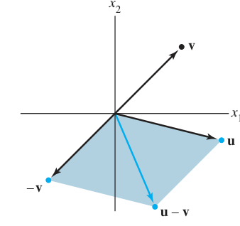

*FIGURE 7 Vector subtraction. 图7 向量减法 $\mathbf{u}-\mathbf{v}$ 的几何意义*

### 线性组合 Linear Combinations（本节核心概念！）

**中文讲解**：给定向量 $\mathbf{v}_1, \dots, \mathbf{v}_p \in \mathbb{R}^n$ 和标量 $c_1, \dots, c_p$，向量

$$
\mathbf{y} = c_1\mathbf{v}_1 + c_2\mathbf{v}_2 + \cdots + c_p\mathbf{v}_p
$$

称为 $\mathbf{v}_1, \dots, \mathbf{v}_p$ 的**线性组合（linear combination）**，其中 $c_1, \dots, c_p$ 叫**权（weights）**。

> 英文原文：Given vectors $\mathbf{v}_1, \dots, \mathbf{v}_p$ in $\mathbb{R}^n$ and given scalars $c_1, \dots, c_p$, the vector $\mathbf{y} = c_1\mathbf{v}_1 + \cdots + c_p\mathbf{v}_p$ is called a **linear combination** of $\mathbf{v}_1, \dots, \mathbf{v}_p$ with **weights** $c_1, \dots, c_p$. Note that weights in a linear combination can be any real numbers, including zero.

**例2（Example 2）**：设 $\mathbf{v}_1 = \begin{bmatrix} -1 \\\\ 1 \end{bmatrix}$, $\mathbf{v}_2 = \begin{bmatrix} 2 \\\\ 1 \end{bmatrix}$，求 $\frac{1}{2}\mathbf{v}_1 + \mathbf{v}_2$、$0\mathbf{v}_1$、$1.5\mathbf{v}_1 - 2\mathbf{v}_2$。

$$
\frac{1}{2}\mathbf{v}_1 + \mathbf{v}_2 = \begin{bmatrix} -1/2+2 \\
1/2+1 \end{bmatrix} = \begin{bmatrix} 3/2 \\
3/2 \end{bmatrix}, \qquad 0\mathbf{v}_1 = \begin{bmatrix} 0 \\
0 \end{bmatrix}, \qquad 1.5\mathbf{v}_1 - 2\mathbf{v}_2 = \begin{bmatrix} -5.5 \\
-0.5 \end{bmatrix}
$$

**例3（Example 3）图释**：两个不平行的向量 $\mathbf{v}_1, \mathbf{v}_2$ 的所有整数线性组合，铺满了整个平面的网格——每个格点都是一个线性组合：

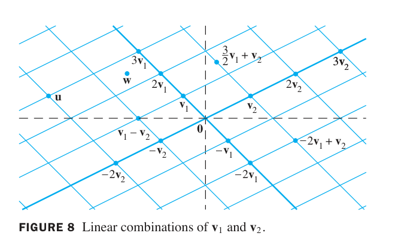

*FIGURE 8 Linear combinations of $\mathbf{v}_1$ and $\mathbf{v}_2$. 图8 $\mathbf{v}_1$ 与 $\mathbf{v}_2$ 的线性组合铺满整个平面网格*

### 向量方程与线性方程组的联系（关键桥梁）

**中文讲解**：一个基本而重要的问题：

$$
\mathbf{b} \text{ 能否写成 } \mathbf{a}_1, \dots, \mathbf{a}_n \text{ 的线性组合？}
$$

即是否存在 $x_1, \dots, x_n$ 使

$$
x_1\mathbf{a}_1 + x_2\mathbf{a}_2 + \cdots + x_n\mathbf{a}_n = \mathbf{b}
$$

这个**向量方程（vector equation）**有解，当且仅当对应的**线性方程组**有解——把每个 $\mathbf{a}_j$ 的分量按列排开，$x_j$ 就是方程组的未知量！

> 英文原文：A vector equation $x_1\mathbf{a}_1 + x_2\mathbf{a}_2 + \cdots + x_n\mathbf{a}_n = \mathbf{b}$ has the same solution set as the linear system whose augmented matrix is $[\mathbf{a}_1\ \mathbf{a}_2\ \cdots\ \mathbf{a}_n\ \mathbf{b}]$. In particular, $\mathbf{b}$ can be generated by a linear combination of $\mathbf{a}_1, \dots, \mathbf{a}_n$ if and only if there exists a solution to the linear system corresponding to the matrix.

**例4（Example 4）**：设 $\mathbf{a}_1 = \begin{bmatrix} 1 \\\\ -2 \\\\ -5 \end{bmatrix}$, $\mathbf{a}_2 = \begin{bmatrix} 2 \\\\ 5 \\\\ 6 \end{bmatrix}$, $\mathbf{b} = \begin{bmatrix} 7 \\\\ 4 \\\\ -3 \end{bmatrix}$。判断 $\mathbf{b}$ 能否写成 $\mathbf{a}_1, \mathbf{a}_2$ 的线性组合，即解：

$$
x_1\begin{bmatrix} 1 \\
-2 \\
-5 \end{bmatrix} + x_2\begin{bmatrix} 2 \\
5 \\
6 \end{bmatrix} = \begin{bmatrix} 7 \\
4 \\
-3 \end{bmatrix}
$$

对应增广矩阵行化简：

$$
\left[\begin{array}{rrr} 1 & 2 & 7 \\
-2 & 5 & 4 \\
-5 & 6 & -3 \end{array}\right] \sim \left[\begin{array}{rrr} 1 & 2 & 7 \\
0 & 9 & 18 \\
0 & 16 & 32 \end{array}\right] \sim \left[\begin{array}{rrr} 1 & 2 & 7 \\
0 & 1 & 2 \\
0 & 0 & 0 \end{array}\right]
$$

得 $x_2 = 2$, $x_1 = 3$。**$\mathbf{b} = 3\mathbf{a}_1 + 2\mathbf{a}_2$**，向量方程有唯一解。

### 张成 Span（生成集）

**中文讲解**：$\mathbf{v}_1, \dots, \mathbf{v}_p$ 的**所有线性组合组成的集合**记作 $\operatorname{Span}\{\mathbf{v}_1, \dots, \mathbf{v}_p\}$，读作"$\mathbf{v}_1$ 到 $\mathbf{v}_p$ 张成的集合"。

> 英文原文：If $\mathbf{v}_1, \dots, \mathbf{v}_p$ are in $\mathbb{R}^n$, then the set of all linear combinations of $\mathbf{v}_1, \dots, \mathbf{v}_p$ is denoted by $\operatorname{Span}\{\mathbf{v}_1, \dots, \mathbf{v}_p\}$ and is called the **subset of $\mathbb{R}^n$ spanned** (or generated) by $\mathbf{v}_1, \dots, \mathbf{v}_p$. That is, $\operatorname{Span}\{\mathbf{v}_1, \dots, \mathbf{v}_p\}$ is the collection of all vectors that can be written in the form $c_1\mathbf{v}_1 + \cdots + c_p\mathbf{v}_p$ with $c_1, \dots, c_p$ scalars.

**几何直觉**：
- $\operatorname{Span}\{\mathbf{v}\}$：一条过原点的直线（$\mathbf{v}$ 的所有倍数）
- $\operatorname{Span}\{\mathbf{u}, \mathbf{v}\}$（$\mathbf{u},\mathbf{v}$ 不平行）：过原点的整张平面
- 问"$\mathbf{b}$ 是否在 $\operatorname{Span}\{\mathbf{v}_1, \dots, \mathbf{v}_p\}$ 中" = 问"$\mathbf{b}$ 能否由它们线性表示" = 问"对应的方程组是否有解"

**例5（Example 5）**：设 $\mathbf{v}_1 = \begin{bmatrix} 1 \\\\ -2 \\\\ 3 \end{bmatrix}$, $\mathbf{v}_2 = \begin{bmatrix} 5 \\\\ -13 \\\\ -3 \end{bmatrix}$, $\mathbf{b} = \begin{bmatrix} -3 \\\\ 8 \\\\ 1 \end{bmatrix}$。判断 $\mathbf{b}$ 是否在 $\operatorname{Span}\{\mathbf{v}_1, \mathbf{v}_2\}$ 中：

$$
\left[\begin{array}{rrr} 1 & 5 & -3 \\
-2 & -13 & 8 \\
3 & -3 & 1 \end{array}\right] \sim \left[\begin{array}{rrr} 1 & 5 & -3 \\
0 & -3 & 2 \\
0 & -18 & 10 \end{array}\right] \sim \left[\begin{array}{rrr} 1 & 5 & -3 \\
0 & -3 & 2 \\
0 & 0 & -2 \end{array}\right]
$$

第三行 $0 = -2$ 矛盾，**无解**——$\mathbf{b}$ 不在 $\operatorname{Span}\{\mathbf{v}_1, \mathbf{v}_2\}$ 中。

**例6（Example 6，几何判断）**：设 $\mathbf{u}, \mathbf{v}$ 是 $\mathbb{R}^3$ 中向量，判断 $\operatorname{Span}\{\mathbf{u}, \mathbf{v}\}$ 是什么样的集合。

若 $\mathbf{v}$ 是 $\mathbf{u}$ 的倍数，则 $\operatorname{Span}\{\mathbf{u},\mathbf{v}\}$ 是过原点的直线；否则是过原点的平面——即 $\mathbf{u}$ 与 $\mathbf{v}$ 确定的平面上的所有向量。

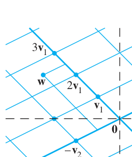

*FIGURE 9 $\mathbf{w}$ 不是 $\mathbf{u}$ 与 $\mathbf{v}$ 的线性组合。 图9 不在张成集中的向量*

### 1.3 小结

| 概念 | 一句话理解 |
|---|---|
| 向量 vector | 有序数列，几何上即点或从原点出发的箭头 |
| 线性组合 linear combination | $c_1\mathbf{v}_1 + \cdots + c_p\mathbf{v}_p$，系数 $c_i$ 叫权 weights |
| 张成 Span | 所有线性组合的集合：一条直线、一个平面…… |
| 向量方程 = 方程组 | $\mathbf{b}$ 能否线性表示 ⇔ 对应方程组是否有解 |

> **本节精髓**：线性代数把两个看似无关的问题统一了——"一个向量能否由另一些向量线性生成"（几何/向量语言）与"一个线性方程组是否有解"（代数语言），本质上是**同一个问题**。

---

## 1.4 矩阵方程 Ax = b The Matrix Equation Ax = b

**中文讲解**：线性代数的一个 fundamental idea（根本思想）：把向量的线性组合看成**矩阵与向量的乘积**。这个定义让我们能用全新方式重述 1.3 节的概念。

### 定义：矩阵乘向量 DEFINITION

若 $A$ 是 $m \times n$ 矩阵，列为 $\mathbf{a}_1, \dots, \mathbf{a}_n$，$\mathbf{x}$ 在 $\mathbb{R}^n$ 中，则 $A$ 与 $\mathbf{x}$ 的**乘积（product）**记作 $A\mathbf{x}$，是 $A$ 的各列以 $\mathbf{x}$ 中对应元素为权的**线性组合**：

$$
A\mathbf{x} = \begin{bmatrix} \mathbf{a}_1 & \mathbf{a}_2 & \cdots & \mathbf{a}_n \end{bmatrix} \begin{bmatrix} x_1 \\
x_2 \\
\vdots \\
x_n \end{bmatrix} = x_1\mathbf{a}_1 + x_2\mathbf{a}_2 + \cdots + x_n\mathbf{a}_n
$$

> 注意：$A\mathbf{x}$ 只有当 $A$ 的**列数**等于 $\mathbf{x}$ 的**分量个数**时才有定义（即 $\mathbf{x} \in \mathbb{R}^n$，$A$ 是 $m\times n$）。

**例1（Example 1）**：

$$
\text{a. } \begin{bmatrix} 1 & 2 & -1 \\
0 & -5 & 3 \end{bmatrix} \begin{bmatrix} 4 \\
3 \\
7 \end{bmatrix} = 4\begin{bmatrix} 1 \\
0 \end{bmatrix} + 3\begin{bmatrix} 2 \\
-5 \end{bmatrix} + 7\begin{bmatrix} -1 \\
3 \end{bmatrix} = \begin{bmatrix} 4 \\
0 \end{bmatrix} + \begin{bmatrix} 6 \\
-15 \end{bmatrix} + \begin{bmatrix} -7 \\
21 \end{bmatrix} = \begin{bmatrix} 3 \\
6 \end{bmatrix}
$$

**例2（Example 2）**：把线性组合 $3\mathbf{v}_1 - 5\mathbf{v}_2 + 7\mathbf{v}_3$ 写成矩阵乘向量：设 $A = [\mathbf{v}_1\ \mathbf{v}_2\ \mathbf{v}_3]$，$\mathbf{x} = (3, -5, 7)$，则 $A\mathbf{x} = 3\mathbf{v}_1 - 5\mathbf{v}_2 + 7\mathbf{v}_3$。

### THEOREM 3（矩阵方程、向量方程、方程组三合一）

**中文讲解**：下面三个问题有**完全相同的解集**——这是全书的"交通枢纽"：
1. 矩阵方程 $A\mathbf{x} = \mathbf{b}$
2. 向量方程 $x_1\mathbf{a}_1 + x_2\mathbf{a}_2 + \cdots + x_n\mathbf{a}_n = \mathbf{b}$
3. 以 $[\mathbf{a}_1\ \mathbf{a}_2\ \cdots\ \mathbf{a}_n\ \mathbf{b}]$ 为增广矩阵的线性方程组

> **Existence of Solutions 解的存在性**：
> 方程 $A\mathbf{x} = \mathbf{b}$ 有解，当且仅当 $\mathbf{b}$ 是 $A$ 各列的线性组合。

**例3（Example 3）**：设 $A = \begin{bmatrix} 1 & 5 & -3 \\\\ -4 & 1 & 3 \\\\ -2 & -7 & 0 \end{bmatrix}$, $\mathbf{b} = \begin{bmatrix} -4 \\\\ 3 \\\\ h \end{bmatrix}$。$h$ 取何值时方程 $A\mathbf{x}=\mathbf{b}$ 有解？

增广矩阵行化简：

$$
\left[\begin{array}{rrrr} 1 & 5 & -3 & -4 \\
-4 & 1 & 3 & 3 \\
-2 & -7 & 0 & h \end{array}\right] \sim \left[\begin{array}{rrrr} 1 & 5 & -3 & -4 \\
0 & 1 & -2 & -1 \\
0 & 3 & -6 & h-8 \end{array}\right] \sim \left[\begin{array}{rrrr} 1 & 5 & -3 & -4 \\
0 & 1 & -2 & -1 \\
0 & 0 & 0 & h-5 \end{array}\right]
$$

当且仅当第4列没有主元时系统相容，即 **$h = 5$**。此时 $\mathbf{b} \in \operatorname{Span}\{\mathbf{v}_1, \mathbf{v}_2, \mathbf{v}_3\}$。

> **Remember 切记**：系统中**有自由变量并不能保证系统相容**！自由变量只说明"如果"有解则有无穷多解。

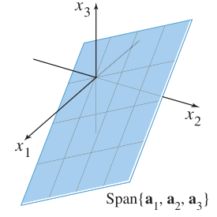

*FIGURE 1 The columns of $A$ span a plane through $\mathbf{0}$. 图1 $A$ 的各列张成一个过原点的平面——只有当 $\mathbf{b}$ 在这个平面上时，$A\mathbf{x}=\mathbf{b}$ 才有解。*

### THEOREM 4（$A\mathbf{x}=\mathbf{b}$ 有解的等价条件）

设 $A$ 是 $m \times n$ 矩阵，则下列命题**逻辑等价**（同真同假）：
1. 对每个 $\mathbf{b} \in \mathbb{R}^m$，$A\mathbf{x} = \mathbf{b}$ 都有解
2. $\mathbb{R}^m$ 中每个 $\mathbf{b}$ 都是 $A$ 各列的线性组合
3. $A$ 的各列**张成** $\mathbb{R}^m$（$\operatorname{Span}\{\mathbf{a}_1,\dots,\mathbf{a}_n\} = \mathbb{R}^m$）
4. $A$ **每一行都有主元位置**

> **直观理解**：要"覆盖"整个 $\mathbb{R}^m$，$A$ 必须有足够多的"方向"——行数 $m$ 不能太多（否则某些 $\mathbf{b}$ 够不着）。特别地，若 $n < m$（列数少于行数），命题一定为假。

### 计算 Ax 的另一种方法：行向量法则 Row-Vector Rule

若 $A$ 的各**行**为 $\mathbf{r}_1, \dots, \mathbf{r}_m$，则：

$$
A\mathbf{x} = \begin{bmatrix} \mathbf{r}_1 \\
\vdots \\
\mathbf{r}_m \end{bmatrix} \mathbf{x} = \begin{bmatrix} \mathbf{r}_1 \cdot \mathbf{x} \\
\vdots \\
\mathbf{r}_m \cdot \mathbf{x} \end{bmatrix} = \begin{bmatrix} a_{11}x_1 + a_{12}x_2 + \cdots + a_{1n}x_n \\
\vdots \\
a_{m1}x_1 + a_{m2}x_2 + \cdots + a_{mn}x_n \end{bmatrix}
$$

即 **$A\mathbf{x}$ 的每个分量 = $A$ 的对应行与 $\mathbf{x}$ 的点积（dot product）**。

**例4（Example 4）**：

$$
\begin{bmatrix} 1 & 2 & -1 \\
0 & -5 & 3 \end{bmatrix} \begin{bmatrix} 4 \\
3 \\
7 \end{bmatrix} = \begin{bmatrix} 1\cdot4 + 2\cdot3 + (-1)\cdot7 \\
0\cdot4 + (-5)\cdot3 + 3\cdot7 \end{bmatrix} = \begin{bmatrix} 3 \\
6 \end{bmatrix}
$$

两种算法（列的线性组合 / 行向量法则）结果一致，互为验证。

### 单位矩阵 Identity Matrix

主对角线（从左上到右下）全为 1、其余全为 0 的 $n\times n$ 矩阵叫**单位矩阵（identity matrix）**，记作 $I_n$。例如：

$$
I_3 = \begin{bmatrix} 1 & 0 & 0 \\
0 & 1 & 0 \\
0 & 0 & 1 \end{bmatrix}
$$

**关键性质**：对任何 $\mathbf{x} \in \mathbb{R}^3$，有 $I_3\mathbf{x} = \mathbf{x}$。单位矩阵是矩阵乘法中的"1"。

### THEOREM 5（矩阵乘法的代数性质）

设 $A$ 是 $m\times n$ 矩阵，$\mathbf{u}, \mathbf{v} \in \mathbb{R}^n$，$c$ 是标量：
1. $A(\mathbf{u}+\mathbf{v}) = A\mathbf{u} + A\mathbf{v}$（分配律）
2. $A(c\mathbf{u}) = c(A\mathbf{u})$（数乘交换）

> **证明思路（小白版）**：把 $\mathbf{u}+\mathbf{v}$ 写成分量形式代入定义即可。例如第1条：$A(\mathbf{u}+\mathbf{v})$ 的第 $i$ 个分量是 $\sum_j a_{ij}(u_j+v_j) = \sum_j a_{ij}u_j + \sum_j a_{ij}v_j$，正是 $A\mathbf{u}+A\mathbf{v}$ 的第 $i$ 个分量。

### 1.4 小结

| 概念 | 一句话理解 |
|---|---|
| $A\mathbf{x}$ | $A$ 各列以 $\mathbf{x}$ 分量为权的线性组合；也等于"行·点积" |
| Theorem 3 | $A\mathbf{x}=\mathbf{b}$ = 向量方程 = 方程组，**三者同解** |
| Theorem 4 | 对所有 $\mathbf{b}$ 有解 ⇔ $A$ 的列张成 $\mathbb{R}^m$ ⇔ 每行有主元 |
| Theorem 5 | 矩阵乘法保持加法和数乘（线性性的雏形） |

> **本节精髓**：$A\mathbf{x}=\mathbf{b}$ 把"方程组求解"（1.1–1.2）、"线性组合/Span"（1.3）统一成一个简洁的矩阵语言。下一节 1.8–1.9 的**线性变换（linear transformation）**将揭示 $A\mathbf{x}$ 的几何本质：它是对空间的**旋转、拉伸、投影**。
## 1.5 线性方程组的解集 Solution Sets of Linear Systems

**中文讲解**：1.2 节我们学会了判断解的"个数"，这一节把解集**完整地、几何地**写出来。核心工具：把通解改写成**参数向量形式（parametric vector form）**。

### 齐次线性方程组 Homogeneous Linear Equations

**中文讲解**：形如 $A\mathbf{x} = \mathbf{0}$ 的方程组叫**齐次方程组**。它一定相容——因为 $\mathbf{x} = \mathbf{0}$ 永远是解（叫**平凡解 trivial solution**）。关键问题是：它有没有**非平凡解（nontrivial solution）**（即某个分量非零的解）？

> **基本事实**：齐次方程 $A\mathbf{x} = \mathbf{0}$ 有非平凡解，**当且仅当**方程至少有一个自由变量。（由 1.2 节定理 2 直接推出）

**例1（Example 1）**：判断下列齐次系统是否有非平凡解，并描述其解集：

$$
3x_1 + 5x_2 - 4x_3 = 0
$$

$$
-3x_1 - 2x_2 + 4x_3 = 0
$$

$$
6x_1 + \ x_2 - 8x_3 = 0
$$

增广矩阵（右端全 0，可省略）行化简到阶梯形再化到简化阶梯形：

$$
\begin{bmatrix} 3 & 5 & -4 & 0 \\
-3 & -2 & 4 & 0 \\
6 & 1 & -8 & 0 \end{bmatrix} \sim \begin{bmatrix} 3 & 5 & -4 & 0 \\
0 & 3 & 0 & 0 \\
0 & 0 & 0 & 0 \end{bmatrix} \sim \begin{bmatrix} 1 & 0 & -\frac{4}{3} & 0 \\
0 & 1 & 0 & 0 \\
0 & 0 & 0 & 0 \end{bmatrix}
$$

$x_3$ 自由，$x_1 = \frac{4}{3}x_3$, $x_2 = 0$。通解写成向量形式并把 $x_3$ 提出来：

$$
\mathbf{x} = \begin{bmatrix} x_1 \\
x_2 \\
x_3 \end{bmatrix} = \begin{bmatrix} \frac{4}{3}x_3 \\
0 \\
x_3 \end{bmatrix} = x_3 \begin{bmatrix} \frac{4}{3} \\
0 \\
1 \end{bmatrix} = x_3\mathbf{v}, \quad \mathbf{v} = \begin{bmatrix} 4/3 \\
0 \\
1 \end{bmatrix}
$$

**每个解都是 $\mathbf{v}$ 的倍数，解集 = $\operatorname{Span}\{\mathbf{v}\}$**——几何上是 $\mathbb{R}^3$ 中过原点的一条直线（除 $\mathbf{x}=\mathbf{0}$ 外的点全是非平凡解）：

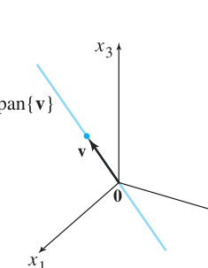

*FIGURE 1 The solution set of $A\mathbf{x}=\mathbf{0}$ is a line through $\mathbf{0}$. 图1 $A\mathbf{x}=\mathbf{0}$ 的解集是过原点的直线*

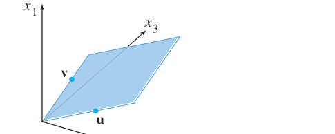

*FIGURE 2 The solution set of $A\mathbf{x}=\mathbf{0}$ is a plane through $\mathbf{0}$（两个自由变量时）. 图2 若有两个自由变量，解集是过原点的平面（$\operatorname{Span}\{\mathbf{u},\mathbf{v}\}$）*

> **注意**：非平凡解 $\mathbf{x}$ 允许某些分量是 0，只要**不全为 0** 即可。

### 参数向量形式 Parametric Vector Form

**中文讲解**：上例中"把自由变量作为公因子提出来"的技巧可以推广。若齐次系统通解为

$$
\mathbf{x} = s\mathbf{u} + t\mathbf{v}
$$

（$s,t$ 自由），解集就是 $\operatorname{Span}\{\mathbf{u}, \mathbf{v}\}$——过原点的平面。这种把解写成自由变量的向量和的形式，叫解集的**参数向量形式**。

### 非齐次方程组的解集：平移！THEOREM 6

**中文讲解**：对非齐次方程 $A\mathbf{x} = \mathbf{b}$（$\mathbf{b} \neq \mathbf{0}$），解集不再是过原点的子空间，而是**把 $A\mathbf{x}=\mathbf{0}$ 的解集沿向量 $\mathbf{p}$ 平移**，其中 $\mathbf{p}$ 是 $A\mathbf{x}=\mathbf{b}$ 的任一特解。

> **THEOREM 6**：设 $A\mathbf{x}=\mathbf{b}$ 相容，$\mathbf{p}$ 是一个特解。则 $A\mathbf{x}=\mathbf{b}$ 的解集 = 满足 $\mathbf{w} = \mathbf{p} + \mathbf{v}_h$ 的所有向量 $\mathbf{w}$ 的集合，其中 $\mathbf{v}_h$ 是 $A\mathbf{x}=\mathbf{0}$ 的任意解。
> 换句话说：**非齐次通解 = 特解 + 齐次通解**（$\mathbf{x} = \mathbf{p} + \mathbf{v}_h$）

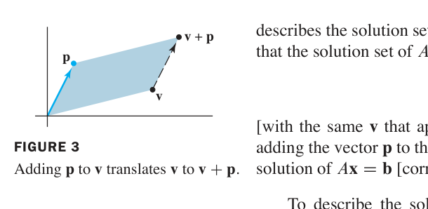

*FIGURE 3 Adding $\mathbf{p}$ to $\mathbf{v}$ translates $\mathbf{v}$ to $\mathbf{v}+\mathbf{p}$. 图3 把每个向量都加上 $\mathbf{p}$，等于把整条线平移*

**例2（Example 2）**：描述 $A\mathbf{x}=\mathbf{b}$ 的解集，其中 $A$ 为例1 的系数矩阵，$\mathbf{b} = \begin{bmatrix} 7 \\\\ -4 \\\\ -4 \end{bmatrix}$。

增广矩阵行化简：

$$
\left[\begin{array}{rrrr} 3 & 5 & -4 & 7 \\
-3 & -2 & 4 & -4 \\
6 & 1 & -8 & -4 \end{array}\right] \sim \left[\begin{array}{rrrr} 1 & 0 & -\frac{4}{3} & -1 \\
0 & 1 & 0 & 2 \\
0 & 0 & 0 & 0 \end{array}\right]
$$

$x_3$ 自由，通解：

$$
\mathbf{x} = \begin{bmatrix} -1 + \frac{4}{3}x_3 \\
2 \\
x_3 \end{bmatrix} = \begin{bmatrix} -1 \\
2 \\
0 \end{bmatrix} + x_3 \begin{bmatrix} 4/3 \\
0 \\
1 \end{bmatrix} = \mathbf{p} + x_3\mathbf{v}
$$

即 **$\mathbf{x} = \mathbf{p} + t\mathbf{v}$（$t \in \mathbb{R}$）**——解集是过 $\mathbf{p}$、平行于 $\mathbf{v}$ 的直线（不过原点！）：

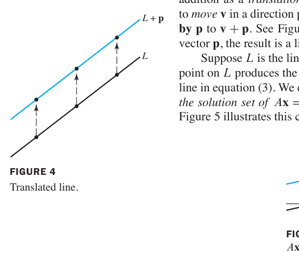

*FIGURE 4 The translated line. 图4 非齐次解集 = 齐次解集平移后的直线*

**例3（Example 3）**：单个方程 $10x_1 - 3x_2 - 2x_3 = 0$ 的解集。把 $x_1$ 用自由变量表示：$x_1 = .3x_2 + .2x_3$，

$$
\mathbf{x} = \begin{bmatrix} .3x_2 + .2x_3 \\
x_2 \\
x_3 \end{bmatrix} = x_2\begin{bmatrix} .3 \\
1 \\
0 \end{bmatrix} + x_3\begin{bmatrix} .2 \\
0 \\
1 \end{bmatrix} = x_2\mathbf{u} + x_3\mathbf{v}
$$

解集是 $\operatorname{Span}\{\mathbf{u}, \mathbf{v}\}$（过原点的平面）。对非齐次版本 $10x_1 - 3x_2 - 2x_3 = b$（$b\neq 0$），解集是**平行平面** $\mathbf{p} + \operatorname{Span}\{\mathbf{u}, \mathbf{v}\}$。

**几何关系总结**：

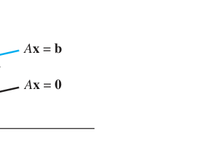

*FIGURE 5 Parallel solution sets of $A\mathbf{x}=\mathbf{b}$ and $A\mathbf{x}=\mathbf{0}$. 图5 $A\mathbf{x}=\mathbf{b}$ 与 $A\mathbf{x}=\mathbf{0}$ 的解集互相平行*

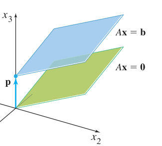

*FIGURE 6 Parallel solution sets of $A\mathbf{x}=\mathbf{b}$ and $A\mathbf{x}=\mathbf{0}$（两个自由变量时）. 图6 两自由变量时，解集是平行平面*

> **写作解集的步骤（WRITING A SOLUTION SET IN PARAMETRIC VECTOR FORM）**：
> 1. 把增广矩阵行化简到简化阶梯形
> 2. 把每个基本变量用自由变量表示
> 3. 把通解 $\mathbf{x}$ 写成自由变量是公因子的向量组合（参数向量形式）

### 1.5 小结

| 概念 | 一句话理解 |
|---|---|
| 齐次方程 $A\mathbf{x}=\mathbf{0}$ | 必有平凡解；有自由变量 ⇔ 有非平凡解 |
| 齐次解集 | 过原点的直线（1 个自由变量）/平面（2 个自由变量）= Span |
| THEOREM 6 | 非齐次通解 = 特解 $\mathbf{p}$ + 齐次通解 $\mathbf{v}_h$，几何上是**平移** |
| 参数向量形式 | 把自由变量提为系数，如 $\mathbf{x} = \mathbf{p} + s\mathbf{u} + t\mathbf{v}$ |

> **本节精髓**：齐次与非齐次的解集关系，就是"过原点"与"平移"的关系——这条几何直觉在 4.2 节会发展为严格的**向量空间（子空间）**理论。

---

## 第一章完 Chapter 1 Complete

至此第 1 章核心脉络完整：**解方程组（1.1–1.2）→ 线性组合与 Span（1.3）→ 矩阵方程 $A\mathbf{x}=\mathbf{b}$（1.4）→ 解集的结构：特解 + 齐次通解（1.5）**。接下来第 2 章将进入**矩阵代数**（逆矩阵、矩阵分解），第 1 章的一切都是它的地基。
---

## 2.2 逆矩阵 The Inverse of a Matrix

**中文讲解**：数的"倒数"概念推广到矩阵。回忆：5 的乘法逆元是 $5^{-1} = \frac{1}{5}$，满足 $5^{-1} \cdot 5 = 1$ 且 $5 \cdot 5^{-1} = 1$。矩阵推广需要**两个**方程都成立（因为矩阵乘法**不交换**），而且只有**方阵**才谈逆矩阵。

### 定义：可逆矩阵 DEFINITION

$n \times n$ 矩阵 $A$ 称为**可逆的（invertible）**，若存在 $n \times n$ 矩阵 $C$ 使

$$CA = I \quad \text{且} \quad AC = I$$

其中 $I = I_n$ 是 $n \times n$ 单位矩阵。这个 $C$ 由 $A$ **唯一决定**（证明：若 $B$ 也是逆，则 $B = BI = B(AC) = (BA)C = IC = C$），称为 $A$ 的逆，记作 $A^{-1}$：

$$A^{-1}A = I \quad \text{且} \quad AA^{-1} = I$$

- **奇异矩阵（singular）** = 不可逆矩阵；**非奇异矩阵（nonsingular）** = 可逆矩阵

**例1（Example 1）**：验证 $C = A^{-1}$

$$A = \begin{bmatrix} 2 & 5 \\
-3 & -7 \end{bmatrix}, \qquad C = \begin{bmatrix} -7 & -5 \\
3 & 2 \end{bmatrix}$$

$$AC = \begin{bmatrix} 1 & 0 \\
0 & 1 \end{bmatrix} = I \quad \text{且} \quad CA = \begin{bmatrix} 1 & 0 \\
0 & 1 \end{bmatrix} = I$$

两个方向都成立，所以 $C = A^{-1}$。

### THEOREM 4（2×2 矩阵的逆公式 + 判别法）

设

$$A = \begin{bmatrix} a & b \\
c & d \end{bmatrix}$$

若 $ad - bc \neq 0$，则 $A$ 可逆，且

$$A^{-1} = \frac{1}{ad-bc}\begin{bmatrix} d & -b \\
-c & a \end{bmatrix}$$

若 $ad - bc = 0$，则 $A$ 不可逆。

**行列式登场**：量 $ad - bc$ 称为 $A$ 的**行列式（determinant）**，记作 $\det A = ad - bc$。定理 4 说：**2×2 矩阵 $A$ 可逆 ⟺ $\det A \neq 0$**。

**例2（Example 2）**：求 $A = \begin{bmatrix} 3 & 4 \\
5 & 6 \end{bmatrix}$ 的逆。

$$\det A = 3(6) - 4(5) = -2 \neq 0 \Rightarrow A \text{ 可逆}$$

$$A^{-1} = \frac{1}{-2}\begin{bmatrix} 6 & -4 \\
-5 & 3 \end{bmatrix} = \begin{bmatrix} -3 & 2 \\
5/2 & -3/2 \end{bmatrix}$$

### THEOREM 5（可逆矩阵 ⇒ 方程组唯一解）

**中文讲解**：可逆矩阵在解方程时的作用，相当于"数的倒数解一元一次方程"。

> 若 $A$ 是可逆 $n \times n$ 矩阵，则对每个 $\mathbf{b} \in \mathbb{R}^n$，方程 $A\mathbf{x} = \mathbf{b}$ 有**唯一解** $\mathbf{x} = A^{-1}\mathbf{b}$。

**证明（小白版）**：存在性：代入 $\mathbf{x} = A^{-1}\mathbf{b}$，得 $A(A^{-1}\mathbf{b}) = (AA^{-1})\mathbf{b} = I\mathbf{b} = \mathbf{b}$ ✓。唯一性：若 $A\mathbf{u} = \mathbf{b}$，两边左乘 $A^{-1}$：$A^{-1}A\mathbf{u} = A^{-1}\mathbf{b} \Rightarrow I\mathbf{u} = A^{-1}\mathbf{b} \Rightarrow \mathbf{u} = A^{-1}\mathbf{b}$，即任何解都必等于 $A^{-1}\mathbf{b}$。

**例3（Example 3，工程应用）**：水平弹性梁两端支撑，在 1、2、3 点受力（FIGURE 1）。设 $\mathbf{f} \in \mathbb{R}^3$ 记录三点的力，$\mathbf{y} \in \mathbb{R}^3$ 记录三点的**挠度（deflection）**（梁的弯曲位移）。由物理学的胡克定律：

$$\mathbf{y} = D\mathbf{f}$$

$D$ 叫**柔度矩阵（flexibility matrix）**，其逆 $D^{-1}$ 叫**刚度矩阵（stiffness matrix）**。问：$D$ 和 $D^{-1}$ 的各列各有什么物理意义？

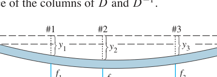

*FIGURE 1 Deflection of an elastic beam. 图1 弹性梁在三点受力产生挠度*

**解答**：把 $I_3$ 按列拆开：$D = DI_3 = \begin{bmatrix} D\mathbf{e}_1 & D\mathbf{e}_2 & D\mathbf{e}_3 \end{bmatrix}$。

- $D$ 的第 1 列 $D\mathbf{e}_1$：在点 1 施加**单位力**（1 磅，向下）时，三个点的挠度各是多少。第 2、3 列同理。
- 再看 $D^{-1} = D^{-1}I_3 = \begin{bmatrix} D^{-1}\mathbf{e}_1 & D^{-1}\mathbf{e}_2 & D^{-1}\mathbf{e}_3 \end{bmatrix}$：$D^{-1}\mathbf{e}_1$ 是使点 1 产生**单位挠度**、其余两点挠度为零所需的三个力。
- 若柔度单位是"英寸/磅"，则刚度矩阵的单位是"磅/英寸"。

> ⚠️ **注意**：定理 5 的公式 $\mathbf{x} = A^{-1}\mathbf{b}$ 在**数值计算中很少用**——对 $[A\ \ \mathbf{b}]$ 做行化简几乎总是更快、更准（避免舍入误差累积）。唯一例外是 2×2 情形，用心算公式有时更快（例4）。

**例4（Example 4）**：用例2 的逆矩阵解方程组

$$
\begin{aligned}
3x_1 + 4x_2 &= 3 \\
5x_1 + 6x_2 &= 7
\end{aligned}
$$

即 $A\mathbf{x} = \mathbf{b}$，$\mathbf{b} = \begin{bmatrix} 3 \\
7 \end{bmatrix}$，所以

$$\mathbf{x} = A^{-1}\mathbf{b} = \begin{bmatrix} -3 & 2 \\
5/2 & -3/2 \end{bmatrix}\begin{bmatrix} 3 \\
7 \end{bmatrix} = \begin{bmatrix} 5 \\
-3 \end{bmatrix}$$

**验证**：$3(5) + 4(-3) = 3$ ✓；$5(5) + 6(-3) = 7$ ✓

### THEOREM 6（逆矩阵的三条运算律）

a. 若 $A$ 可逆，则 $A^{-1}$ 也可逆，且 $(A^{-1})^{-1} = A$

b. 若 $A, B$ 都是 $n \times n$ 可逆矩阵，则 $AB$ 也可逆，且**逆的顺序反过来**：

$$(AB)^{-1} = B^{-1}A^{-1}$$

c. 若 $A$ 可逆，则 $A^T$ 也可逆，且 $(A^T)^{-1} = (A^{-1})^T$

> **直觉记忆 (b)**：穿衣与脱衣——先穿袜子再穿鞋，脱的时候必须先鞋后袜（顺序反转）。这条"**穿脱衣法则**"在全书反复出现。

推广：任意 $n \times n$ 可逆矩阵的乘积仍可逆，逆 = 各逆矩阵按**相反顺序**的乘积。

### 初等矩阵 Elementary Matrices

**定义**：对**单位矩阵**做一次初等行变换得到的矩阵，叫**初等矩阵（elementary matrix）**。三种行变换对应三种初等矩阵。

**例5（Example 5）**：

$$E_1 = \begin{bmatrix} 1 & 0 & 0 \\
0 & 1 & 0 \\
-4 & 0 & 1 \end{bmatrix}, \qquad E_2 = \begin{bmatrix} 0 & 1 & 0 \\
1 & 0 & 0 \\
0 & 0 & 1 \end{bmatrix}, \qquad E_3 = \begin{bmatrix} 1 & 0 & 0 \\
0 & 1 & 0 \\
0 & 0 & 5 \end{bmatrix}$$

$$A = \begin{bmatrix} a & b & c \\
d & e & f \\
g & h & i \end{bmatrix}$$

计算 $E_1A$、$E_2A$、$E_3A$：

$$E_1A = \begin{bmatrix} a & b & c \\
d & e & f \\
g-4a & h-4b & i-4c \end{bmatrix}, \qquad E_2A = \begin{bmatrix} d & e & f \\
a & b & c \\
g & h & i \end{bmatrix}, \qquad E_3A = \begin{bmatrix} a & b & c \\
d & e & f \\
5g & 5h & 5i \end{bmatrix}$$

**发现（重要！）**：左乘 $E_1$ = "第3行加 −4 倍第1行"；左乘 $E_2$ = "交换1、2行"；左乘 $E_3$ = "第3行乘 5"。**左乘初等矩阵的效果 = 对 A 做同样的行变换！**

### THEOREM 7（初等矩阵与行变换的桥梁）

> 若对 $m \times n$ 矩阵 $A$ 施行一次初等行变换，所得矩阵等于 $EA$，其中 $E$ 是对 $I_m$ 施行**同一行变换**得到的初等矩阵。

**推论**：每个初等矩阵 $E$ 都可逆，且 $E^{-1}$ 就是把 $E$ 变回 $I$ 的那个行变换对应的初等矩阵（行变换可逆 ⇒ 初等矩阵可逆）。

**例6（Example 6）**：

$$E_1 = \begin{bmatrix} 1 & 0 & 0 \\
0 & 1 & 0 \\
-4 & 0 & 1 \end{bmatrix} \quad \Rightarrow \quad E_1^{-1} = \begin{bmatrix} 1 & 0 & 0 \\
0 & 1 & 0 \\
4 & 0 & 1 \end{bmatrix}$$

（验证：$E_1^{-1}E_1 = I$ ✓）

### THEOREM 8（可逆 ⟺ 行等价于单位矩阵）

> $n \times n$ 矩阵 $A$ 可逆，**当且仅当** $A$ 行等价于 $I_n$。此时，任何把 $A$ 化简到 $I_n$ 的初等行变换序列，同时把 $I_n$ 变成 $A^{-1}$。

**这就是求逆矩阵的算法来源**：把 $A$ 和 $I$ 并排，对 $[A\ \ I]$ 行化简——左边变成 $I$ 的同时，右边自动变成 $A^{-1}$。

### 求 $A^{-1}$ 的算法 ALGORITHM

> 对增广矩阵 $[A\ \ I]$ 做行化简。若 $A$ 行等价于 $I$，则 $[A\ \ I]$ 行等价于 $[I\ \ A^{-1}]$；否则 $A$ 不可逆。

**例7（Example 7）**：求 $A = \begin{bmatrix} 0 & 1 & 2 \\
1 & 0 & 3 \\
4 & -3 & 8 \end{bmatrix}$ 的逆（若存在）。

$$
\left[\begin{array}{ccc|ccc} 0 & 1 & 2 & 1 & 0 & 0 \\
1 & 0 & 3 & 0 & 1 & 0 \\
4 & -3 & 8 & 0 & 0 & 1 \end{array}\right] \sim \left[\begin{array}{ccc|ccc} 1 & 0 & 3 & 0 & 1 & 0 \\
0 & 1 & 2 & 1 & 0 & 0 \\
4 & -3 & 8 & 0 & 0 & 1 \end{array}\right] \sim \left[\begin{array}{ccc|ccc} 1 & 0 & 3 & 0 & 1 & 0 \\
0 & 1 & 2 & 1 & 0 & 0 \\
0 & -3 & -4 & 0 & -4 & 1 \end{array}\right]
$$

（交换1、2行；第3行 += −4×第1行）

$$
\sim \left[\begin{array}{ccc|ccc} 1 & 0 & 3 & 0 & 1 & 0 \\
0 & 1 & 2 & 1 & 0 & 0 \\
0 & 0 & 2 & 3 & -4 & 1 \end{array}\right] \sim \left[\begin{array}{ccc|ccc} 1 & 0 & 3 & 0 & 1 & 0 \\
0 & 1 & 2 & 1 & 0 & 0 \\
0 & 0 & 1 & 3/2 & -2 & 1/2 \end{array}\right]
$$

（第3行 += 3×第2行；第3行 × 1/2）

$$
\sim \left[\begin{array}{ccc|ccc} 1 & 0 & 0 & -9/2 & 7 & -3/2 \\
0 & 1 & 0 & -2 & 4 & -1 \\
0 & 0 & 1 & 3/2 & -2 & 1/2 \end{array}\right] = \left[\begin{array}{ccc|ccc} I & A^{-1} \end{array}\right]
$$

（第1行 += −3×第3行；第2行 += −2×第3行）

$$A^{-1} = \begin{bmatrix} -9/2 & 7 & -3/2 \\
-2 & 4 & -1 \\
3/2 & -2 & 1/2 \end{bmatrix}$$

**验算**（好习惯）：

$$AA^{-1} = \begin{bmatrix} 0 & 1 & 2 \\
1 & 0 & 3 \\
4 & -3 & 8 \end{bmatrix}\begin{bmatrix} -9/2 & 7 & -3/2 \\
-2 & 4 & -1 \\
3/2 & -2 & 1/2 \end{bmatrix} = \begin{bmatrix} 1 & 0 & 0 \\
0 & 1 & 0 \\
0 & 0 & 1 \end{bmatrix} = I \checkmark$$

### 求逆的另一种视角 Another View of Matrix Inversion

把 $I_n$ 的列记为 $\mathbf{e}_1, \dots, \mathbf{e}_n$。则 $[A\ \ I] \sim [I\ \ A^{-1}]$ 可看作**同时解 $n$ 个方程组**：

$$A\mathbf{x} = \mathbf{e}_1, \qquad A\mathbf{x} = \mathbf{e}_2, \qquad \cdots, \qquad A\mathbf{x} = \mathbf{e}_n$$

这 $n$ 个方程组的解正好就是 $A^{-1}$ 的各列——因为 $AA^{-1} = I$ 按列看就是 $A \times (A^{-1}\text{ 的第 } j \text{ 列}) = \mathbf{e}_j$。

### 2.2 小结

| 概念 | 一句话理解 |
|---|---|
| $A^{-1}$ | 满足 $A^{-1}A = AA^{-1} = I$ 的唯一矩阵（方阵才有） |
| $\det A = ad-bc$ | 2×2 可逆 ⟺ 行列式非零 |
| Theorem 5 | $A$ 可逆 ⟹ $A\mathbf{x}=\mathbf{b}$ 唯一解 $\mathbf{x}=A^{-1}\mathbf{b}$ |
| Theorem 6(b) | $(AB)^{-1} = B^{-1}A^{-1}$（**穿脱衣法则**：顺序反转） |
| 初等矩阵 | 对 $I$ 做一次行变换；左乘它 = 对 $A$ 做同样变换 |
| Theorem 8 + 算法 | $A$ 可逆 ⟺ $A \sim I$；$[A\ \ I] \sim [I\ \ A^{-1}]$ 求逆 |

> **本节精髓**：逆矩阵是"倒数"思想的矩阵化。行变换与初等矩阵的对应（Theorem 7）把"解方程"与"矩阵乘法"焊接在一起，直接催生出行化简求逆算法——这是线性代数"**计算**"与"**代数结构**"两条主线的重要交汇点。2.3 节的**可逆矩阵定理（IMT）**将给出 20+ 个等价条件，把全章知识一网打尽。

---
---

## 2.3 可逆矩阵的特征 Characterizations of Invertible Matrices

**中文讲解**：本节把前 4 章的关键概念串成一条"项链"——**可逆矩阵定理（Invertible Matrix Theorem, IMT）**。它把 12 个看似无关的命题连成等价关系：验证其中**任何一个**，其余全部自动成立。这是全书被引用最多的定理。

### THE INVERTIBLE MATRIX THEOREM（可逆矩阵定理）

> 设 $A$ 是 $n \times n$ 矩阵，则下列命题**逻辑等价**（同真同假）：
>
> a. $A$ 是**可逆矩阵**
>
> b. $A$ **行等价于** $n \times n$ 单位矩阵 $I_n$
>
> c. $A$ 有 $n$ 个**主元位置**
>
> d. 方程 $A\mathbf{x} = \mathbf{0}$ 仅有**平凡解**
>
> e. $A$ 的各列**线性无关**
>
> f. 线性变换 $\mathbf{x} \mapsto A\mathbf{x}$ 是**一对一（one-to-one）**的
>
> g. 方程 $A\mathbf{x} = \mathbf{b}$ 对每个 $\mathbf{b} \in \mathbb{R}^n$ **至少有一个解**
>
> h. $A$ 的各列**张成** $\mathbb{R}^n$
>
> i. 线性变换 $\mathbf{x} \mapsto A\mathbf{x}$ 是**映上（onto）**的
>
> j. 存在 $n \times n$ 矩阵 $C$ 使 $CA = I$
>
> k. 存在 $n \times n$ 矩阵 $D$ 使 $AD = I$
>
> l. $A^T$ 是**可逆矩阵**

**证明思路（教材 Figure 1）**：关键链条是 (c) ⇒ (d) ⇒ (j) ⇒ (a) ⇒ (b) ⇒ (c)——绕一圈把所有命题串起来，再加上各种"直路"连接。其中 (a) ⇒ (l) 因为由 2.1 定理 6(c) 知 $(A^T)^{-1} = (A^{-1})^T$。

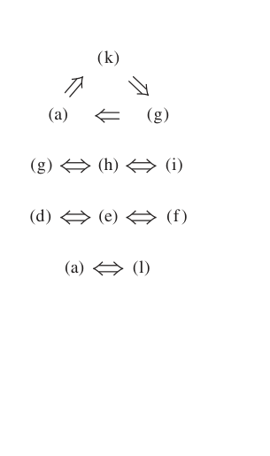

*FIGURE 1 The connections between the statements of the Invertible Matrix Theorem. 图1 IMT 各命题间的等价关系：左边圆圈是证明主干 (c)⇒(d)⇒(j)⇒(a)⇒(b)⇒(c)*

> **小白使用指南**：IMT 的威力在于"一证全证"。做题时只需验证**最容易验证**的一条（通常是对 $A$ 行化简看主元数），就能调用其余 11 条的全部结论。注意 **IMT 只对 $n \times n$ 方阵成立**！

**警告**：2.4 节定理 9 会把 (g)、(h)、(i) 推广到**任何矩阵**（不必是方阵）——那是"存在性定理"，但 (d)、(e)、(f) 的对应推广**不成立**。

### 例8（Example 8，IMT 实战）

**题目**：用 IMT 判断 $A$ 是否可逆：

$$A = \begin{bmatrix} 1 & 0 & -2 \\
3 & 1 & -2 \\
-5 & -1 & 9 \end{bmatrix}$$

**解**：对 $A$ 行化简（验证命题 (b)：$A$ 是否行等价于 $I$）：

$$A \sim \begin{bmatrix} 1 & 0 & -2 \\
0 & 1 & 4 \\
0 & 0 & 3 \end{bmatrix}$$

A 有 **3 个主元**（命题 (c) 成立）⇒ **A 可逆**，且 IMT 其余命题全部成立：方程 $A\mathbf{x}=\mathbf{b}$ 对每个 $\mathbf{b}$ 有唯一解、$A\mathbf{x}=\mathbf{0}$ 只有平凡解、列线性无关且张成 $\mathbb{R}^3$、变换既一对一又映上……

> **效率秘诀**：例8 只把 $A$ 化到**阶梯形**（不必到简化阶梯形）就能数主元、下结论——这是 IMT 实战的标准操作。

### 推论（THEOREM 9 预告）

若 $A, B$ 是方阵且 $AB = I$，则 $A, B$ 都可逆，且 $B = A^{-1}$、$A = B^{-1}$。

> **直觉**：IMT 的 (j)、(k) 说：对方阵而言，**单侧**逆就是双侧逆！这和"$AB=I \nRightarrow BA=I$"（2.1 节的警示）**不矛盾**——2.1 节说的反例都是**非方阵**。对方阵，单边成立 ⇒ 双边自动成立。

### 深入：IMT 的"扩展表"（定理 2-10 的完整版）

把后面章节的结果并入，IMT 实际可用的等价条件超过 **20 条**。核心几组对照（小白先混个眼熟，后面章节会逐一展开）：

| 视角 | 可逆（全部成立） | 不可逆（全部不成立） |
|---|---|---|
| 行化简 | $A \sim I_n$（b） | 主元数 < $n$ |
| 方程组 | $A\mathbf{x}=\mathbf{0}$ 只有平凡解（d） | 存在非平凡解 |
| 列向量 | 列线性无关（e）且张成 $\mathbb{R}^n$（h） | 列相关或张不满 |
| 线性变换 | 既一对一（f）又映上（i） | 至少破坏其一 |
| 行列式 | $\det A \neq 0$（第3章） | $\det A = 0$ |
| 特征值 | $0$ **不是**特征值（第5章） | $0$ 是特征值 |

### 例（补充练习，选自 2.3 Exercises 风格）

**判断题**："若 $A, B$ 是 $n \times n$ 矩阵且 $AB$ 可逆，则 $A$ 可逆。"——**True**。

**证明**：$AB$ 可逆 ⇒ 存在 $C$ 使 $C(AB) = I$ ⇒ $(CA)B = I$。由定理 9 推论，$B$ 可逆且 $B^{-1} = CA$；再由 2.1 定理 6，$A = C^{-1}B^{-1}$…… 更简洁：$AB$ 可逆 ⇒ $AB$ 有 $n$ 个主元（IMT (c)）⇒ $A$ 必有 $n$ 个主元（$A$ 的列数 = $n$，行化简 $A$ 时不可能比 $AB$ 的秩更多……用 $(AB)x=0$ 只有平凡解 ⇒ $Bx=0$ 时 $A(Bx)=0$ ⇒ $Bx=0$…… 故 $B$ 列无关 ⇒ $B$ 可逆 ⇒ $A = (AB)B^{-1}$ 可逆 ✓）。

### 2.3 小结

| 概念 | 一句话理解 |
|---|---|
| **IMT** | 12 条等价命题"一荣俱荣、一损俱损"，验证最易的一条即可调用全部 |
| 验证首选 | 行化简到阶梯形，数主元是否 = $n$（命题 (c)） |
| 方阵特权 | 单侧逆 $CA=I$ ⇒ 双侧逆，$C = A^{-1}$ |
| 使用前提 | **必须是 $n \times n$ 方阵**！非方阵请用 1.4 定理 4 与 2.4 定理 9 |

> **本节精髓**：IMT 是线性代数的"**总开关**"——它把"解方程"（d, g）、"向量关系"（e, h）、"变换性质"（f, i）、"矩阵运算"（a, j, k, l）、"行化简"（b, c）五大主题统一在"可逆"这一个概念之下。后续学习每章新概念（行列式、秩、特征值、对角化），请养成习惯问自己："这给 IMT 的清单添了哪一条等价条件？"

---
---

## 2.4 分块矩阵 Partitioned Matrices

**中文讲解**：把矩阵看作**列向量列表**的观点（1.4 节的核心）大获成功，自然推广：用水平、竖直虚线把矩阵切成**子矩阵（submatrix / block）**，按"块"参与运算。这就是**模块化思想**——像乐高积木一样拼拆矩阵。现代应用（飞机设计、电路板、大规模线性规划）中分块记号无处不在。

### 例1（Example 1）：分块记号

$$
A = \begin{bmatrix} 3 & 0 & -1 & 5 & 9 & -2 \\
-5 & 2 & 4 & 0 & -3 & 1 \\
-8 & -6 & 3 & 1 & 7 & -4 \end{bmatrix} = \begin{bmatrix} A_{11} & A_{12} & A_{13} \\
A_{21} & A_{22} & A_{23} \end{bmatrix}
$$

按 $2 \times 3$ 分块，各子矩阵为：

$$A_{11} = \begin{bmatrix} 3 & 0 & -1 \\
-5 & 2 & 4 \end{bmatrix}, \qquad A_{12} = \begin{bmatrix} 5 & 9 \\
0 & -3 \end{bmatrix}, \qquad A_{13} = \begin{bmatrix} -2 \\
1 \end{bmatrix}$$

$$A_{21} = \begin{bmatrix} -8 & -6 & 3 \end{bmatrix}, \qquad A_{22} = \begin{bmatrix} 1 & 7 \end{bmatrix}, \qquad A_{23} = \begin{bmatrix} -4 \end{bmatrix}$$

**例2（Example 2，应用背景）**：若微机电路板由三块 VLSI 芯片组成，电路板矩阵自然分块为

$$
A = \begin{bmatrix} A_{11} & A_{12} & A_{13} \\
A_{21} & A_{22} & A_{23} \\
A_{31} & A_{32} & A_{33} \end{bmatrix}
$$

每块对应一颗芯片的信息——**分块让矩阵的"物理结构"一目了然**。

### 分块矩阵的加法与数乘

**规则（与数的运算完全类似）**：两个**分块方式相同**的矩阵相加，对应块相加；数乘则每个块分别乘。

### 分块矩阵的乘法 THE KEY RULE

**中文讲解**：分块矩阵可以像普通矩阵一样用**行-列法则**相乘——**把每个块当作"数"**！但有前提：

> **相容条件（conformable）**：对乘积 $AB$，$A$ 的**列分法**必须与 $B$ 的**行分法**一致。

**例3（Example 3，完整演示）**：

$$
A = \begin{bmatrix} 2 & -3 & 1 & 0 & -4 \\
1 & 5 & -2 & 3 & -1 \\
0 & -4 & 2 & 7 & -1 \end{bmatrix} = \begin{bmatrix} A_{11} & A_{12} \\
A_{21} & A_{22} \end{bmatrix}, \qquad B = \begin{bmatrix} 6 & 4 \\
-2 & 1 \\
-3 & 7 \\
-1 & 3 \\
5 & 2 \end{bmatrix} = \begin{bmatrix} B_1 \\
B_2 \end{bmatrix}
$$

$A$ 的 5 列分成 $3+2$，$B$ 的 5 行也分成 $3+2$——**分法匹配**，可以分块相乘：

$$AB = \begin{bmatrix} A_{11}B_1 + A_{12}B_2 \\
A_{21}B_1 + A_{22}B_2 \end{bmatrix} = \begin{bmatrix} -5 & 4 \\
-6 & 2 \\
2 & 1 \end{bmatrix}$$

逐个验证（注意**子矩阵必须 A 在左、B 在右**，乘法不交换！）：

$$A_{11}B_1 = \begin{bmatrix} 2 & -3 & 1 \\
1 & 5 & -2 \end{bmatrix}\begin{bmatrix} 6 & 4 \\
-2 & 1 \\
-3 & 7 \end{bmatrix} = \begin{bmatrix} 15 & 12 \\
2 & -5 \end{bmatrix}$$

$$A_{12}B_2 = \begin{bmatrix} 0 & -4 \\
3 & -1 \end{bmatrix}\begin{bmatrix} -1 & 3 \\
5 & 2 \end{bmatrix} = \begin{bmatrix} -20 & -8 \\
-8 & 7 \end{bmatrix}$$

$$A_{11}B_1 + A_{12}B_2 = \begin{bmatrix} 15 & 12 \\
2 & -5 \end{bmatrix} + \begin{bmatrix} -20 & -8 \\
-8 & 7 \end{bmatrix} = \begin{bmatrix} -5 & 4 \\
-6 & 2 \end{bmatrix}$$

> **视角统一**：分块乘法的行-列法则是矩阵乘法**最一般**的看法。前面学过的都是特例：(1) $A\mathbf{x}$ 的列定义（$A$ 按列分块）；(2) $AB$ 的列定义（$B$ 按列分块）；(3) 行视角。

### THEOREM 10（AB 的列-行展开 Column-Row Expansion）

**中文讲解**：$A$ 按**列**分、$B$ 按**行**分，得到 $AB$ 的又一种表达——**外积之和**：

$$AB = \begin{bmatrix} \text{col}_1(A) & \text{col}_2(A) & \cdots & \text{col}_n(A) \end{bmatrix} \begin{bmatrix} \text{row}_1(B) \\
\text{row}_2(B) \\
\vdots \\
\text{row}_n(B) \end{bmatrix} = \text{col}_1(A)\,\text{row}_1(B) + \cdots + \text{col}_n(A)\,\text{row}_n(B)$$

**证明（小白版）**：$\text{col}_k(A)\,\text{row}_k(B)$ 的 $(i,j)$ 元是 $a_{ik}b_{kj}$。对 $k$ 求和：$a_{i1}b_{1j} + a_{i2}b_{2j} + \cdots + a_{in}b_{nj}$——这正是行-列法则给出的 $AB$ 的 $(i,j)$ 元 ✓

**数值注记**：计算机中 AB 的列-行展开把 $A$ 和 $B$ 切成小块，只把小矩阵送进高速内存相乘——这是处理**超大规模矩阵**的标准技术（见本节末尾注记：某线性规划问题矩阵有 837 行、51 块列、每块约 25 万列！）。

### 分块矩阵求逆（例5，重点公式）

**中文讲解**：形如

$$A = \begin{bmatrix} A_{11} & A_{12} \\
0 & A_{22} \end{bmatrix}$$

的**分块上三角矩阵**（$A_{11}$ 是 $p \times p$，$A_{22}$ 是 $q \times q$），求逆有简洁公式。设逆矩阵也按同法分块 $B = \begin{bmatrix} B_{11} & B_{12} \\
B_{21} & B_{22} \end{bmatrix}$，则

$$AB = \begin{bmatrix} A_{11} & A_{12} \\
0 & A_{22} \end{bmatrix}\begin{bmatrix} B_{11} & B_{12} \\
B_{21} & B_{22} \end{bmatrix} = \begin{bmatrix} I_p & 0 \\
0 & I_q \end{bmatrix}$$

分块相乘得到**四个方程**，逐一破解：

$$
\begin{aligned}
A_{11}B_{11} + A_{12}B_{21} &= I_p \\
A_{11}B_{12} + A_{12}B_{22} &= 0 \\
A_{22}B_{21} &= 0 \\
A_{22}B_{22} &= I_q
\end{aligned}
$$

**求解顺序**（从右下往左上，逐个击破）：

1. **(6)**：$A_{22}$ 是方阵，由 IMT 知 $A_{22}$ 可逆，$B_{22} = A_{22}^{-1}$
2. **(5)**：两边左乘 $A_{22}^{-1}$：$B_{21} = A_{22}^{-1} \cdot 0 = 0$
3. **(3)**：简化为 $A_{11}B_{11} = I_p$ ⇒ $A_{11}$ 可逆，$B_{11} = A_{11}^{-1}$
4. **(4)**：$A_{11}B_{12} = -A_{12}B_{22} = -A_{12}A_{22}^{-1}$ ⇒ $B_{12} = -A_{11}^{-1}A_{12}A_{22}^{-1}$

**结论公式（务必记住）**：

$$\begin{bmatrix} A_{11} & A_{12} \\
0 & A_{22} \end{bmatrix}^{-1} = \begin{bmatrix} A_{11}^{-1} & -A_{11}^{-1}A_{12}A_{22}^{-1} \\
0 & A_{22}^{-1} \end{bmatrix}$$

> **对照 2×2 三角矩阵**：$\begin{bmatrix} a & b \\
0 & d \end{bmatrix}^{-1} = \frac{1}{ad}\begin{bmatrix} d & -b \\
0 & a \end{bmatrix}$——形式完全一致，分块公式是它的"矩阵版"！

**分块对角矩阵（block diagonal）**：主对角块之外全是零块。它可逆 ⟺ **每个对角块都可逆**（练习 13、14）。

### 数值注记（为什么分块重要）

1. **内存管理**：矩阵太大装不进高速内存时，分块让计算机每次只取两三个子矩阵工作
2. **并行架构**：向量流水线计算机用分块算法效率更高
3. **工业软件**：LAPACK（高性能数值线性代数库）大量使用分块计算

### 2.4 小结

| 概念 | 一句话理解 |
|---|---|
| 分块矩阵 | 用横竖虚线切出子矩阵，按"块"运算 |
| 分块乘法 | 块当作数用行-列法则；**A 的列分法 = B 的行分法** |
| Theorem 10 | $AB$ = 各列-行外积之和（超大规模计算的基础） |
| 分块上三角求逆 | 右下角先求逆，逐块上推；$B_{12} = -A_{11}^{-1}A_{12}A_{22}^{-1}$ |
| 分块对角 | 可逆 ⟺ 每个对角块可逆 |

> **本节精髓**：分块是线性代数的"**结构化思维**"——好分法让复杂矩阵的结构显形（芯片对应块、稀疏结构对应零块）。Theorem 10 的外积展开更是连接"第 4 章秩的理论"与"第 7 章 SVD"的暗线，先在此留个印象。

---
---

## 2.5 矩阵分解 Matrix Factorizations

**中文讲解**：矩阵分解 = 把矩阵 $A$ 写成几个**更简单矩阵的乘积**。本节主角：**LU 分解** $A = LU$（$L$ 下三角、$U$ 阶梯形）。它是工程计算的核心技术——把 $A$ 的"消元工作"存进 $L$，之后解任何 $A\mathbf{x} = \mathbf{b}$ 只需**回代**，不必重复消元。

### 为什么需要 LU 分解？（动机）

设 $A$ 是 $n \times n$ 可逆矩阵。解单个 $A\mathbf{x} = \mathbf{b}$ 用行化简；但工程中常见**同一 $A$、25 个不同右端 $\mathbf{b}_1, \dots, \mathbf{b}_{25}$** 的场景（波音论文：机翼设计迭代）。做法：

$$[A\ \ \mathbf{b}_1\ \ \mathbf{b}_2\ \ \cdots\ \ \mathbf{b}_{25}] \sim [I\ \ \mathbf{x}_1\ \ \mathbf{x}_2\ \ \cdots\ \ \mathbf{x}_{25}]$$

虽然比逐个求逆快得多，但若有新的 $\mathbf{b}_{26}$ 进来，又得重新化简整张大矩阵。

**LU 分解的妙招**：把消元过程"存档"。解 $A\mathbf{x} = \mathbf{b}$ 分三步（设 $A = LU$）：

1. 解 $L\mathbf{y} = \mathbf{b}$（$L$ 下三角，**前代** forward substitution，快！）
2. 解 $U\mathbf{x} = \mathbf{y}$（$U$ 上三角，**回代** back substitution，快！）
3. 得 $A\mathbf{x} = LU\mathbf{x} = L\mathbf{y} = \mathbf{b}$ ✓

**运算量对比**：$n \times n$ 矩阵行化简约 $2n^3/3$ flops；而三角求解只需 $n^2$ flops。25 个右端项：行化简方案 ≈ $25 \times 2n^3/3$，LU 方案 ≈ $2n^3/3 + 25 \times 2n^2$——**省出一个数量级**！

### LU 分解的存在性 THEOREM（关键限制）

> **基本定理**：若 $n \times n$ 矩阵 $A$ 可以**只用行替换**（row replacement）**不做行交换**就化为阶梯形 $U$，则 $A = LU$ 成立，其中 $L$ 是**单位下三角矩阵**（对角线全 1、对角线以下存"消元倍数"）。
>
> **一句话：LU 分解存在 ⟺ 消元过程中不需要换行。**

**为什么行交换是障碍？** 行交换对应置换矩阵 $P$，需要分解推广为 $PA = LU$（2.5 节练习涉及）。

### 构造 L 的原理（理解性推导）

只用行替换：$E_p \cdots E_1 A = U$，每个 $E_k$ 都是**单位下三角**初等矩阵（"某行 += c×另一行"型）。

**关键事实**：单位下三角矩阵的乘积、逆仍是单位下三角（练习 19）。令

$$L = (E_p \cdots E_1)^{-1} = E_1^{-1} \cdots E_p^{-1}$$

则 $A = (E_p \cdots E_1)^{-1} U = LU$，且 $L$ 单位下三角。

**妙处**：把 $A$ 化到 $U$ 的**同一串行变换**，作用在 $L$ 上恰好把它变回 $I$（因为 $E_p \cdots E_1 L = I$）——所以 **$L$ 中存的正是每次行变换的倍数**（对角线以下）。

### LU 分解算法 ALGORITHM FOR AN LU FACTORIZATION

1. **把 $A$ 只用行替换化为阶梯形 $U$**（若必须换行则基本 LU 不存在）
2. **填 $L$**：在每个主元列，把该列中**高亮条目（确定行变换的数）除以主元**，商放进 $L$ 的对应位置；$L$ 对角线全填 1

### 例2（Example 2，完整实战）

求 $A$ 的 LU 分解：

$$A = \begin{bmatrix} 2 & 4 & -1 & 5 & -2 \\
-4 & -5 & 3 & -8 & 1 \\
2 & -5 & -4 & 1 & 8 \\
-6 & 0 & 7 & -3 & 1 \end{bmatrix}$$

**第1列**：$A$ 的第一列 $[2, -4, 2, -6]^T$ 除以主元 2，得 $L$ 的第一列 $[1, -2, 1, -3]^T$。

**行变换**（消第一列）：R2 += 2R1，R3 += −R1，R4 += 3R1：

$$A \sim \begin{bmatrix} 2 & 4 & -1 & 5 & -2 \\
0 & \mathbf{3} & 1 & 2 & -3 \\
0 & -9 & -3 & -4 & 10 \\
0 & 12 & 4 & 12 & -5 \end{bmatrix} = A_1$$

（高亮主元 3；高亮列下方条目 $-9, 12$ 将用于填 $L$ 第二列）

**第2列**：$(-9, 12)/3 = (-3, 4)$，填入 $L(3,2) = -3$，$L(4,2) = 4$。

**行变换**（消第二列）：R3 += 3R2，R4 += −4R2：

$$A_1 \sim \begin{bmatrix} 2 & 4 & -1 & 5 & -2 \\
0 & 3 & 1 & 2 & -3 \\
0 & 0 & 0 & \mathbf{2} & 1 \\
0 & 0 & 0 & 4 & 7 \end{bmatrix} = A_2$$

**第3列（主元列为第4列）**：主元 2 下方条目 $4$，$4/2 = 2$，填入 $L(4,3) = 2$。

**行变换**：R4 += −2R3：

$$A_2 \sim \begin{bmatrix} 2 & 4 & -1 & 5 & -2 \\
0 & 3 & 1 & 2 & -3 \\
0 & 0 & 0 & 2 & 1 \\
0 & 0 & 0 & 0 & 5 \end{bmatrix} = U$$

**组装结果**：

$$L = \begin{bmatrix} 1 & 0 & 0 & 0 \\
-2 & 1 & 0 & 0 \\
1 & -3 & 1 & 0 \\
-3 & 4 & 2 & 1 \end{bmatrix}, \qquad U = \begin{bmatrix} 2 & 4 & -1 & 5 & -2 \\
0 & 3 & 1 & 2 & -3 \\
0 & 0 & 0 & 2 & 1 \\
0 & 0 & 0 & 0 & 5 \end{bmatrix}$$

**验算**：$LU = A$ ✓（读者可按行-列法则抽查第 2 行：$-2 \times [2\ 4\ -1\ 5\ -2] + [0\ 3\ 1\ 2\ -3] = [-4\ -5\ 3\ -8\ 1]$ ✓）

> **小白技巧**：填 $L$ 的口诀——"**主元除高亮，对角填 1**"。只需盯着行化简过程中每个主元列的高亮条目，除以主元即得 $L$ 对应列。

### LU 分解解方程组实战（练习题风格）

解 $A\mathbf{x} = \mathbf{b}$，其中 $A = LU$ 如上，$\mathbf{b} = [2, -4, 5, -6]^T$：

**第1步 前代** $L\mathbf{y} = \mathbf{b}$（从上到下逐行解）：

$$
\begin{aligned}
y_1 &= 2 \\
-2y_1 + y_2 &= -4 & \Rightarrow\ y_2 &= 0 \\
y_1 - 3y_2 + y_3 &= 5 & \Rightarrow\ y_3 &= 3 \\
-3y_1 + 4y_2 + 2y_3 + y_4 &= -6 & \Rightarrow\ y_4 &= 4
\end{aligned}
$$

**第2步 回代** $U\mathbf{x} = \mathbf{y}$（从下到上）：

$$
\begin{aligned}
5x_5 &= 4 & \Rightarrow\ x_5 &= \tfrac{4}{5} \\
2x_4 + x_5 &= 3 & \Rightarrow\ x_4 &= \tfrac{11}{10} \\
&\ \vdots
\end{aligned}
$$

（逐行向上即可解出全部 $x_i$——每个方程只含一个未知量！）

### 2.5 小结

| 概念 | 一句话理解 |
|---|---|
| $A = LU$ | 消元过程存档：$L$ 存倍数、$U$ 存阶梯形 |
| 存在条件 | 消元**不需换行**（否则要 $PA = LU$） |
| 解方程三步 | 前代 $L\mathbf{y} = \mathbf{b}$ → 回代 $U\mathbf{x} = \mathbf{y}$ |
| 效率 | $n^2$ vs $2n^3/3$，多右端问题时完胜行化简 |
| 填 $L$ 口诀 | 主元除高亮，对角填 1 |

> **本节精髓**：LU 分解把"一次昂贵的消元"与"多次廉价的求解"分离——这正是数值线性代数"**分解优先于求逆**"原则的第一个实例。第 7 章的 QR 分解、SVD 都是同一思想的升级版。

---
---

## 2.6 列昂惕夫投入产出模型 The Leontief Input-Output Model

**中文讲解**：回到第 1 章开头的列昂惕夫（1973 年诺贝尔经济学奖）！他的投入产出模型是第一个真正大规模应用线性代数的经济学模型，至今仍在世界各国使用。本节用 $(I-C)\mathbf{x} = \mathbf{d}$ 回答一个实际经济问题：**各部门各生产多少，才能恰好满足全社会的需求？**

### 模型设定 Setup

把国民经济分成 $n$ 个生产部门（制造、农业、服务业……），另有一个**开放部门（open sector）**只消费不生产（消费者、政府、出口）。

- **生产向量** $\mathbf{x} \in \mathbb{R}^n$：各部门一年的产出
- **最终需求向量** $\mathbf{d} \in \mathbb{R}^n$：开放部门对各部门产品的需求
- **单位消费向量** $\mathbf{c}_j$：第 $j$ 部门每生产 **1 单位**产品，需要从各部门"订购"多少投入

**平衡方程（核心）**：

$$\underbrace{\mathbf{x}}_{\text{生产量}} = \underbrace{C\mathbf{x}}_{\text{中间需求}} + \underbrace{\mathbf{d}}_{\text{最终需求}} \tag{4}$$

- 第 $j$ 部门计划生产 $x_j$ 单位，就要消耗 $x_j\mathbf{c}_j$（自己的投入需求）
- 所有部门的中间需求之和：$x_1\mathbf{c}_1 + x_2\mathbf{c}_2 + x_3\mathbf{c}_3 = C\mathbf{x}$，其中

$$C = \begin{bmatrix} \mathbf{c}_1 & \mathbf{c}_2 & \mathbf{c}_3 \end{bmatrix}$$

叫**消费矩阵（consumption matrix）**——注意 $\mathbf{c}_j$ 是 $C$ 的第 $j$ **列**（列 j 记录"生产 1 单位 j 产品要消耗什么"，按"从谁那里购买"分行）。

**例1（Example 1）**：制造业生产 100 单位要消耗什么？

$$100\mathbf{c}_1 = 100\begin{bmatrix} .50 \\
.20 \\
.10 \end{bmatrix} = \begin{bmatrix} 50 \\
20 \\
10 \end{bmatrix}$$

即从制造业内部订购 50、从农业订购 20、从服务业订购 10。

### 教材数值例（Table 1 + Example 2 完整求解）

三个部门的消费矩阵（**列 = 生产 1 单位该部门产品的投入来源**，表 1）：

| 投入来源 ↓ / 产品 → | 制造业 | 农业 | 服务业 |
|---|---|---|---|
| 制造业 | .50 | .40 | .20 |
| 农业 | .20 | .30 | .10 |
| 服务业 | .10 | .10 | .30 |

$$C = \begin{bmatrix} .50 & .40 & .20 \\
.20 & .30 & .10 \\
.10 & .10 & .30 \end{bmatrix}$$

**例2（Example 2）**：最终需求 $\mathbf{d} = \begin{bmatrix} 50 \\
30 \\
20 \end{bmatrix}$，求生产水平 $\mathbf{x}$。

方程 $(I - C)\mathbf{x} = \mathbf{d}$，系数矩阵：

$$I - C = \begin{bmatrix} 1 & 0 & 0 \\
0 & 1 & 0 \\
0 & 0 & 1 \end{bmatrix} - \begin{bmatrix} .50 & .40 & .20 \\
.20 & .30 & .10 \\
.10 & .10 & .30 \end{bmatrix} = \begin{bmatrix} .5 & -.4 & -.2 \\
-.2 & .7 & -.1 \\
-.1 & -.1 & .7 \end{bmatrix}$$

增广矩阵行化简（×10 消小数）：

$$\left[\begin{array}{rrrr} 5 & -4 & -2 & 500 \\
-2 & 7 & -1 & 300 \\
-1 & -1 & 7 & 200 \end{array}\right] \sim \cdots \sim \left[\begin{array}{rrrr} 1 & 0 & 0 & 226 \\
0 & 1 & 0 & 119 \\
0 & 0 & 1 & 78 \end{array}\right]$$

**答案**：制造业约 **226 单位**、农业约 **119 单位**、服务业约 **78 单位**（末列取整）。

> **观察**：最终需求只要 50+30+20 = 100 单位，生产却要做 226+119+78 = 423 单位！**中间需求（部门互相购买）是最终需求的 3 倍多**——这正是模型的价值：直观算不清的链式反应，线性代数一步搞定。

### THEOREM 11（存在性 + 经济可行性）

> 设 $C$ 是消费矩阵、$\mathbf{d}$ 是最终需求。若 $C$ 和 $\mathbf{d}$ 的元素都非负，且 **$C$ 的每列元素之和都小于 1**（每部门生产 1 单位的投入成本小于 1 单位——经济学常识），则 $(I-C)^{-1}$ 存在，且

$$\mathbf{x} = (I-C)^{-1}\mathbf{d}$$

元素全非负，是 $\mathbf{x} = C\mathbf{x} + \mathbf{d}$ 的唯一解。

### $(I-C)^{-1}$ 的级数公式（美的发现）

**中文讲解**：直接求 $(I-C)^{-1}$ 很贵。换个思路：年初先按 $\mathbf{x} = \mathbf{d}$ 生产，各部门为生产 $\mathbf{d}$ 又要订购 $C\mathbf{d}$，为满足 $C\mathbf{d}$ 又要生产 $C^2\mathbf{d}$……需求一轮轮传导：

| 需要满足的 | 为达此需求又产生的 |
|---|---|
| 最终需求 $\mathbf{d}$ | $C\mathbf{d}$ |
| 第 1 轮中间需求 $C\mathbf{d}$ | $C(C\mathbf{d}) = C^2\mathbf{d}$ |
| 第 2 轮 $C^2\mathbf{d}$ | $C^3\mathbf{d}$ |
| 第 3 轮 $C^3\mathbf{d}$ | $C^4\mathbf{d}$ |
| ⋮ | ⋮ |

全部需求之和：

$$\mathbf{x} = \mathbf{d} + C\mathbf{d} + C^2\mathbf{d} + C^3\mathbf{d} + \cdots = (I + C + C^2 + C^3 + \cdots)\mathbf{d} \tag{6}$$

**代数恒等式**（可验证）：

$$(I - C)(I + C + C^2 + \cdots + C^m) = I - C^{m+1} \tag{7}$$

当 $C$ 的列和都 < 1 时，$C^m \to 0$（类比：$|t|<1$ 时 $t^m \to 0$），所以 $I - C^{m+1} \to I$，于是

$$(I-C)^{-1} \approx I + C + C^2 + C^3 + \cdots + C^m \tag{8}$$

$m$ 越大越精确。**实际模型中 $C^m$ 收敛极快**（部门链条几轮就衰减没了），所以 (8) 是实用的计算方法！(6) 还自动保证：$C,\mathbf{d}$ 非负 ⇒ $\mathbf{x}$ 非负。

### $(I-C)^{-1}$ 元素的经济意义

$(I-C)^{-1}$ 的第 $j$ **列** = 当第 $j$ 部门的最终需求**增加 1 单位**时，各部门需要**追加**的产量。它是经济预测的敏感分析工具（见练习 8）。

### 例3（Example 3，建模练习）

设两部门经济体：产品（goods）与服务（services）。

- 生产 1 单位产品需要：0.2 单位产品投入 + 0.5 单位服务投入
- 生产 1 单位服务需要：0.4 单位产品投入 + 0.3 单位服务投入
- 最终需求：产品 20 单位，服务 30 单位

**建立模型**：

$$C = \begin{bmatrix} .2 & .4 \\
.5 & .3 \end{bmatrix}, \qquad \mathbf{d} = \begin{bmatrix} 20 \\
30 \end{bmatrix}$$

$$(I - C)\mathbf{x} = \mathbf{d} \quad \text{即} \quad \begin{bmatrix} .8 & -.4 \\
-.5 & .7 \end{bmatrix}\begin{bmatrix} x_1 \\
x_2 \end{bmatrix} = \begin{bmatrix} 20 \\
30 \end{bmatrix}$$

（求解作为练习，答案：$x_1 = 50$，$x_2 = 50$。）

### 数值注记：条件数

任何应用问题（不限于经济）中，$A\mathbf{x} = \mathbf{b}$ 的解对 $A$ 或 $\mathbf{b}$ 的小扰动的敏感程度由**条件数（condition number）**刻画。病态（ill-conditioned）方程组：输入数据的测量误差（或舍入误差）会被放大到解中。奇异值分解（第 7 章）给出条件数的严格定义。

### 2.6 小结

| 概念 | 一句话理解 |
|---|---|
| 消费矩阵 $C$ | 列 $j$ = 生产 1 单位产品 $j$ 的全部投入 |
| 模型方程 | $\mathbf{x} = C\mathbf{x} + \mathbf{d}$，即 $(I-C)\mathbf{x} = \mathbf{d}$ |
| Theorem 11 | 列和 < 1 ⇒ 唯一非负解（经济可行） |
| 级数公式 | $(I-C)^{-1} \approx I + C + C^2 + \cdots$（需求传导的数学化身） |
| $(I-C)^{-1}$ 的列 | 第 $j$ 部门需求 +1 ⇒ 各部门增产多少 |

> **本节精髓**：列昂惕夫模型展示了线性代数"**建模**"的一面：把经济系统抽象成矩阵方程，平衡条件写成 $(I-C)\mathbf{x} = \mathbf{d}$，求解即得生产计划。级数公式 (8) 更是把"经济直觉"（需求层层传导）翻译成了"矩阵级数"——这个 $(I - \text{算子})^{-1}$ 的展开思想在马尔可夫链（4.9）、差分方程（4.8）中还会反复出现。

---
---

## 2.7 计算机图形学的应用 Applications to Computer Graphics

**中文讲解**：现代计算机图形学（CAD、游戏、动画）的底层数学，就是**矩阵乘法**。物体 = 顶点列表，变换 = 矩阵，渲染 = 算矩阵乘积。本节看线性代数如何让图形"动"起来。

### 数据矩阵 Data Matrix

屏幕上的图形由顶点（vertices）决定。把 $n$ 个顶点的坐标存进**数据矩阵** $D$（2×n，第一行 x 坐标、第二行 y 坐标）。顶点被变换后，新图形的数据矩阵为 $AD$（矩阵乘法的**列定义**在此大显身手：$AD$ 的每列 = 对应顶点变换后的像）。

**例1（Example 1）**：大写字母 N（FIGURE 1）由 8 个顶点确定，其数据矩阵为：

$$D = \begin{bmatrix} 0 & .5 & .5 & 6 & 6 & 5.5 & 5.5 & 0 \\
0 & 0 & 6.42 & 0 & 8 & 8 & 1.58 & 8 \end{bmatrix}$$

> **几何观察**：左竖条宽 0.5（x 从 0 到 .5），右竖条宽 0.5（x 从 5.5 到 6）；对角线从左竖条上端 $(.5, 6.42)$ 连到右竖条下端 $(5.5, 1.58)$——注意 $6.42 + 1.58 = 8$，对角线端点关于中线 $y = 4$ 对称，这是精心设计的标准 N。

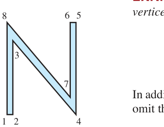

*FIGURE 1 Regular N. 图1 原来的大写字母 N（8 个顶点）*

用剪切矩阵 $A = \begin{bmatrix} 1 & .25 \\
0 & 1 \end{bmatrix}$ 左乘 $D$，得剪切后的 N（FIGURE 2）：

$$AD = \begin{bmatrix} 1 & .25 \\
0 & 1 \end{bmatrix}\begin{bmatrix} 0 & .5 & .5 & 6 & 6 & 5.5 & 5.5 & 0 \\
0 & 0 & 6.42 & 0 & 8 & 8 & 1.58 & 8 \end{bmatrix} = \begin{bmatrix} 0 & .5 & 2.105 & 6 & 8 & 7.5 & 5.895 & 2 \\
0 & 0 & 6.42 & 0 & 8 & 8 & 1.58 & 8 \end{bmatrix}$$

**逐个验证**（剪切 = x 坐标加 0.25 倍 y 坐标）：$.5 + .25(6.42) = 2.105$ ✓；$6 + .25(8) = 8$ ✓；$5.5 + .25(8) = 7.5$ ✓；$5.5 + .25(1.58) = 5.895$ ✓；$0 + .25(8) = 2$ ✓

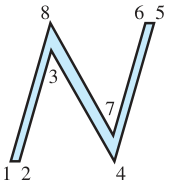

*FIGURE 2 Slanted N. 图2 剪切后的斜体 N*

**例2（Example 2，复合变换）**：FIGURE 2 的 N 有点太宽，补偿办法：再做一个**缩放变换** $S = \begin{bmatrix} .75 & 0 \\
0 & 1 \end{bmatrix}$（x 坐标乘 .75）。复合变换矩阵 = **乘积**（顺序：先剪切、后缩放 = $S$ 在左）：

$$SA = \begin{bmatrix} .75 & 0 \\
0 & 1 \end{bmatrix}\begin{bmatrix} 1 & .25 \\
0 & 1 \end{bmatrix} = \begin{bmatrix} .75 & .1875 \\
0 & 1 \end{bmatrix}$$

一个矩阵完成"先剪切、再缩放"两步（FIGURE 3）：

*FIGURE 3 Composite transformation of N. 图3 复合变换（剪切 + 缩放）后的 N*

> **硬件优势**：数据矩阵的乘法天然并行（每列独立），这正是 GPU 架构的数学模型——现代显卡每秒完成数十亿次矩阵乘法。

### 齐次坐标 Homogeneous Coordinates（核心技巧）

**中文讲解**：平移 $(x, y) \mapsto (x+h, y+k)$ **不是线性变换**（它把原点挪走了），无法用 2×2 矩阵表示。标准技巧：把平面点"升级"成三维**齐次坐标**：

$$(x, y) \;\longleftrightarrow\; (x, y, 1)$$

平移就能用 3×3 矩阵实现了：

$$\begin{bmatrix} 1 & 0 & h \\
0 & 1 & k \\
0 & 0 & 1 \end{bmatrix}\begin{bmatrix} x \\
y \\
1 \end{bmatrix} = \begin{bmatrix} x+h \\
y+k \\
1 \end{bmatrix}$$

**旋转 + 缩放 + 平移任意复合** = 对应 3×3 矩阵连乘，一次乘法完成整个动画帧。CAD 与游戏引擎的全部几何运算，都在这个 3×3 世界里完成。

### 三维旋转 3D Rotations

三维空间中，图形绕坐标轴旋转的标准矩阵（飞机姿态 yaw/pitch/roll 的数学本体）：

$$R_x(\alpha) = \begin{bmatrix} 1 & 0 & 0 \\
0 & \cos\alpha & -\sin\alpha \\
0 & \sin\alpha & \cos\alpha \end{bmatrix}$$

$$R_y(\beta) = \begin{bmatrix} \cos\beta & 0 & \sin\beta \\
0 & 1 & 0 \\
-\sin\beta & 0 & \cos\beta \end{bmatrix}$$

$$R_z(\gamma) = \begin{bmatrix} \cos\gamma & -\sin\gamma & 0 \\
\sin\gamma & \cos\gamma & 0 \\
0 & 0 & 1 \end{bmatrix}$$

任意朝向 = 三个基本旋转的乘积（欧拉角分解）。

### 透视投影 Perspective Projection

**中文讲解**：三维场景显示到二维屏幕 = 投影。近大远小的透视效果，用**齐次坐标 + 除以深度**实现。标准透视投影矩阵（投影中心在 z 轴上、屏幕为 xy 平面）作用后，齐次坐标的第 4 个分量变为 $1 - z/d$，最后"归一化"（各分量同除以它）：

$$\begin{bmatrix} 1 & 0 & 0 & 0 \\
0 & 1 & 0 & 0 \\
0 & 0 & 0 & 0 \\
0 & 0 & -1/d & 1 \end{bmatrix}\begin{bmatrix} x \\
y \\
z \\
1 \end{bmatrix} = \begin{bmatrix} x \\
y \\
0 \\
1 - z/d \end{bmatrix} \;\longrightarrow\; \left(\frac{x}{1-z/d},\ \frac{y}{1-z/d},\ 0\right)$$

**直觉**：$z$ 越大（越远），除数 $1 - z/d$ 越大，投影点越靠近原点——**近大远小**自动实现。计算机图形学中"摄像机在内、投影在外"的奇观（例：1997 年北卡罗来纳大学虚拟现实项目，观察者移动、投影实时跟随），都是这条公式的工程实现。

### 2.7 小结

| 概念 | 一句话理解 |
|---|---|
| 数据矩阵 D | 图形顶点坐标存成 2×n 矩阵 |
| 图形变换 | 左乘矩阵；复合 = 矩阵连乘（顺序从右到左） |
| 齐次坐标 | (x,y) → (x,y,1)，把平移"伪装"成线性变换 |
| 3D 旋转 | 绕 x/y/z 轴三个基本矩阵，欧拉角的积木 |
| 透视投影 | 齐次坐标 + 除以深度 = 近大远小 |

> **本节精髓**：图形学把矩阵乘法的"**变换**"本质演绎到极致——矩阵是运动，乘法是复合，逆矩阵是"撤销"。下一节的子空间理论，则把矩阵的"**结构**"本质（列空间、零空间）推向中心舞台。

---
---

## 2.8 $\mathbb{R}^n$ 的子空间 Subspaces of $\mathbb{R}^n$

**中文讲解**：前面我们反复遇到两种向量集合：齐次方程 $A\mathbf{x} = \mathbf{0}$ 的解集、若干向量的张成 $\operatorname{Span}$。它们有一个共同的名字——**子空间（subspace）**。本节把第 1 章的几何直觉升级为严格定义，并引出全书最重要的两个子空间：**列空间**与**零空间**。

### 子空间的定义 DEFINITION

$\mathbb{R}^n$ 中的集合 $H$ 称为**子空间**，若满足三条性质：

a. **零向量** $\mathbf{0}$ 在 $H$ 中

b. 对 $H$ 中任意 $\mathbf{u}, \mathbf{v}$，**和** $\mathbf{u} + \mathbf{v}$ 仍在 $H$ 中（对加法封闭）

c. 对 $H$ 中任意 $\mathbf{u}$ 和任意标量 $c$，**数乘** $c\mathbf{u}$ 仍在 $H$ 中（对数乘封闭）

> 用一句话说：**子空间 = 包含零向量、且对加法与数乘都封闭的向量集合**。第 1 章讨论过的几乎所有向量集合都是子空间。

**例1（Example 1）**：若 $\mathbf{v}_1, \mathbf{v}_2 \in \mathbb{R}^n$，则 $H = \operatorname{Span}\{\mathbf{v}_1, \mathbf{v}_2\}$ 是 $\mathbb{R}^n$ 的子空间。

**验证**：零向量在 $H$ 中（$0\mathbf{v}_1 + 0\mathbf{v}_2$ 是线性组合）；任取 $\mathbf{u} = s_1\mathbf{v}_1 + s_2\mathbf{v}_2$、$\mathbf{v} = t_1\mathbf{v}_1 + t_2\mathbf{v}_2$，则

$$\mathbf{u} + \mathbf{v} = (s_1+t_1)\mathbf{v}_1 + (s_2+t_2)\mathbf{v}_2 \in H$$

$$c\mathbf{u} = (cs_1)\mathbf{v}_1 + (cs_2)\mathbf{v}_2 \in H$$

三条性质全满足，故 $H$ 是子空间。几何上，它就是**过原点的平面**（或直线）：

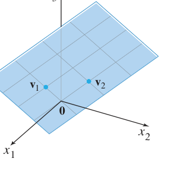

*FIGURE 1 Span{v1, v2} as a plane through the origin. 图1 张成集是过原点的平面（子空间的典型形象）*

**例3（Example 3，反例）**：**不过原点的直线 $L$ 不是子空间**——它不含零向量，破坏性质 (a)；而且看图就知道：$L$ 上两向量之和可能跑出 $L$（$\mathbf{u}+\mathbf{v}$ 不在 $L$ 上），倍数也可能跑出（$2\mathbf{w}$ 不在 $L$ 上）——加法、数乘都不封闭！

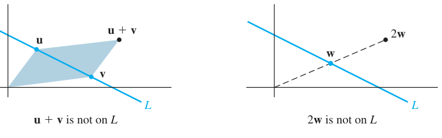

*FIGURE 2 A line L not through the origin is not a subspace. 图2 不过原点的直线不是子空间：u+v 与 2w 都不在 L 上（加法、数乘均不封闭）*

> **记忆要点**：1.5 节我们学过"非齐次方程的解集 = 特解 + 齐次通解（平移）"。平移后的集合**不再是子空间**（不过原点）——这正呼应了例3。

**THEOREM 12**：对任意 $\mathbf{v}_1, \dots, \mathbf{v}_p \in \mathbb{R}^n$，集合 $\operatorname{Span}\{\mathbf{v}_1, \dots, \mathbf{v}_p\}$ 是 $\mathbb{R}^n$ 的子空间。我们称它为**由 $\mathbf{v}_1, \dots, \mathbf{v}_p$ 张成（生成）的子空间**。

**两个特殊子空间**：
- $\mathbb{R}^n$ 本身（显然满足三条）
- **零子空间** $\{\mathbf{0}\}$（只含零向量）

### 列空间 Column Space of a Matrix

**定义**：$m \times n$ 矩阵 $A$ 的**列空间** $\operatorname{Col} A$ 是其各列所有线性组合构成的集合：

$$\operatorname{Col} A = \operatorname{Span}\{\mathbf{a}_1, \dots, \mathbf{a}_n\}$$

- 若 $A$ 的列在 $\mathbb{R}^m$ 中，则 $\operatorname{Col} A$ 是 $\mathbb{R}^m$ 的子空间（由 Theorem 12）
- **关键联系**：$\operatorname{Col} A = \mathbb{R}^m$ ⟺ $A$ 的列张成 $\mathbb{R}^m$；否则 $\operatorname{Col} A$ 只是 $\mathbb{R}^m$ 的一部分
- **方程组视角**：$\mathbf{b} \in \operatorname{Col} A$ ⟺ 方程 $A\mathbf{x} = \mathbf{b}$ **有解**（这正是 1.4 定理 4 的语言！）

**例4（Example 4）**：判断 $\mathbf{b}$ 是否在 $A$ 的列空间中：

$$A = \begin{bmatrix} 1 & -3 & -4 \\
-4 & 6 & -2 \\
-3 & 7 & 6 \end{bmatrix}, \qquad \mathbf{b} = \begin{bmatrix} 3 \\
3 \\
-4 \end{bmatrix}$$

**解**：$\mathbf{b}$ 是 $A$ 各列的线性组合 ⟺ 存在 $\mathbf{x}$ 使 $A\mathbf{x} = \mathbf{b}$。对增广矩阵行化简：

$$
\left[\begin{array}{rrrr} 1 & -3 & -4 & 3 \\
-4 & 6 & -2 & 3 \\
-3 & 7 & 6 & -4 \end{array}\right] \sim \left[\begin{array}{rrrr} 1 & -3 & -4 & 3 \\
0 & -6 & -18 & 15 \\
0 & -2 & -6 & 5 \end{array}\right] \sim \left[\begin{array}{rrrr} 1 & -3 & -4 & 3 \\
0 & -6 & -18 & 15 \\
0 & 0 & 0 & 0 \end{array}\right]
$$

第三行全零、无矛盾方程，系统**相容** ⇒ **$\mathbf{b}$ 在 $\operatorname{Col} A$ 中**（且因 $x_3$ 自由，表示方法无穷多种）。

> **Col A 的妙用**：$\operatorname{Col} A$ 就是"方程 $A\mathbf{x} = \mathbf{b}$ 有解"的所有 $\mathbf{b}$ 构成的集合——它把"解的存在性"翻译成了"向量属于某个子空间"。

### 零空间 Null Space of a Matrix

**定义**：$m \times n$ 矩阵 $A$ 的**零空间** $\operatorname{Nul} A$ 是齐次方程 $A\mathbf{x} = \mathbf{0}$ 的**全部解**构成的集合：

$$\operatorname{Nul} A = \{\mathbf{x} \in \mathbb{R}^n : A\mathbf{x} = \mathbf{0}\}$$

**THEOREM 13**：$m \times n$ 矩阵 $A$ 的零空间是 $\mathbb{R}^n$ 的子空间。

**证明**：
1. 零向量：$A\mathbf{0} = \mathbf{0}$，故 $\mathbf{0} \in \operatorname{Nul} A$
2. 加法：若 $A\mathbf{u} = \mathbf{0}$、$A\mathbf{v} = \mathbf{0}$，则 $A(\mathbf{u} + \mathbf{v}) = A\mathbf{u} + A\mathbf{v} = \mathbf{0} + \mathbf{0} = \mathbf{0}$，故 $\mathbf{u} + \mathbf{v} \in \operatorname{Nul} A$
3. 数乘：$A(c\mathbf{u}) = c(A\mathbf{u}) = c\mathbf{0} = \mathbf{0}$，故 $c\mathbf{u} \in \operatorname{Nul} A$ ∎

> **两种描述方式**：
> - $\operatorname{Nul} A$ 由"必须逐向量检验的条件 $A\mathbf{x} = \mathbf{0}$"定义，叫**隐式（implicit）描述**
> - $\operatorname{Col} A$ 可由各列**构造（线性组合）**出来，叫**显式（explicit）描述**
> - 想给 $\operatorname{Nul} A$ 一个显式描述？解 $A\mathbf{x} = \mathbf{0}$，写成**参数向量形式**即可（见例 6）

### 基 Basis for a Subspace

**中文讲解**：子空间通常含**无穷多个**向量。问题："能否找一组'骨干'向量，既线性无关、又能张成整个子空间？"——这就是**基（basis）**。

**定义**：$\mathbb{R}^n$ 中子空间 $H$ 的一组**基** = $H$ 中满足两个条件的向量集 $\mathcal{B} = \{\mathbf{v}_1, \dots, \mathbf{v}_p\}$：

1. $\mathcal{B}$ 是**线性无关**集
2. $H = \operatorname{Span}\{\mathbf{v}_1, \dots, \mathbf{v}_p\}$（$\mathcal{B}$ 张成 $H$）

> **直观**：基是子空间的"最小生成集"——不多不少，恰好够用。第 4 章会证明：**每个子空间的基含向量个数相同**（= 维数）。

**求 $\operatorname{Nul} A$ 的基（标准流程，例 6/7）**：

**例6（Example 6）**：求 $\operatorname{Nul} A$ 的基，其中

$$A = \begin{bmatrix} -3 & 6 & -1 & 1 & -7 \\
1 & -2 & 2 & 3 & -1 \\
2 & -4 & 5 & 8 & -4 \end{bmatrix}$$

**解**：解 $A\mathbf{x} = \mathbf{0}$，行化简到简化阶梯形：

$$A \sim \begin{bmatrix} 1 & -2 & 0 & -1 & 3 \\
0 & 0 & 1 & 2 & -2 \\
0 & 0 & 0 & 0 & 0 \end{bmatrix}$$

对应方程组：$x_1 - 2x_2 - x_4 + 3x_5 = 0$，$x_3 + 2x_4 - 2x_5 = 0$（$x_2, x_4, x_5$ 自由）。

**通解的参数向量形式**：

$$
\begin{bmatrix} x_1 \\
x_2 \\
x_3 \\
x_4 \\
x_5 \end{bmatrix} = \begin{bmatrix} 2x_2 + x_4 - 3x_5 \\
x_2 \\
-2x_4 + 2x_5 \\
x_4 \\
x_5 \end{bmatrix} = x_2\begin{bmatrix} 2 \\
1 \\
0 \\
0 \\
0 \end{bmatrix} + x_4\begin{bmatrix} 1 \\
0 \\
-2 \\
1 \\
0 \end{bmatrix} + x_5\begin{bmatrix} -3 \\
0 \\
2 \\
0 \\
1 \end{bmatrix} = x_2\mathbf{u} + x_4\mathbf{v} + x_5\mathbf{w}
$$

**结论**：
- $\{\mathbf{u}, \mathbf{v}, \mathbf{w}\}$ 生成 $\operatorname{Nul} A$（每个解都是它们的线性组合）
- 它们**自动线性无关**：若 $x_2\mathbf{u} + x_4\mathbf{v} + x_5\mathbf{w} = \mathbf{0}$，看第 2、4、5 个分量立得 $x_2 = x_4 = x_5 = 0$

故 $\{\mathbf{u}, \mathbf{v}, \mathbf{w}\}$ 是 $\operatorname{Nul} A$ 的一组**基**。

> **例6 的方法论**：解 $A\mathbf{x} = \mathbf{0}$ 的标准化简**自动**给出 $\operatorname{Nul} A$ 的基——参数向量形式中的每个向量（自由变量依次取 1）都是基成员。这个事实第 5 章会反复使用！

**求 $\operatorname{Col} A$ 的基（主元列定理，例 8/9）**：

**例8（Example 8）**：$B$ 已是简化阶梯形，求 $\operatorname{Col} B$ 的基：

$$B = \begin{bmatrix} 1 & 0 & -3 & 5 & 0 \\
0 & 1 & 2 & -1 & 0 \\
0 & 0 & 0 & 0 & 1 \\
0 & 0 & 0 & 0 & 0 \end{bmatrix}$$

**解**：主元在第 1、2、5 列。观察非主元列：$\mathbf{b}_3 = -3\mathbf{b}_1 + 2\mathbf{b}_2$，$\mathbf{b}_4 = 5\mathbf{b}_1 - \mathbf{b}_2$——非主元列都能由主元列线性表示。所以去掉 $\mathbf{b}_3, \mathbf{b}_4$ 不损失任何张成能力，而 $\{\mathbf{b}_1, \mathbf{b}_2, \mathbf{b}_5\}$ 线性无关（阶梯形中主元列必无关）。故 $\{\mathbf{b}_1, \mathbf{b}_2, \mathbf{b}_5\}$ 是 $\operatorname{Col} B$ 的基。

**例9（Example 9）**：一般矩阵 $A$ 与例 8 的 $B$ 行等价，

$$A = \begin{bmatrix} \mathbf{a}_1 & \mathbf{a}_2 & \mathbf{a}_3 & \mathbf{a}_4 & \mathbf{a}_5 \end{bmatrix} = \begin{bmatrix} 1 & 3 & 3 & 2 & -9 \\
-2 & -2 & 2 & -8 & 2 \\
2 & 3 & 0 & 7 & 1 \\
3 & 4 & -1 & 11 & -8 \end{bmatrix}$$

**关键原理**：行变换**不改变列之间的线性相关关系**——$A\mathbf{x} = \mathbf{0}$ 与 $B\mathbf{x} = \mathbf{0}$ 同解！所以

$$\mathbf{a}_3 = -3\mathbf{a}_1 + 2\mathbf{a}_2, \qquad \mathbf{a}_4 = 5\mathbf{a}_1 - \mathbf{a}_2$$

（读者可自行验证成立）$\Rightarrow$ $\mathbf{a}_3, \mathbf{a}_4$ 多余，$\{\mathbf{a}_1, \mathbf{a}_2, \mathbf{a}_5\}$ 线性无关且张成 $\operatorname{Col} A$，是 $\operatorname{Col} A$ 的基。

**THEOREM 14（主元列定理，Pivot Columns Theorem）**：
> 矩阵 $A$ 的**主元列**构成 $\operatorname{Col} A$ 的一组基。

> ⚠️ **警告（Warning）**：务必用 **$A$ 本身的主元列**，而不是阶梯形 $B$ 的列！$B$ 的列常在 $\operatorname{Col} A$ 之外（例 8、9 中 $B$ 的列末分量全为 0，无法生成 $A$ 的列）。**用法**：化到阶梯形只为"看"主元列在**哪些列**，然后**回到原矩阵 $A$** 取这些列。

### 2.8 小结

| 概念 | 一句话理解 |
|---|---|
| 子空间 | 含零向量、对加法/数乘封闭的向量集（过原点的平面/直线） |
| Col A | A 各列的张成；$\mathbf{b} \in \operatorname{Col} A$ ⟺ $A\mathbf{x} = \mathbf{b}$ 有解 |
| Nul A | $A\mathbf{x} = \mathbf{0}$ 的解集；子空间（Theorem 13） |
| 基 | 线性无关的生成集（子空间的"最小骨架"） |
| Nul A 的基 | 解 $A\mathbf{x} = \mathbf{0}$ 取参数向量形式（自动得基） |
| Col A 的基 | **A 的主元列**（Theorem 14；注意不是 B 的列！） |

> **本节精髓**：Col A 与 Nul A 是矩阵的"**一体两面**"——列空间看"能到达哪里"（值域），零空间看"哪里被压扁"（核）。Theorem 14 的主元列定理把第 1 章的"主元位置"概念升华成了子空间的基，是 2.9 节**秩（Rank）**定义的桥梁。

---
---

# 第三章 行列式
# Chapter 3 Determinants

**导入例子：随机路径与畸变**
**INTRODUCTORY EXAMPLE: Random Paths and Distortion**

诺贝尔物理学奖得主费曼在自传《别闹了，费曼先生》中讲到，他在普林斯顿的公寓里观察蚂蚁搬家，用玻璃纸和糖做实验研究蚂蚁的觅食路径。本节的主角"行列式"研究另一类路径问题——而 3.3 节将揭示：行列式度量的是**线性变换对图形面积的扭曲程度**，这正是多元微积分中**雅可比行列式（Jacobian）**的灵魂。

> 本章两大任务：3.2 节给出**方阵可逆的判别准则**（第 5 章的关键）；3.3 节展示行列式如何度量线性变换改变图形面积的比例。

---

## 3.1 行列式引论 Introduction to Determinants

**中文讲解**：2.2 节我们知道：2×2 矩阵 $A$ 可逆 ⟺ $\det A = a_{11}a_{22} - a_{12}a_{21} \neq 0$。本节把这个有用的事实推广到 $n \times n$ 矩阵。思路很"线性代数"：**观察 3×3 可逆矩阵行化简时什么量必然非零**——这个量就是行列式。

### 从行化简"发现" 3×3 行列式

设 $A = [a_{ij}]$ 可逆且 $a_{11} \neq 0$。第 2、3 行乘 $a_{11}$，再消去第一列：

$$A \sim \begin{bmatrix} a_{11} & a_{12} & a_{13} \\
0 & a_{11}a_{22} - a_{12}a_{21} & a_{11}a_{23} - a_{13}a_{21} \\
0 & a_{11}a_{32} - a_{12}a_{31} & a_{11}a_{33} - a_{13}a_{31} \end{bmatrix}$$

继续消元（必要时先换行），最终 $(3,3)$ 位置出现一个量：

$$
\begin{aligned}
\Delta =\ & a_{11}a_{22}a_{33} + a_{12}a_{23}a_{31} + a_{13}a_{21}a_{32} \\
& - a_{11}a_{23}a_{32} - a_{12}a_{21}a_{33} - a_{13}a_{22}a_{31}
\end{aligned}
$$

$A$ 可逆 ⟹ $\Delta \neq 0$（反之也成立，3.2 节见）。这个 $\Delta$ 就叫 $A$ 的**行列式**。

**结构观察**：六项可以分组因式分解，每项都含第一行的元素：

$$\Delta = a_{11}\cdot\det\begin{bmatrix} a_{22} & a_{23} \\
a_{32} & a_{33} \end{bmatrix} - a_{12}\cdot\det\begin{bmatrix} a_{21} & a_{23} \\
a_{31} & a_{33} \end{bmatrix} + a_{13}\cdot\det\begin{bmatrix} a_{21} & a_{22} \\
a_{31} & a_{32} \end{bmatrix}$$

简记为 $\Delta = a_{11}\det A_{11} - a_{12}\det A_{12} + a_{13}\det A_{13}$，其中 $A_{1j}$ 是**删掉第 1 行和第 $j$ 列**后得到的子矩阵。

### 子矩阵与子式 Submatrices

**定义**：给定 $A = [a_{ij}]$，**$(i, j)$-子矩阵** $A_{ij}$（有的书叫 minor，子式）= 划去 $A$ 的第 $i$ 行和第 $j$ 列后剩下的矩阵。

**例**（书内示例）：

$$A = \begin{bmatrix} 1 & -2 & 5 & 0 \\
2 & 0 & 4 & -1 \\
3 & 1 & 0 & 7 \\
0 & 4 & -2 & 0 \end{bmatrix} \quad \Rightarrow \quad A_{32} = \begin{bmatrix} 1 & 5 & 0 \\
2 & 4 & -1 \\
0 & -2 & 0 \end{bmatrix}$$

（划掉第 3 行、第 2 列）

### $n \times n$ 行列式的递归定义

**DEFINITION**：$n \times n$ 矩阵 $A = [a_{ij}]$ 的行列式是如下 $n$ 项之和（沿**第一行**展开），符号正负交替：

$$\det A = a_{11}\det A_{11} - a_{12}\det A_{12} + \cdots + (-1)^{1+n}a_{1n}\det A_{1n} = \sum_{j=1}^{n}(-1)^{1+j}a_{1j}\det A_{1j}$$

- 1×1 矩阵：$\det[a_{11}] = a_{11}$
- 递归结构：$n$ 阶行列式由 $(n-1)$ 阶行列式定义，层层下降直到 2×2
- 常用记号：$\det A = |A|$（用竖线代替方括号）

**例1（Example 1）**：计算

$$A = \begin{bmatrix} 1 & 5 & 0 \\
2 & 4 & -1 \\
0 & -2 & 0 \end{bmatrix}$$

的 $\det A$。

**解**（沿第一行展开，$\det A = a_{11}\det A_{11} - a_{12}\det A_{12} + a_{13}\det A_{13}$）：

$$
\begin{aligned}
\det A &= 1\cdot\det\begin{bmatrix} 4 & -1 \\
-2 & 0 \end{bmatrix} - 5\cdot\det\begin{bmatrix} 2 & -1 \\
0 & 0 \end{bmatrix} + 0\cdot\det\begin{bmatrix} 2 & 4 \\
0 & -2 \end{bmatrix} \\
&= 1\,(0 - 2) - 5\,(0 - 0) + 0\,(-4 - 0) = -2
\end{aligned}
$$

### 余因子展开 Cofactor Expansion

把定义改写得更对称：$(i,j)$-**余因子（cofactor）**

$$C_{ij} = (-1)^{i+j}\det A_{ij}$$

则沿第一行的展开写成 $\det A = a_{11}C_{11} + a_{12}C_{12} + \cdots + a_{1n}C_{1n}$。

**符号棋盘**：$(-1)^{i+j}$ 与 $a_{ij}$ 本身的符号无关，只取决于位置——记住这个棋盘格：

$$\begin{bmatrix} + & - & + & \cdots \\
- & + & - & \cdots \\
+ & - & + & \cdots \\
\vdots & \vdots & \vdots & \ddots \end{bmatrix}$$

**THEOREM 1（任意行/列展开）**：
> $n \times n$ 矩阵 $A$ 的行列式可按**任意一行**展开：

> $$\det A = a_{i1}C_{i1} + a_{i2}C_{i2} + \cdots + a_{in}C_{in}$$

> 或按**任意一列**展开：

> $$\det A = a_{1j}C_{1j} + a_{2j}C_{2j} + \cdots + a_{nj}C_{nj}$$

（证明从略，教材注明避免冗长离题。）

**例2（Example 2）**：用**第三行**展开重算例1 的矩阵。

**解**：第三行是 $[0, -2, 0]$，只有两个零项中间的项要算：

$$
\begin{aligned}
\det A &= a_{31}C_{31} + a_{32}C_{32} + a_{33}C_{33} \\
&= 0 - (-2)\,(-1)^{3+2}\det\begin{bmatrix} 1 & 0 \\
2 & -1 \end{bmatrix} + 0 \\
&= 2\cdot(-1) = -2
\end{aligned}
$$

与例1 结果一致 ✓——**选零多的行/列展开，工作量锐减**。

**例3（Example 3，5×5 实战）**：

$$A = \begin{bmatrix} 3 & -7 & 8 & 9 & -6 \\
0 & 2 & -5 & 7 & 3 \\
0 & 0 & 1 & 5 & 0 \\
0 & 0 & 0 & 2 & 4 \\
-1 & 0 & 0 & 0 & 0 \end{bmatrix}$$

**解**：第一列只有 $a_{11} = 3$ 和 $a_{51} = -1$ 非零。沿第一列展开：

$$\det A = 3\cdot\det\begin{bmatrix} 2 & -5 & 7 & 3 \\
0 & 1 & 5 & 0 \\
0 & 0 & 2 & 4 \\
0 & 0 & 0 & -2 \end{bmatrix} + 0 + 0 + 0 + (-1)\cdot(-1)^{5+1}\det(\cdots)$$

（零项省略；第 5 行第 1 列项的符号 $(-1)^{5+1} = +$，其 4×4 子式含整零列，值为 0）

对 4×4 子式继续沿第一列展开，再沿第一列展开 3×3：

$$\det A = 3 \cdot 2 \cdot \det\begin{bmatrix} 1 & 5 & 0 \\
4 & -1 & 0 \\
0 & -2 & 0 \end{bmatrix} = 3 \cdot 2 \cdot (-2) = \mathbf{-12}$$

（最后那个 3×3 就是例1 算过的 $= -2$。）

### THEOREM 2（三角矩阵的行列式）

> 若 $A$ 是**三角矩阵**（上三角或下三角），则 $\det A$ = **主对角线元素之积**。

**为什么**：三角矩阵沿"零最多"的行/列反复展开，每次都只剩下对角元一个非零项，递归相乘即得。

**特别地**：有一整行或一整列为零 ⟹ $\det A = 0$（沿该行/列展开，全是零项）。

### 数值注记（为什么需要更快的算法）

按今天的标准，25×25 矩阵算小的。但用余因子展开算 25 阶行列式：**需要超过 $25!$ 次乘法**，而 $25! \approx 1.5 \times 10^{25}$。哪怕计算机每秒做一万亿次乘法，也要运行 **50 万年**！好在 3.2 节将发现行列式与行化简的深刻联系，给出实用算法。

### 练习精选与技巧警示

**3×3 对角线法（仅 3×3 可用！）**：把前两列抄到矩阵右边，三条"主对角线"乘积相加、三条"副对角线"乘积相减：

$$\begin{vmatrix} a_{11} & a_{12} & a_{13} \\
a_{21} & a_{22} & a_{23} \\
a_{31} & a_{32} & a_{33} \end{vmatrix} = (a_{11}a_{22}a_{33} + a_{12}a_{23}a_{31} + a_{13}a_{21}a_{32}) - (a_{13}a_{22}a_{31} + a_{11}a_{23}a_{32} + a_{12}a_{21}a_{33})$$

> ⚠️ **教材明确警告（Warning）**：这个方法**不能**以任何合理方式推广到 4×4 及以上！4 阶以上请老老实实用余因子展开 + 选零行零列。

**概念检查（T/F 精选）**：
- "沿某列的余因子展开 = 沿某行的余因子展开" —— True（都是 $\det A$，Theorem 1）
- "三角矩阵的行列式 = 主对角线元素**之和**" —— False（是**乘积**！Theorem 2）

### 3.1 小结

| 概念 | 一句话理解 |
|---|---|
| $\det A$ | 递归定义：沿某行/列，元素 × 余因子求和 |
| 余因子 $C_{ij}$ | $(-1)^{i+j}\det A_{ij}$，符号看棋盘格 |
| Theorem 1 | 任意行、任意列展开结果相同——**选零多的展开** |
| Theorem 2 | 三角阵行列式 = 对角元乘积 |
| 计算策略 | 先用行化简造零（3.2 节），再展开 |

> **本节精髓**：行列式不是凭空定义的技巧，而是**藏在行化简过程中的不变量**——可逆矩阵行化简到底，某个乘积结构必然非零。例3 的"沿零列反复展开"已经预告了 3.2 节的主题：行列式与行变换的关系。

---
---

## 3.2 行列式的性质 Properties of Determinants

**中文讲解**：3.1 节的余因子展开对 4×4 还凑合，5×5 就吃力，25×25 要算 50 万年。本节打通行列式与**行化简**的关系——用你已经炉火纯青的消元法算行列式，并得到本节主定理：**方阵可逆 ⟺ 行列式非零**。

### 行变换对行列式的影响 THEOREM 3

> 设 $A$ 是方阵。
>
> a. **行替换**（某行 += c×另一行）：**行列式不变**
>
> b. **行交换**：行列式**变号**（$\det = -$原值）
>
> c. **行倍乘**（某行 × k）：行列式变为 **k 倍**（$\det = k\cdot$原值）

**验证方法**：对 2×2 用公式 $\det = ad - bc$ 逐一验证（练习 19–24）；$n \times n$ 情形用数学归纳法证明。

### 行化简求行列式（标准策略）

**核心公式**（设 $A$ 经行替换和 $r$ 次行交换化为阶梯形 $U$）：

$$\det A = (-1)^r \cdot \det U = (-1)^r \cdot (u_{11}u_{22}\cdots u_{nn})$$

因为 $U$ 是三角矩阵，$\det U$ = 对角元乘积。又因为行替换不改变行列式、每次交换添一个负号。

**例1（Example 1）**：求 $\det A$，$A = \begin{bmatrix} 1 & -4 & 2 \\
-2 & 8 & -9 \\
-1 & 7 & 0 \end{bmatrix}$。

**解**（列1消元——**行替换，行列式不变**）：

$$
\det A = \begin{vmatrix} 1 & -4 & 2 \\
-2 & 8 & -9 \\
-1 & 7 & 0 \end{vmatrix} = \begin{vmatrix} 1 & -4 & 2 \\
0 & 0 & -5 \\
0 & 3 & 2 \end{vmatrix}
$$

交换 2、3 行（**变号**）：

$$\det A = -\begin{vmatrix} 1 & -4 & 2 \\
0 & 3 & 2 \\
0 & 0 & -5 \end{vmatrix} = -(1)(3)(-5) = \mathbf{15}$$

> **定理 3(c) 的实用技巧——提取公因子**：某行有公因子 k 时，可把 k **提到行列式外面**（相当于反向使用倍乘规则）。例如：

> $$\begin{vmatrix} * & 5k & * \\
* & -2k & * \\
* & 3k & * \end{vmatrix} = k\begin{vmatrix} * & 5 & * \\
* & -2 & * \\
* & 3 & * \end{vmatrix}$$

**例2（Example 2）**：求 $\det A$，$A = \begin{bmatrix} 2 & -8 & 6 & 8 \\
3 & -9 & 5 & 10 \\
-3 & 0 & 1 & -2 \\
1 & -4 & 0 & 6 \end{bmatrix}$。

**解**（先提公因子 2，避免分数）：

$$
\det A = 2\begin{vmatrix} 1 & -4 & 3 & 4 \\
3 & -9 & 5 & 10 \\
-3 & 0 & 1 & -2 \\
1 & -4 & 0 & 6 \end{vmatrix} = 2\begin{vmatrix} 1 & -4 & 3 & 4 \\
0 & 3 & -4 & -2 \\
0 & -12 & 10 & 10 \\
0 & 0 & -3 & 2 \end{vmatrix}
$$

（列1消元；再用第2列的 3 作主元消第3行）

$$= 2\begin{vmatrix} 1 & -4 & 3 & 4 \\
0 & 3 & -4 & -2 \\
0 & 0 & -6 & 2 \\
0 & 0 & -3 & 2 \end{vmatrix} = 2\begin{vmatrix} 1 & -4 & 3 & 4 \\
0 & 3 & -4 & -2 \\
0 & 0 & -6 & 2 \\
0 & 0 & 0 & 1 \end{vmatrix} = 2\,(1)(3)(-6)(1) = \mathbf{-36}$$

（最后一步：第4行 += −1/2×第3行，造出三角阵。）

### 公式 (1)：行列式的化简解释

若只用**行替换 + 行交换**（不倍乘）把 $A$ 化为阶梯形 $U$，共交换 $r$ 次，则：

$$\det A = \begin{cases} (-1)^r \times (\text{U 中主元之积}) & \text{若 } A \text{ 可逆} \\
0 & \text{若 } A \text{ 不可逆} \end{cases}$$

- 可逆 ⟹ $U$ 的 $n$ 个主元全在，$\det U$ = 主元乘积 ≠ 0
- 不可逆 ⟹ $U$ 有零行（至少 $u_{nn} = 0$），$\det U = 0$

> **有趣事实**：$U$ 本身不唯一（阶梯形不唯一），主元也不唯一，但**主元乘积唯一**（最多差个负号）——这正是行列式作为"不变量"的意义。

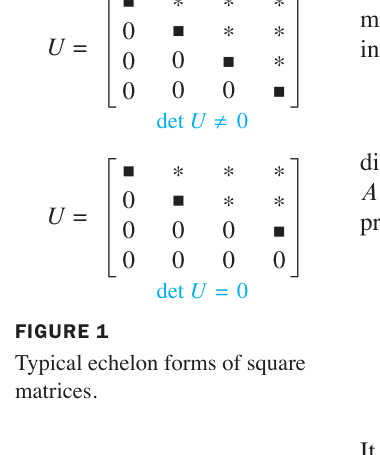

*FIGURE 1 Typical echelon forms of square matrices. 图1 方阵的典型阶梯形：左（可逆）det U ≠ 0；右（不可逆）det U = 0*

### THEOREM 4（本节主定理：可逆 ⟺ 行列式非零）

> 方阵 $A$ 可逆，**当且仅当** $\det A \neq 0$。

**推论**：列（或行）线性相关 ⟹ $\det A = 0$（相关 ⟹ 奇异 ⟹ 行列式为零）；两列或两行成比例 ⟹ $\det A = 0$（实践中一眼可见的相关情形）。

### 行列式与列变换 Column Operations

**列变换** = 对 $A^T$ 做行变换。而：

### THEOREM 5（转置不变性）

$$\det A^T = \det A$$

（数学归纳法证明，见教材。）因此**列变换对行列式的影响与行变换完全相同**（替换不变、交换变号、倍乘乘 k）——行列式可以"横着算"也可以"竖着算"，哪个零多用哪个。

### 行列式与矩阵乘积 THEOREM 6（乘法性质）

> 若 $A, B$ 是 $n \times n$ 矩阵，则

> $$\det(AB) = (\det A)(\det B)$$

**例5（Example 5，验证）**：$A = \begin{bmatrix} 6 & 1 \\
3 & 2 \end{bmatrix}$, $B = \begin{bmatrix} 4 & 3 \\
1 & 2 \end{bmatrix}$。

$$AB = \begin{bmatrix} 25 & 20 \\
14 & 13 \end{bmatrix}, \qquad \det AB = 25(13) - 20(14) = 45$$

而 $\det A = 9$, $\det B = 5$, $9 \times 5 = 45 = \det AB$ ✓

> ⚠️ **常见误解**：$\det(A + B) \neq \det A + \det B$（一般不成立）！行列式保持**乘法**结构，但**不保持加法**结构。（练习 45 的数值实验会让你确信这一点。）

**重要推论**：$\det(A^{-1}) = \dfrac{1}{\det A}$（由 $AA^{-1} = I$ 两边取行列式：$\det A \cdot \det A^{-1} = 1$）；$\det A^k = (\det A)^k$。

### 行列式函数的单变量线性

**中文讲解**：把 $\det A$ 看作其中**某一列**的函数（其余列固定），它满足：

$$T(c\mathbf{x}) = c\,T(\mathbf{x}), \qquad T(\mathbf{u} + \mathbf{v}) = T(\mathbf{u}) + T(\mathbf{v})$$

即对该列是**线性函数**（性质 (2) 是 Theorem 3(c) 的列版，(3) 可由余因子展开证明）。注意：这只是**对单列**线性，不是整体线性——再次印证 $\det(A+B) \neq \det A + \det B$。

### 数值注记

1. 实践中的行列式基本由**行化简**计算：n 阶只需约 $2n^3/3$ flops（LU 分解顺带得出），而余因子展开需要超过 $n!$ 次运算。
2. 若已知 LU 分解 $A = LU$（L 单位下三角、U 上三角），则 $\det A = \det U$ = U 的对角元乘积——分解一次，行列式立得。
3. 大规模**稀疏矩阵**（大量零元）有专门算法，手算也务必利用零元 + 展开（见例 4 演示的组合策略）。

**例4（Example 4，行列式计算的组合策略）**：

$$A = \begin{bmatrix} 0 & 1 & 2 & -1 \\
2 & 5 & -7 & 3 \\
0 & 3 & 6 & 2 \\
-2 & -5 & 4 & -2 \end{bmatrix}$$

**解**（消元 + 展开交替使用）：

$$\det A = \begin{vmatrix} 0 & 1 & 2 & -1 \\
2 & 5 & -7 & 3 \\
0 & 3 & 6 & 2 \\
0 & 0 & -3 & 1 \end{vmatrix} = -2\begin{vmatrix} 1 & 2 & -1 \\
3 & 6 & 2 \\
0 & -3 & 1 \end{vmatrix} = -2\begin{vmatrix} 1 & 2 & -1 \\
0 & 0 & 5 \\
0 & -3 & 1 \end{vmatrix}$$

（第4行 += 第2行消去首元；按第一列展开，(2,1) 位置符号为 −；再第2行 += −3×第1行）

再按第一列展开：

$$\det A = (-2)(1)\begin{vmatrix} 0 & 5 \\
-3 & 1 \end{vmatrix} = -2\,(0 - (-15)) = \mathbf{-30}$$

### 3.2 小结

| 概念 | 一句话理解 |
|---|---|
| Theorem 3 | 替换不变、交换变号、倍乘乘 k |
| 化简策略 | 行化简到 U：$\det A = (-1)^r \times$ 主元积 |
| Theorem 4 | **可逆 ⟺ det ≠ 0**（加入 IMT 大家庭） |
| Theorem 5 | $\det A^T = \det A$（行列对称） |
| Theorem 6 | $\det(AB) = \det A \det B$（保持乘法） |
| 反例警示 | $\det(A+B) \neq \det A + \det B$ |

> **本节精髓**：行列式是"行化简过程的记账员"——三种行变换对它的影响精确而简单。Theorem 4 把行列式接入了 IMT 的等价网络，Theorem 6 揭示它保持乘法结构。下一节 3.3 转向几何：行列式 = 面积/体积的伸缩系数，并给出克拉默法则这个"理论美、实践少用"的公式。

---
---

## 3.3 克拉默法则、体积与线性变换 Cramer's Rule, Volume, and Linear Transformations

**中文讲解**：本节给出行列式的三个重要应用：解方程组的**克拉默法则**（理论美、数值计算少用）、几何中的**面积/体积公式**、以及**线性变换的伸缩系数**——后者是多元微积分雅可比行列式的原型。

### 克拉默法则 Cramer's Rule

**背景**：若 $A$ 可逆，$A\mathbf{x} = \mathbf{b}$ 的解 $\mathbf{x} = A^{-1}\mathbf{b}$。把 2.2 的伴随矩阵公式代入、按分量展开，每个 $x_i$ 都是**两个行列式的商**——这就是克拉默法则。

**记号**：对 $n \times n$ 矩阵 $A$ 和 $\mathbf{b} \in \mathbb{R}^n$，$A_i(\mathbf{b})$ 表示"把 $A$ 的第 $i$ 列换成 $\mathbf{b}$"得到的矩阵。

**THEOREM 7（Cramer's Rule）**：
> 设 $A$ 是可逆 $n \times n$ 矩阵。对任意 $\mathbf{b} \in \mathbb{R}^n$，方程 $A\mathbf{x} = \mathbf{b}$ 的唯一解 $\mathbf{x}$ 的分量为

> $$x_i = \frac{\det A_i(\mathbf{b})}{\det A}, \qquad i = 1, 2, \dots, n$$

**例1（Example 1，2×2 实战）**：用克拉默法则解 $A\mathbf{x} = \mathbf{b}$：

$$A = \begin{bmatrix} 3 & -2 \\
-5 & 4 \end{bmatrix}, \qquad \mathbf{b} = \begin{bmatrix} 6 \\
8 \end{bmatrix}$$

**解**：$\det A = 12 - 10 = 2 \neq 0$，可用克拉默法则：

$$A_1(\mathbf{b}) = \begin{bmatrix} 6 & -2 \\
8 & 4 \end{bmatrix}, \qquad A_2(\mathbf{b}) = \begin{bmatrix} 3 & 6 \\
-5 & 8 \end{bmatrix}$$

$$x_1 = \frac{\det A_1(\mathbf{b})}{\det A} = \frac{24 - (-16)}{2} = \frac{40}{2} = 20$$

$$x_2 = \frac{\det A_2(\mathbf{b})}{\det A} = \frac{24 - (-30)}{2} = \frac{54}{2} = 27$$

### 求逆矩阵的公式 THEOREM 8（伴随矩阵公式）

**THEOREM 8（逆矩阵公式）**：
> $A^{-1} = \dfrac{1}{\det A}\operatorname{adj} A$，其中 $\operatorname{adj} A$ 是 $A$ 的**伴随矩阵（adjugate）**——$A$ 的余因子矩阵的**转置**：

> $$\operatorname{adj} A = \begin{bmatrix} C_{11} & C_{21} & \cdots & C_{n1} \\
C_{12} & C_{22} & \cdots & C_{n2} \\
\vdots & \vdots & \ddots & \vdots \\
C_{1n} & C_{2n} & \cdots & C_{nn} \end{bmatrix}$$

（即 $(\operatorname{adj} A)_{ij} = C_{ji}$——注意**行列互换**！）

> **证明思路**：由余因子展开，$A \cdot \operatorname{adj} A$ 的 $(i,j)$ 元 = $\sum_k a_{ik}C_{jk}$。$i = j$ 时是沿第 $i$ 行的展开 = $\det A$；$i \neq j$ 时相当于"把第 $j$ 行换成第 $i$ 行再展开" = 0（两行相同，行列式为 0）。故 $A \cdot \operatorname{adj} A = (\det A) I$，整理即得。∎

**例2（Example 2，含参数 s 的方程组）**：用克拉默法则解：

$$\begin{bmatrix} 3s & 2 \\
6 & s \end{bmatrix}\begin{bmatrix} x_1 \\
x_2 \end{bmatrix} = \begin{bmatrix} 4 \\
-1 \end{bmatrix}$$

**解**：$\det A = 3s^2 - 12 = 3(s+2)(s-2)$。当 $s \neq \pm 2$ 时克拉默法则适用：

$$A_1(\mathbf{b}) = \begin{bmatrix} 4 & 2 \\
-1 & s \end{bmatrix}, \quad \det A_1(\mathbf{b}) = 4s + 2$$

$$A_2(\mathbf{b}) = \begin{bmatrix} 3s & 4 \\
6 & -1 \end{bmatrix}, \quad \det A_2(\mathbf{b}) = -3s - 24$$

$$x_1 = \frac{4s+2}{3(s+2)(s-2)}, \qquad x_2 = \frac{-3s-24}{3(s+2)(s-2)} = \frac{-(s+8)}{(s+2)(s-2)}$$

**回代验证**：$3s\,x_1 + 2x_2 = \dfrac{s(4s+2) - 2(s+8)}{s^2-4} = \dfrac{4s^2-16}{s^2-4} = 4$ ✓；$6x_1 + s\,x_2 = \dfrac{2(4s+2) - s(s+8)}{s^2-4} = \dfrac{4-s^2}{s^2-4} = -1$ ✓

> **工程价值**：克拉默法则在**符号计算**（矩阵含参数，如本例的 s）时非常有用——它能给出解的显式公式，让工程师看清参数如何影响解。但数值计算中（具体数字），行化简远比克拉默法则高效（n 阶要算 n+1 个行列式！）。

### 行列式的几何意义：面积与体积

**中文讲解**：现在揭晓 3.1 节导入例的答案——行列式 = 有向面积/体积。

**2×2 情形**：$A = [\mathbf{a}_1\ \ \mathbf{a}_2]$，$\mathbf{a}_1, \mathbf{a}_2$ 确定的**平行四边形面积为 $|\det A|$**（FIGURE 1：矩形面积 |ad| 是特例）。

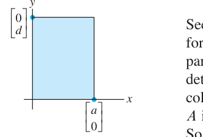

*FIGURE 1 Area = |ad|. 图1 矩形面积 = |ad|（行列式几何意义的起点）*

**3×3 情形**：$A = [\mathbf{u}\ \ \mathbf{v}\ \ \mathbf{w}]$（$3 \times 3$），$\mathbf{u}, \mathbf{v}, \mathbf{w}$ 确定的**平行六面体体积为 $|\det A|$**（FIGURE 3：长方体体积 |abc| 是特例）。

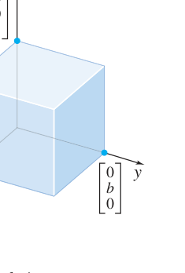

*FIGURE 3 Volume = |abc|. 图3 长方体体积 = |abc|（三阶行列式 = 体积）*

**THEOREM 9（面积/体积公式）**：
> 若 $A$ 是 $2 \times 2$ 矩阵，$A$ 的列确定的平行四边形面积为 $|\det A|$；若 $A$ 是 $3 \times 3$ 矩阵，$A$ 的列确定的平行六面体体积为 $|\det A|$。

**证明思路（2×2）**：分三种情况。
1. $A$ **对角** $\begin{bmatrix} a & 0 \\
0 & d \end{bmatrix}$：矩形，面积 = $|ad| = |\det A|$ ✓
2. $A$ 只有**一个非对角元非零**（如 $\begin{bmatrix} a & 0 \\
c & d \end{bmatrix}$）：图 2 的"剪切"不改变面积（两平行四边形同底等高），仍有面积 = $|ad| = |\det A|$ ✓

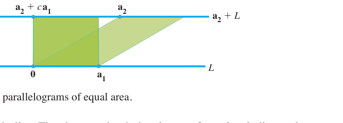

*FIGURE 2 Two parallelograms of equal area. 图2 剪切不改变面积：两个平行四边形等积（det 相同的直观解释）*

3. **一般** $A$：列变换（$\mathbf{a}_2 \to \mathbf{a}_2 + c\mathbf{a}_1$）不改变行列式（定理 3a 的列版），而图形剪切后面积不变；反复剪切最终化到情形 2，而 $\det$ 一路不变 ⇒ 面积恒等于 $|\det A|$。3×3 情形完全类似（用体积）。∎

**例4（Example 4，平移技巧）**：求顶点为 $(-2, -2)$、$(0, 3)$、$(4, -1)$、$(6, 4)$ 的平行四边形面积。

**解**：顶点不在原点，先**平移**：减去 $(-2, -2)$，得新顶点 $(0,0)$、$(2,5)$、$(6,1)$、$(8,6)$（平移不改变面积，FIGURE 5）：

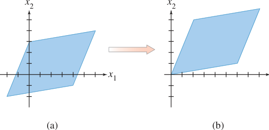

*FIGURE 5 Translating a parallelogram does not change its area. 图5 平移平行四边形不改变面积（例4的技巧）*

由相邻顶点 $(0,0)$、$(2,5)$、$(6,1)$ 构成矩阵 $A = \begin{bmatrix} 2 & 6 \\
5 & 1 \end{bmatrix}$：

$$\text{面积} = |\det A| = |2 - 30| = |-28| = \mathbf{28}$$

### 线性变换与面积 THEOREM 10（变换的伸缩系数）

> 设 $T: \mathbb{R}^2 \to \mathbb{R}^2$ 是由 $2 \times 2$ 矩阵 $A$ 确定的线性变换。若 $S$ 是 $\mathbb{R}^2$ 中面积有限的区域，则

> $$\{T(S)\text{ 的面积}\} = |\det A| \cdot \{S\text{ 的面积}\}$$

> （3×3 版本同理：体积被放大 $|\det A|$ 倍。）

**理解**：$T$ 把整个平面"均匀拉伸/压缩" $|\det A|$ 倍——同一张图形无论放在哪里、什么形状，像的面积都是原面积的 $|\det A|$ 倍。

**证明思路**：对单位正方形验证（显然，面积 1 → 面积 |det A|）；再把 $S$ 切成小正方形网格取极限（积分思想）。∎

> **T 的作用域不必是 R²**：若 $T: \mathbb{R}^3 \to \mathbb{R}^2$（如把三维点投影到平面），$S$ 是 $\mathbb{R}^3$ 中面积有限的曲面，则 $\{T(S)\text{ 的面积}\} = |\det A^T A|^{1/2}\{S\text{ 的面积}\}$——多元微积分中**曲面面积公式**的矩阵形式！

**3×3 体积版例**：平行六面体经 $T$ 作用后，体积变为原来的 $|\det A|$ 倍；若 $|\det A| = 1$，体积不变（体积保持）。

### 3.3 小结

| 概念 | 一句话理解 |
|---|---|
| 克拉默法则 | $x_i = \det A_i(\mathbf{b})/\det A$（理论美；数值计算少用） |
| 伴随矩阵 | $A^{-1} = \operatorname{adj}A/\det A$（$\operatorname{adj} A$ = 余因子矩阵的**转置**） |
| Theorem 9 | 面积/体积 = \|det A\|（2×2 平行四边形、3×3 平行六面体） |
| Theorem 10 | 线性变换把面积放大 \|det A\| 倍（体积同理） |
| 平移技巧 | 顶点不在原点时先平移到原点，面积不变 |

> **本节精髓**：行列式是**几何量**——面积、体积的"有向"版本。Theorem 10 的 $|\det A|$ 倍伸缩是第 5 章特征值理论（$\det(A - \lambda I)$）、第 7 章 SVD 的几何种子。第 3 章至此收官：从递归定义（3.1）到代数性质（3.2）再到几何本质（3.3），行列式完成了"数 → 代数结构 → 几何变换"的三级跳。

---
---

# 第四章 向量空间
# Chapter 4 Vector Spaces

**导入例子：空间飞行与控制系统**
**INTRODUCTORY EXAMPLE: Space Flight and Control Systems**

1995 年 2 月，数学家李成龙（Thomas Luczak）设计的姿态控制问题成功应用于航天飞机：系统需要把机体旋转到指定方向，同时满足燃料约束，最终化为**带约束的优化问题**——其核心是解数千个方程构成的线性系统。这类工程问题中的"向量"往往不是简单的数字列表，而可能是**函数、信号、矩阵**。本章把第 1~3 章的理论从 $\mathbb{R}^n$ 推广到**任意向量空间**——这是线性代数抽象力量的巅峰。

---

## 4.1 向量空间与子空间 Vector Spaces and Subspaces

**中文讲解**：前两章的向量是 $\mathbb{R}^n$ 中的"有序数列"。现在我们抽象出**向量空间的本质**——它只是一个**集合 + 两种运算（加法、数乘）**，满足 10 条公理。判断"一个集合能不能做线性代数"，只看这 10 条。

### 向量空间的定义 DEFINITION

**向量空间（vector space）**是一个非空集合 $V$，其上定义了两种运算——**加法**（把 $V$ 中两元素 $\mathbf{u}, \mathbf{v}$ 映到 $V$ 中元素 $\mathbf{u} + \mathbf{v}$）和**标量乘法**（把标量 $c$ 与 $\mathbf{v} \in V$ 映到 $c\mathbf{v} \in V$）——并满足以下十条公理（对所有 $\mathbf{u}, \mathbf{v}, \mathbf{w} \in V$、所有标量 $c, d$）：

1. $\mathbf{u} + \mathbf{v} \in V$（加法封闭）
2. $\mathbf{u} + \mathbf{v} = \mathbf{v} + \mathbf{u}$（加法交换律）
3. $(\mathbf{u} + \mathbf{v}) + \mathbf{w} = \mathbf{u} + (\mathbf{v} + \mathbf{w})$（加法结合律）
4. 存在**零向量** $\mathbf{0} \in V$ 使 $\mathbf{u} + \mathbf{0} = \mathbf{u}$
5. 对每个 $\mathbf{u}$ 存在**逆元** $-\mathbf{u}$ 使 $\mathbf{u} + (-\mathbf{u}) = \mathbf{0}$
6. $c\mathbf{u} \in V$（数乘封闭）
7. $c(\mathbf{u} + \mathbf{v}) = c\mathbf{u} + c\mathbf{v}$（分配律）
8. $(c + d)\mathbf{u} = c\mathbf{u} + d\mathbf{u}$（分配律）
9. $c(d\mathbf{u}) = (cd)\mathbf{u}$（数乘结合律）
10. $1\mathbf{u} = \mathbf{u}$（单位元）

> **要点**：公理 1、6 是"封闭性"要求（运算结果必须留在 $V$ 中），其余 8 条是"运算规则"。**$V$ 中的元素叫向量，但完全可以不是"数组"**——可以是函数、多项式、信号、矩阵、甚至箭头。

### 关键例子（新向量空间的动物园）

**例1/2（Example 1, 2）**：$n$ 维欧氏空间 $\mathbb{R}^n$（$n \geq 1$）——我们最熟悉的向量空间，10 条公理全部验证过（1.3 节）。特别地，$\mathbb{R}^1$ 的"向量"就是实数。

**例3（Example 3）**：**箭头向量**——平面上从同一起点出发的所有箭头，按"平行四边形法则"相加、按长度缩放。加法结合律由图 2/3 的平行四边形几何保证。

**例4（Example 4，多项式空间 $\mathbb{P}_n$）**：**次数 ≤ n 的实系数多项式**全体构成的集合，按多项式通常的加法与数乘。例：$\mathbb{P}_2$ 中的元素形如

$$p(t) = a_0 + a_1 t + a_2 t^2$$

（注意"次数 ≤ n"——包括次数更小的，如常数多项式。）

**例6（Example 6，函数空间 $\mathbb{C}[a, b]$）**：定义在闭区间 $[a, b]$ 上的**实值连续函数**全体，按"逐点相加" $(f + g)(t) = f(t) + g(t)$、"逐点缩放" $(cf)(t) = c\,f(t)$。连续函数的和与倍数仍连续，故封闭性满足。这是泛函分析的出发点。

**例5（Example 5，离散信号空间）**：定义在整数集上的实值"双无穷序列" $\{y_k\}$（$k \in \mathbb{Z}$）——模拟离散时间信号。加法、数乘均**逐点**进行（图 4 可视化一个离散信号）。这是**数字信号处理**的数学舞台。

> **其他重要例子**（教材列举）：全体 $m \times n$ 矩阵、全体实值函数……线性代数在几何、分析、工程等一切"可加可缩放"的对象上通行无阻。

### 子空间 Subspaces

**定义**：向量空间 $V$ 的子集 $H$ 称为**子空间**，若 $H$ 满足（对 $\mathbf{u}, \mathbf{v} \in H$、标量 $c$）：

a. **零向量** $\mathbf{0} \in H$

b. $\mathbf{u} + \mathbf{v} \in H$（加法封闭）

c. $c\mathbf{u} \in H$（数乘封闭）

> 与 2.8 节 $\mathbb{R}^n$ 的定义一模一样！**子空间本身也是一个向量空间**（10 条公理由 $V$ 继承，自动成立）。每个向量空间 $V$ 至少有两个子空间：$V$ 本身和零子空间 $\{\mathbf{0}\}$。

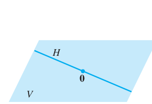

*FIGURE 6 A subspace of V. 图6 V 的子空间 H（过原点的平面/直线形象在抽象空间同样成立）*

**例7/8/9（常用子空间速览）**：
- 仅含**零向量**的集 $\{\mathbf{0}\}$：任何向量空间的（零）子空间
- $\mathbb{P}_2$（次数 ≤ 2 的多项式）：$\mathbb{P}$（全体多项式）的子空间——次数 ≤ 2 的和与倍数次数仍 ≤ 2，封闭 ✓
- $[a, b]$ 上连续函数集：函数空间的子空间（连续函数的和与倍数仍连续）

**几何对照**（在 $\mathbb{R}^3$ 中巩固直觉）：

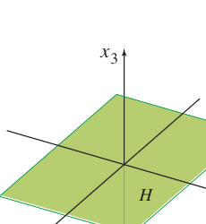

*FIGURE 7 The x1x2-plane as a subspace of $\mathbb{R}^3$. 图7 $x_1x_2$ 平面（$x_3 = 0$）是 $\mathbb{R}^3$ 的子空间：过原点、含零向量 ✓*

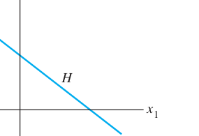

*FIGURE 8 A line that is not a vector space. 图8 不过原点的直线不是子空间：不含零向量，加法/数乘都会跑出 H*

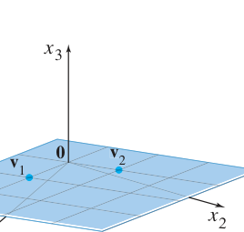

*FIGURE 9 An example of a subspace. 图9 子空间示例：$H = \operatorname{Span}\{\mathbf{v}_1, \mathbf{v}_2\}$（过原点平面）*

**THEOREM 1**：若 $\mathbf{v}_1, \dots, \mathbf{v}_p$ 在向量空间 $V$ 中，则 $\operatorname{Span}\{\mathbf{v}_1, \dots, \mathbf{v}_p\}$ 是 $V$ 的子空间。

（证明与 2.8 节例 1 完全相同：零向量在 Span 中；线性组合的和与倍数仍是线性组合。∎）

**例10（Example 10）**：$V$ 中任意 $\mathbf{v}_1, \mathbf{v}_2$，$H = \operatorname{Span}\{\mathbf{v}_1, \mathbf{v}_2\}$ 是子空间（Theorem 1 直接给出）。

**例11（Example 11，参数化描述）**：设 $H = \{(a - 3b,\ b - a,\ a,\ b) : a, b \in \mathbb{R}\}$。证明 $H$ 是 $\mathbb{R}^4$ 的子空间。

**解**：把参数形式拆成向量的线性组合：

$$\begin{bmatrix} a - 3b \\
b - a \\
a \\
b \end{bmatrix} = a\begin{bmatrix} 1 \\
-1 \\
1 \\
0 \end{bmatrix} + b\begin{bmatrix} -3 \\
1 \\
0 \\
1 \end{bmatrix} = a\mathbf{v}_1 + b\mathbf{v}_2$$

故 $H = \operatorname{Span}\{\mathbf{v}_1, \mathbf{v}_2\}$，由 Theorem 1 是子空间 ∎

> **方法论**：证明"H 是子空间"的最快路径——把 $H$ 写成**若干向量的张成**（参数化拆向量），再引用 Theorem 1。这与 2.8 节例 11 一脉相承。

### 4.1 小结

| 概念 | 一句话理解 |
|---|---|
| 向量空间 | 集合 + 加法 + 数乘 + 10 条公理（元素不必是数组！） |
| 子空间 | 含零向量、对加法/数乘封闭（继承 V 的全部公理） |
| Theorem 1 | 任意向量组的张成是子空间（最通用的构造法） |
| 新例子 | $\mathbb{P}_n$（多项式）、$\mathbb{C}[a,b]$（连续函数）、信号空间 |

> **本节精髓**：抽象化让线性代数"一次证明、处处适用"。第 1~3 章在 $\mathbb{R}^n$ 中学过的一切——子空间、张成、线性无关、基、维数——将在 4.2~4.5 节逐一推广到任意向量空间。下一节先看两个最重要的"具体对象"：矩阵的零空间与列空间在抽象框架下的样子。

---
---

## 4.2 零空间、列空间与线性变换 Null Spaces, Column Spaces, and Linear Transformations

**中文讲解**：2.8 节我们在 $\mathbb{R}^n$ 中初步认识了矩阵的两大子空间（Col A 与 Nul A）。本节在抽象框架下系统展开：正确定义、子空间判定、两者的对照、以及与线性变换的核（kernel）与值域（range）的联系。

### 零空间 The Null Space

**定义**：$m \times n$ 矩阵 $A$ 的**零空间**是齐次方程 $A\mathbf{x} = \mathbf{0}$ 的**全部解**：

$$\operatorname{Nul} A = \{\mathbf{x} : \mathbf{x} \in \mathbb{R}^n,\ A\mathbf{x} = \mathbf{0}\} \subseteq \mathbb{R}^n$$

**例1（Example 1，验证向量属于 Nul A）**：设 $A = \begin{bmatrix} 1 & -3 & -2 \\
-5 & 9 & 1 \end{bmatrix}$, $\mathbf{u} = \begin{bmatrix} 5 \\
3 \\
-2 \end{bmatrix}$。判断 $\mathbf{u} \in \operatorname{Nul} A$？

**解**：算 $A\mathbf{u} = \begin{bmatrix} 5 - 9 + 4 \\
-25 + 27 - 2 \end{bmatrix} = \begin{bmatrix} 0 \\
0 \end{bmatrix} = \mathbf{0}$ ✓ 故 $\mathbf{u} \in \operatorname{Nul} A$。

**THEOREM 2**：$m \times n$ 矩阵 $A$ 的零空间是 $\mathbb{R}^n$ 的子空间。

（等价表述：$m$ 个方程 $n$ 个未知量的齐次线性方程组的解集是 $\mathbb{R}^n$ 的子空间。）

**证明**：完全复制 2.8 定理 13 的三步（$\mathbf{0} \in \operatorname{Nul} A$；$A(\mathbf{u}+\mathbf{v}) = A\mathbf{u} + A\mathbf{v} = \mathbf{0}$；$A(c\mathbf{u}) = c\,A\mathbf{u} = \mathbf{0}$）。注意**不要求 $A$ 是方阵**！∎

**例2（Example 2，隐式描述转显式）**：设 $H = \{(a, b, c, d) \in \mathbb{R}^4 : a - 2b + 5c = d,\ c - a = b\}$。判断 $H$ 是否是子空间。

**解**：把定义条件重排成**齐次方程组**：

$$
\begin{aligned}
a - 2b + 5c - d &= 0 \\
-a - b + c \quad\;\; &= 0
\end{aligned}
$$

系数矩阵 $A = \begin{bmatrix} 1 & -2 & 5 & -1 \\
-1 & -1 & 1 & 0 \end{bmatrix}$，则 $H = \operatorname{Nul} A$，由 Theorem 2 是子空间 ∎

> **方法论**：判断"由线性方程条件定义的集合"是否为子空间——把条件改写成**齐次**方程组，证明它就是某矩阵的零空间。注意条件必须全是"= 0"型（等号右边不能有非零常数，否则不过原点，不是子空间）。

**Nul A 的显式描述（例3）**：与 2.8 节例 6 完全相同的 $3 \times 5$ 矩阵，行化简 + 参数向量形式给出基 $\{\mathbf{u}, \mathbf{v}, \mathbf{w}\}$——**解 $A\mathbf{x} = \mathbf{0}$ 的标准流程自动产生 Nul A 的基**（第 5 章会反复用到这个事实）。

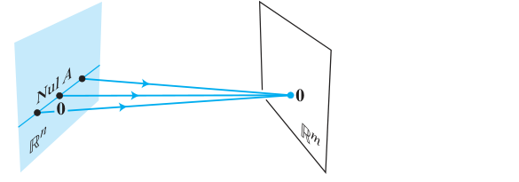

*FIGURE 1 The null space of A: Nul A, a subspace of $\mathbb{R}^n$, is mapped into the zero vector of $\mathbb{R}^m$. 图1 零空间的几何形象：Nul A（$\mathbb{R}^n$ 的子空间）被 A 全部压到 $\mathbb{R}^m$ 的零向量*

### 列空间 The Column Space

**定义**：$m \times n$ 矩阵 $A$ 的**列空间**是其各列所有线性组合之集：

$$\operatorname{Col} A = \operatorname{Span}\{\mathbf{a}_1, \dots, \mathbf{a}_n\} \subseteq \mathbb{R}^m$$

**基本事实**：
- $\operatorname{Col} A = \{\mathbf{b} : A\mathbf{x} = \mathbf{b} \text{ 有解}\}$（"值域"视角）
- $\operatorname{Col} A$ 是 $\mathbb{R}^m$ 的子空间（张成集必为子空间，Theorem 4.1-1）

**例4（Example 4，参数化集合 = 列空间）**：设 $W = \{(6a - b,\ a + b,\ -7a) : a, b \in \mathbb{R}\}$。证明 $W$ 是子空间。

**解**：拆参数：

$$\begin{bmatrix} 6a - b \\
a + b \\
-7a \end{bmatrix} = a\begin{bmatrix} 6 \\
1 \\
-7 \end{bmatrix} + b\begin{bmatrix} -1 \\
1 \\
0 \end{bmatrix}$$

故 $W = \operatorname{Col} A$，$A = \begin{bmatrix} 6 & -1 \\
1 & 1 \\
-7 & 0 \end{bmatrix}$，是子空间 ∎

> **方法论**：证明"由线性参数式定义的集合"为子空间——把参数式拆成**列向量的线性组合**，说明它是某矩阵的列空间。

### Nul A 与 Col A 对照表（本节精华）

| 性质 | $\operatorname{Nul} A$ | $\operatorname{Col} A$ |
|---|---|---|
| 定义 | $A\mathbf{x} = \mathbf{0}$ 的解集 | 各列的线性组合 |
| 属于哪个空间 | $\mathbb{R}^n$（$n$ = A 的列数） | $\mathbb{R}^m$（$m$ = A 的行数） |
| 子空间判别 | 解齐次方程组（Theorem 2） | 化为张成集（Theorem 4.1-1） |
| 求基 | 行化简 + 参数向量形式 | **A 的主元列**（2.8 定理 14） |
| 维数 | 自由变量数 = $n - \operatorname{rank} A$ | 主元列数 = $\operatorname{rank} A$ |

**例5（Example 5，空间归属判断）**：$A = \begin{bmatrix} 2 & 4 & -2 & 1 \\
-2 & -5 & 7 & 3 \\
3 & 7 & -8 & 6 \end{bmatrix}$（$3 \times 4$）。
a. 若 $\operatorname{Col} A$ 是子空间，属于哪个空间？$\operatorname{Nul} A$ 呢？
b. 求 $\operatorname{Col} A$ 与 $\operatorname{Nul} A$ 中各一个非零向量（若存在）。

**解**：
a. $\operatorname{Col} A$ 由 $\mathbb{R}^3$ 中的列张成，故 $\operatorname{Col} A \subseteq \mathbb{R}^3$；$\operatorname{Nul} A$ 是 $A\mathbf{x} = \mathbf{0}$ 的解集，$\mathbf{x} \in \mathbb{R}^4$，故 $\operatorname{Nul} A \subseteq \mathbb{R}^4$。

b. $\operatorname{Col} A$ 中任取一列，如 $(2, -2, 3)$ ✓。$\operatorname{Nul} A$：行化简 $[A\ \ \mathbf{0}]$：

$$[A\ \ \mathbf{0}] \sim \begin{bmatrix} 1 & 0 & 9 & 0 & 0 \\
0 & 1 & -5 & 0 & 0 \\
0 & 0 & 0 & 1 & 0 \end{bmatrix} \Rightarrow x_1 = -9x_3,\ x_2 = 5x_3,\ x_4 = 0\ (x_3 \text{ 自由})$$

取 $x_3 = 1$，得 $\operatorname{Nul} A$ 中向量 $(-9, 5, 1, 0)$ ✓

**例6（Example 6，"不同空间"的判别）**：设 $A$ 为例 5 的矩阵，$\mathbf{u} = (3, -2, -1, 0)$，$\mathbf{v} = (3, -1, 3)$。

**解**：
- $\mathbf{u} \in \operatorname{Nul} A$？算 $A\mathbf{u} = (0, -3, 3) \neq \mathbf{0}$ → **不在**（注意即便算错空间归属，先算 $A\mathbf{u}$ 总没错）
- $\mathbf{u} \in \operatorname{Col} A$？$\mathbf{u} \in \mathbb{R}^4$ 而 $\operatorname{Col} A \subseteq \mathbb{R}^3$ → **不可能**
- $\mathbf{v} \in \operatorname{Col} A$？解 $A\mathbf{x} = \mathbf{v}$ 行化简得相容 → **在**
- $\mathbf{v} \in \operatorname{Nul} A$？$\mathbf{v} \in \mathbb{R}^3$ 而 $\operatorname{Nul} A \subseteq \mathbb{R}^4$ → **不可能**

> **口诀**：先问"在哪个空间"，再问"满足条件吗"——空间归属错误是初学者最常见的坑。

### 线性变换的核与值域 Kernel and Range of a Linear Transformation

**定义**：线性变换 $T: V \to W$ 的
- **核（kernel）**：$\operatorname{ker} T = \{\mathbf{v} \in V : T(\mathbf{v}) = \mathbf{0}\}$ —— $V$ 中被压成零的向量集
- **值域（range）**：$\operatorname{range} T = \{T(\mathbf{v}) : \mathbf{v} \in V\}$ —— $T$ 的全部输出

**联系矩阵情形**：$T(\mathbf{x}) = A\mathbf{x}$ 时，$\operatorname{ker} T = \operatorname{Nul} A$（$\mathbb{R}^n$ 的子空间），$\operatorname{range} T = \operatorname{Col} A$（$\mathbb{R}^m$ 的子空间）。一般结论：**ker T 是 V 的子空间，range T 是 W 的子空间**（证明同 Theorem 2 / 4.1-1，练习 35–37）。

**例8（Example 8，微分算子的核）**：设 $\mathbb{P}_2$ 中 $T(p) = p'$（求导）。$\ker T$ = 导数为零的多项式 = **全体常数多项式**；$\operatorname{range} T = \mathbb{P}_1$（次数 ≤ 1 的多项式）。

**例9（Example 9，微分方程的解空间）**：设 $C[a,b]$ 中 $T(f) = 3f'' + 4f' - 2f$（$f''$ 表示二阶导）。$\ker T$ = 满足 $3f'' + 4f' - 2f = 0$ 的全体函数——**这是一个齐次线性微分方程的解集，是子空间**（叠加原理！）。而 $T(f) = 5$ 这类非齐次方程的解集**不是**子空间（是子空间的平移）。

### 4.2 小结

| 概念 | 一句话理解 |
|---|---|
| Nul A | $A\mathbf{x} = \mathbf{0}$ 的解集（$\mathbb{R}^n$ 的子空间，Thm 2） |
| Col A | 各列的张成（$\mathbb{R}^m$ 的子空间） |
| 判别法 | 方程条件 → Nul A；参数式 → Col A |
| ker T / range T | 核 = "压成零的输入"（V 的子空间）；值域 = "全部输出"（W 的子空间） |
| 统一视角 | 矩阵情形：ker T = Nul A，range T = Col A |

> **本节精髓**：Nul A 与 Col A 是矩阵 $A$ 的"一体两面"——核看"哪里被压扁"，值域看"能到达哪里"。抽象为 ker T 与 range T 后，微分算子、积分算子等无穷维对象也纳入同一框架——这是泛函分析中"算子理论"的起点。下一节 4.3 把**线性无关与基**推广到任意向量空间，完成理论大厦的主体结构。

---
---

## 4.3 线性无关集与基 Linearly Independent Sets; Bases

**中文讲解**：本节把第 1 章的"线性无关"和 2.8 节的"基"推广到**任意向量空间**。定义几乎原封不动，但新例子（多项式、函数）会刷新你对这两个概念的理解。核心新定理：张成集可以"瘦身"成基（Theorem 3）。

### 向量空间中的线性无关 Linear Independence

**定义**：向量空间 $V$ 中向量集 $\{\mathbf{v}_1, \dots, \mathbf{v}_p\}$（$p \geq 2$）称为**线性无关**，若向量方程

$$c_1\mathbf{v}_1 + c_2\mathbf{v}_2 + \cdots + c_p\mathbf{v}_p = \mathbf{0}$$

只有**平凡解** $c_1 = \cdots = c_p = 0$。否则称为**线性相关**——即存在某个 $\mathbf{v}_j$ 是其余向量的线性组合。

> 定义与 1.7 节完全一致！验证方法也一致：设线性组合等于零，论证权必须全为零。

**例1（Example 1，多项式空间的相依性）**：设 $\mathbf{p}_1(t) = 1$, $\mathbf{p}_2(t) = t$, $\mathbf{p}_3(t) = 4 - t$。则 $\{\mathbf{p}_1, \mathbf{p}_2, \mathbf{p}_3\}$ 在 $\mathbb{P}$ 中**线性相关**——因为

$$\mathbf{p}_3 = 4\mathbf{p}_1 - \mathbf{p}_2$$

（即 $4\mathbf{p}_1 - \mathbf{p}_2 - \mathbf{p}_3 = \mathbf{0}$，存在非平凡组合）。

**例2（Example 2，函数空间的无关性）**：在 $C[0, 1]$（$[0,1]$ 上连续函数空间）中：

- $\{\sin t, \cos t\}$ **线性无关**：设 $c_1\sin t + c_2\cos t = 0$（零函数），分别取 $t = 0$ 得 $c_2 = 0$，取 $t = \pi/2$ 得 $c_1 = 0$——只有平凡解 ✓
- $\{\sin t\cos t,\ \sin 2t\}$ **线性相关**：因为三角恒等式 $\sin 2t = 2\sin t\cos t$——$\sin 2t$ 是 $\sin t\cos t$ 的倍数！

> **启示**：同样的两个函数，换不同的"环境"（空间），相关性结论可以不同——判断相关性永远在所讨论的向量空间内进行。

### 基 Basis

**定义**：向量空间 $V$ 的一个子集 $\mathcal{B}$ 称为 $V$ 的**基**，若

1. $\mathcal{B}$ 是**线性无关**集
2. $\mathcal{B}$ **张成** $V$（$\operatorname{Span}\mathcal{B} = V$）

**例4（Example 4，可逆矩阵的列 = 基）**：$n \times n$ 可逆矩阵 $A$ 的列构成 $\mathbb{R}^n$ 的基——因为可逆 ⟺ 列线性无关（IMT-e）且张成 $\mathbb{R}^n$（IMT-h）。这正是 IMT 的另一种表述！

**例5（Example 5，$\mathbb{R}^n$ 的标准基）**：

$$\mathcal{E} = \{\mathbf{e}_1, \mathbf{e}_2, \dots, \mathbf{e}_n\}$$

即单位矩阵 $I_n$ 的各列。线性无关（IMT）且张成 $\mathbb{R}^n$。FIGURE 1 画出 $\mathbb{R}^3$ 的标准基：

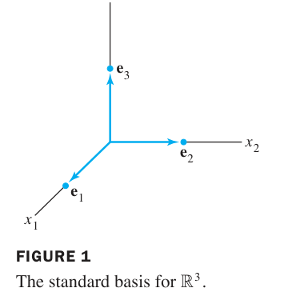

*FIGURE 1 The standard basis for $\mathbb{R}^3$. 图1 $\mathbb{R}^3$ 的标准基 $\{\mathbf{e}_1, \mathbf{e}_2, \mathbf{e}_3\}$*

**例6（Example 6，$\mathbb{P}_n$ 的标准基）**：单项式集合

$$\{1,\ t,\ t^2,\ \dots,\ t^n\}$$

是 $\mathbb{P}_n$ 的基。**验证**：
1. **张成**：任何次数 ≤ n 的多项式都是 $1, t, \dots, t^n$ 的线性组合（按定义！）
2. **无关**：若 $c_0 + c_1 t + \cdots + c_n t^n = \mathbf{0}$（零多项式，即对所有 $t$ 取值为 0），则必有 $c_0 = \cdots = c_n = 0$——因为**非零的 n 次多项式至多 n 个根**，而这个多项式有无穷多个根。

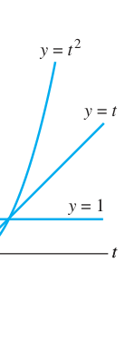

*FIGURE 2 The standard basis for $\mathbb{P}_2$. 图2 $\mathbb{P}_2$ 的标准基：$1, t, t^2$ 三个"坐标方向"*

### 张成集定理 The Spanning Set Theorem（基的存在性构造）

**THEOREM 3**：
> 设 $S = \{\mathbf{v}_1, \dots, \mathbf{v}_p\}$ 是向量空间 $V$ 的子集，$H = \operatorname{Span}\{\mathbf{v}_1, \dots, \mathbf{v}_p\}$。
>
> a. 若 $S$ 中某向量（如 $\mathbf{v}_k$）是其余向量的线性组合，则从 $S$ 中**去掉** $\mathbf{v}_k$ 后张成的空间不变。
>
> b. 若 $H \neq \{\mathbf{0}\}$，则 $S$ 的某个子集是 $H$ 的一组**基**。

**证明要点 (a)**：若 $\mathbf{v}_k = c_1\mathbf{v}_1 + \cdots$（不含 $\mathbf{v}_k$ 的组合），则 $H$ 中任一向量代入消去 $\mathbf{v}_k$ 后，仍是其余向量的组合 ⇒ 张成集不缩小。反向显然（子集张成 ⊆ 原张成）。∎

**(b) 的操作含义**：从张成集里逐个删"可被其余向量表示"的向量，直到删不动为止——剩下的就是基（无关且张成）。**张成集可"收缩"为基。**

**例7（Example 7）**：设 $\mathbf{v}_1 \neq \mathbf{0}$, $\mathbf{v}_2 \in \operatorname{Span}\{\mathbf{v}_1\}$（$\mathbf{v}_2 = k\mathbf{v}_1$），$\mathbf{v}_3 = 5\mathbf{v}_1 + 3\mathbf{v}_2$。则 $\operatorname{Span}\{\mathbf{v}_1, \mathbf{v}_2, \mathbf{v}_3\} = \operatorname{Span}\{\mathbf{v}_1\}$——后两个都是 $\mathbf{v}_1$ 的倍数，全删！

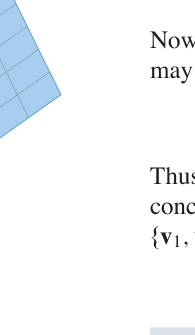

*FIGURE 3 例7 图示：$H = \operatorname{Span}\{\mathbf{v}_1, \mathbf{v}_2, \mathbf{v}_3\}$ 平面上的向量收缩*

### Nul A 与 Col A 的基（复习 + 推广）

求基的标准流程（与 2.8 节完全一致，此处以抽象语言重述）：
- $\operatorname{Nul} A$ 的基：解 $A\mathbf{x} = \mathbf{0}$，参数向量形式中的向量
- $\operatorname{Col} A$ 的基：$A$ 的**主元列**（Theorem 4，注意是 A 本身的列，不是阶梯形的列！）

### 4.3 小结

| 概念 | 一句话理解 |
|---|---|
| 线性无关（V 中） | $c_1\mathbf{v}_1 + \cdots + c_p\mathbf{v}_p = \mathbf{0}$ 只有平凡解（定义与 Rⁿ 相同） |
| 基 | 无关 + 张成（V 的"最小骨架"） |
| 标准基 | $\mathbb{R}^n$: $\{\mathbf{e}_i\}$；$\mathbb{P}_n$: $\{1, t, \dots, t^n\}$ |
| Theorem 3 | 张成集删"冗余向量"可收缩为基 |
| Col A 的基 | A 的主元列（Theorem 4） |

> **本节精髓**：Theorem 3 给出基的**构造性存在**——任何张成集都能瘦身成基（反之 4.5 节将证明：任何无关集都能扩充成基，且所有基大小相同 = 维数）。多项式与函数的例子提醒我们：线性无关性是个"关系"概念，与向量是什么无关，只与"怎么组合"有关。

---
---

## 4.4 坐标系 Coordinate Systems

**中文讲解**：2.9 节我们在 $\mathbb{R}^n$ 中见过 $\mathcal{B}$-坐标。本节把它推广到**任意向量空间**：给定向量空间 $V$ 的一组基 $\mathcal{B}$，$V$ 中每个向量都有唯一的"坐标身份证" $[\mathbf{x}]_{\mathcal{B}} \in \mathbb{R}^n$。这把抽象的 $V$ 与具体的 $\mathbb{R}^n$ **一一对应**起来——同构（isomorphism）登场。

### 唯一表示定理 THEOREM 7

> 设 $\mathcal{B} = \{\mathbf{b}_1, \dots, \mathbf{b}_n\}$ 是向量空间 $V$ 的一组基。则对每个 $\mathbf{x} \in V$，存在**唯一**的一组标量 $c_1, \dots, c_n$ 使

> $$\mathbf{x} = c_1\mathbf{b}_1 + c_2\mathbf{b}_2 + \cdots + c_n\mathbf{b}_n$$

**为什么需要"基"才有坐标？**
- **张成**保证"每个 $\mathbf{x}$ 都有表示"（存在性）
- **无关**保证"表示只有一种"（唯一性）

缺任何一条，"坐标"这个概念都会崩塌——所以基是坐标系的代名词。

### $\mathcal{B}$-坐标定义

**定义**：上式中的权 $c_1, \dots, c_n$ 称为 $\mathbf{x}$ 相对基 $\mathcal{B}$ 的**坐标**，向量

$$[\mathbf{x}]_{\mathcal{B}} = \begin{bmatrix} c_1 \\
\vdots \\
c_n \end{bmatrix} \in \mathbb{R}^n$$

称为 $\mathbf{x}$ 的 **$\mathcal{B}$-坐标向量**。

**例1（Example 1）**：设 $\mathbf{b}_1 = \begin{bmatrix} 2 \\
1 \end{bmatrix}$, $\mathbf{b}_2 = \begin{bmatrix} -1 \\
1 \end{bmatrix}$, $\mathbf{x} = \begin{bmatrix} 4 \\
5 \end{bmatrix}$，$\mathcal{B} = \{\mathbf{b}_1, \mathbf{b}_2\}$。求 $[\mathbf{x}]_{\mathcal{B}}$。

**解**：解 $c_1\mathbf{b}_1 + c_2\mathbf{b}_2 = \mathbf{x}$：

$$\begin{bmatrix} 2 & -1 & 4 \\
1 & 1 & 5 \end{bmatrix} \sim \begin{bmatrix} 1 & 0 & 3 \\
0 & 1 & 2 \end{bmatrix}$$

故 $[\mathbf{x}]_{\mathcal{B}} = \begin{bmatrix} 3 \\
2 \end{bmatrix}$。**验证**：$3\mathbf{b}_1 + 2\mathbf{b}_2 = \begin{bmatrix} 6-2 \\
3+2 \end{bmatrix} = \begin{bmatrix} 4 \\
5 \end{bmatrix}$ ✓

**图形直觉（FIGURE 1 vs FIGURE 2）**：同一向量 $\mathbf{x}$，在标准坐标纸上看是 $(4,5)$，在 $\mathcal{B}$-坐标纸（沿 $\mathbf{b}_1, \mathbf{b}_2$ 方向画网格）上看是 $(3,2)$——**换基 = 换坐标纸**：

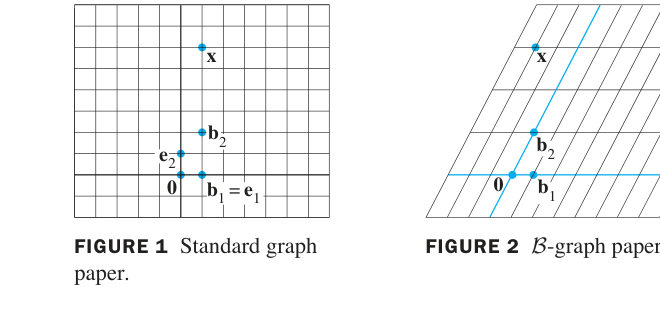

*FIGURE 1 Standard graph paper. FIGURE 2 B-graph paper. 图1 标准坐标纸（e₁,e₂ 网格）；图2 B-坐标纸（b₁,b₂ 网格）——同一点 x，两种读数*

### 坐标变换矩阵 The Change-of-Coordinates Matrix

**例4（Example 4）**：接例 1，求从 $\mathcal{B}$ 到 $\mathbb{R}^2$ 标准基的**坐标变换矩阵**，并验证 $\mathbf{x} = P_{\mathcal{B}}[\mathbf{x}]_{\mathcal{B}}$。

**解**：把基向量按列排成矩阵：

$$P_{\mathcal{B}} = \begin{bmatrix} \mathbf{b}_1 & \mathbf{b}_2 \end{bmatrix} = \begin{bmatrix} 2 & -1 \\
1 & 1 \end{bmatrix}$$

则 $P_{\mathcal{B}}[\mathbf{x}]_{\mathcal{B}} = \begin{bmatrix} 2 & -1 \\
1 & 1 \end{bmatrix}\begin{bmatrix} 3 \\
2 \end{bmatrix} = \begin{bmatrix} 4 \\
5 \end{bmatrix} = \mathbf{x}$ ✓

**核心公式 (4)**：

$$\mathbf{x} = P_{\mathcal{B}}[\mathbf{x}]_{\mathcal{B}}$$

- $P_{\mathcal{B}}$ 的列就是 $\mathcal{B}$ 的基向量，它把"$\mathcal{B}$-坐标"翻译回"$V$ 中真实的向量"
- 求 $[\mathbf{x}]_{\mathcal{B}}$：行化简 $[P_{\mathcal{B}}\ \ \mathbf{x}]$（例 1 的做法）
- 因 $\mathcal{B}$ 是基，$P_{\mathcal{B}}$ 的列无关 ⟹ $P_{\mathcal{B}}$ **可逆**，故 $[\mathbf{x}]_{\mathcal{B}} = P_{\mathcal{B}}^{-1}\mathbf{x}$

### 坐标映射与同构 The Coordinate Mapping

把上面的一切总结为一个映射：对每个 $\mathbf{x} \in V$，

$$\mathbf{x} \mapsto [\mathbf{x}]_{\mathcal{B}}$$

称为**坐标映射**（FIGURE 5）：

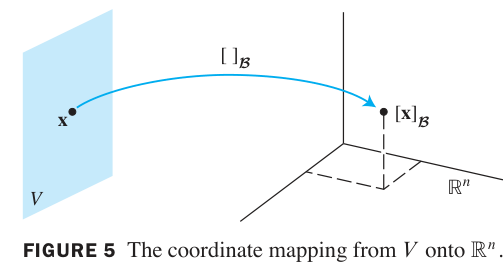

*FIGURE 5 The coordinate mapping from V onto $\mathbb{R}^n$. 图5 坐标映射：V 中每个向量 x 被映到它的坐标向量 $[\mathbf{x}]_{\mathcal{B}} \in \mathbb{R}^n$（一一对应、保持线性运算）*

**THEOREM 8（坐标映射是同构）**：
> 设 $\mathcal{B} = \{\mathbf{b}_1, \dots, \mathbf{b}_n\}$ 是向量空间 $V$ 的基。则坐标映射 $\mathbf{x} \mapsto [\mathbf{x}]_{\mathcal{B}}$ 是一个**从 $V$ 映上到 $\mathbb{R}^n$ 的一对一（onto / one-to-one）线性变换**。

**定义（同构 isomorphism）**：从向量空间 $V$ 映上到向量空间 $W$ 的一对一线性变换，称为从 $V$ 到 $W$ 的**同构**。

> **同构 = "结构完全相同"**：$V$ 与 $W$ 同构意味着它们在加法、数乘、线性组合等一切线性代数结构上不可区分——只是元素的"名字"不同。Theorem 8 说：**每个 n 维向量空间都同构于 $\mathbb{R}^n$**。这正是 2.9 节"任何 p 维子空间都同构于 $\mathbb{R}^p$"的完全版。

**例5（Example 5）**：$\mathbb{P}_3$（次数 ≤ 3 的多项式）同构于 $\mathbb{R}^4$。映射：

$$a_0 + a_1 t + a_2 t^2 + a_3 t^3 \;\mapsto\; \begin{bmatrix} a_0 \\
a_1 \\
a_2 \\
a_3 \end{bmatrix}$$

就是标准基 $\{1, t, t^2, t^3\}$ 下的坐标映射（FIGURE 6）：

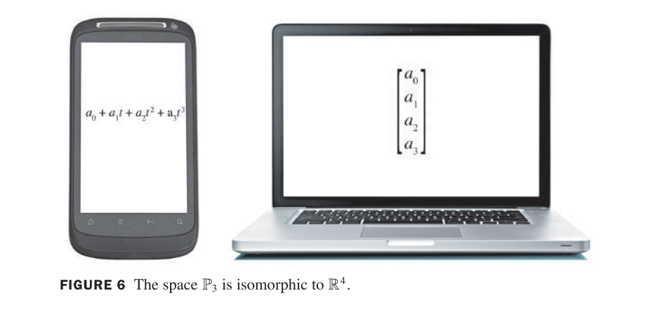

*FIGURE 6 The space $\mathbb{P}_3$ is isomorphic to $\mathbb{R}^4$. 图6 手机上显示的多项式 $a_0 + a_1 t + a_2 t^2 + a_3 t^3$，在笔记本电脑上变成坐标向量——同一对象，两种表示*

**例6（Example 6，坐标向量验证书相关性）**：用坐标向量验证 $\mathbb{P}_2$ 中三个多项式 $1 + 2t^2$、$4 + t + 5t^2$、$3 + 2t$ 线性相关。

**解**：相对标准基 $\{1, t, t^2\}$，坐标向量分别为 $(1,0,2)$、$(4,1,5)$、$(3,2,0)$。拼成矩阵行化简：

$$\begin{bmatrix} 1 & 4 & 3 \\
0 & 1 & 2 \\
2 & 5 & 0 \end{bmatrix} \sim \begin{bmatrix} 1 & 4 & 3 \\
0 & 1 & 2 \\
0 & 0 & 0 \end{bmatrix}$$

列相关（第 3 列 = 2×第 2 列 − 5×第 1 列）⇒ 多项式相关，且对应关系为：

$$3 + 2t = 2(4 + t + 5t^2) - 5(1 + 2t^2)$$

> **方法论**：验证抽象空间（$\mathbb{P}_n$、矩阵空间等）中的线性关系——**转成坐标向量在 $\mathbb{R}^n$ 中处理**，所有 $\mathbb{R}^n$ 的工具（行化简、主元、秩）直接可用。这是同构思想的实战威力。

### 4.4 小结

| 概念 | 一句话理解 |
|---|---|
| Theorem 7 | 基 ⟹ 每个向量有**唯一**坐标表示（张成给存在、无关给唯一） |
| $[\mathbf{x}]_{\mathcal{B}}$ | 向量在基 $\mathcal{B}$ 下的"坐标身份证" |
| $P_{\mathcal{B}}$ | 坐标变换矩阵：$\mathbf{x} = P_{\mathcal{B}}[\mathbf{x}]_{\mathcal{B}}$，列 = 基向量 |
| Theorem 8 | 坐标映射是 V → Rⁿ 的同构（一一对应、保持线性） |
| 同构 | 结构完全相同的两个空间（只换元素"名字"） |
| 实战价值 | 抽象空间的线性问题 → 转成 Rⁿ 坐标计算 |

> **本节精髓**：同构是线性代数最重要的"翻译器"——它宣告：凡 n 维向量空间，本质上都是 $\mathbb{R}^n$。第 1~3 章在 $\mathbb{R}^n$ 中建立的全部算法与定理，经由坐标映射，自动适用于多项式空间、函数空间、矩阵空间。下一节 4.5 给出维数的严格理论（所有基大小相同），完成抽象大厦的最后一块基石。

---
---

## 4.5 向量空间的维数 The Dimension of a Vector Space

**中文讲解**：一个向量空间可能有许多不同的基——$\mathbb{R}^2$ 的标准基是 $\{\mathbf{e}_1, \mathbf{e}_2\}$，$\{\mathbf{b}_1, \mathbf{b}_2\}$（例 4.4-1）也是基。**不同的基，向量个数一样吗？** 本节回答：一样！这个共同的数字就是**维数**——向量空间最重要的不变量。

### 基的"大小"唯一 THEOREM 9 & 10

**THEOREM 9**：
> 设 $V$ 有一组基 $\mathcal{B} = \{\mathbf{b}_1, \dots, \mathbf{b}_n\}$。则 $V$ 中任何含**超过 n 个**向量的集合必线性相关。

**证明思路**：设 $\{\mathbf{u}_1, \dots, \mathbf{u}_p\}$（$p > n$）。每个 $\mathbf{u}_j$ 都是基向量的线性组合。考察 $c_1\mathbf{u}_1 + \cdots + c_p\mathbf{u}_p = \mathbf{0}$，把每个 $\mathbf{u}_j$ 用基展开、按 $\mathbf{b}_i$ 合并系数，得 $n$ 个方程 $p$ 个未知量的齐次系统——未知量多于方程数，必有非平凡解。∎

**THEOREM 10**：
> 若 $V$ 有一组含 $n$ 个向量的基，则 $V$ 的**每组基都恰好含 $n$ 个向量**。

**证明**：设 $\mathcal{B}_1$（n 个向量）、$\mathcal{B}_2$（m 个向量）都是基。$\mathcal{B}_1$ 是基、$\mathcal{B}_2$ 无关 ⟹ 由 Theorem 9，$m \leq n$。交换角色得 $n \leq m$。故 $m = n$。∎

### 维数的定义 DEFINITION

**定义**：
- 若 $V$ 由**有限个**向量的基张成，则 $V$ 称为**有限维（finite-dimensional）**，$V$ 的**维数** $\dim V$ = 基中向量的个数
- **零空间** $\{\mathbf{0}\}$ 的维数定义为 $0$
- 若 $V$ 不由有限集张成，则称**无限维（infinite-dimensional）**

**例1（Example 1）**：
- $\dim \mathbb{R}^n = n$（标准基 n 个向量）
- $\dim \mathbb{P}_n = n + 1$（标准基 $\{1, t, \dots, t^n\}$ 共 $n+1$ 个）
- $\mathbb{P}$（全体多项式）**无限维**（任意有限集都张不出"所有次数"）

**例2（Example 2）**：$H = \operatorname{Span}\{\mathbf{v}_1, \mathbf{v}_2\}$（$\mathbf{v}_1, \mathbf{v}_2$ 无关）中 $\{\mathbf{v}_1, \mathbf{v}_2\}$ 是 $H$ 的基，故 $\dim H = 2$。

**例3（Example 3，$\mathbb{R}^3$ 的子空间维数清单）**：

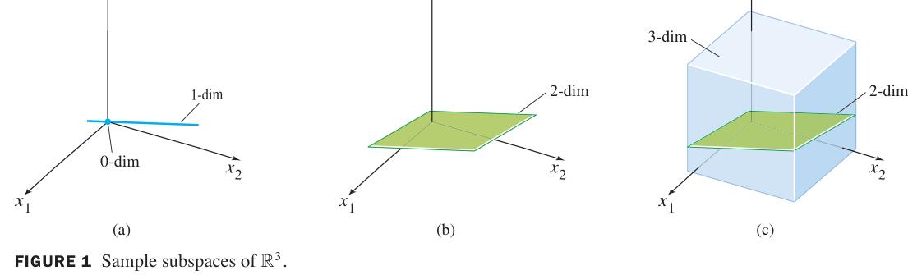

*FIGURE 1 Sample subspaces of $\mathbb{R}^3$. 图1 $\mathbb{R}^3$ 的子空间按维数分类：(a) 0 维={原点}、1 维=过原点直线；(b) 2 维=过原点平面；(c) 3 维=$\mathbb{R}^3$ 本身（含一个 2 维平面）*

| 维数 | $\mathbb{R}^3$ 的子空间 |
|---|---|
| 0 | $\{\mathbf{0}\}$（原点） |
| 1 | 过原点的直线 |
| 2 | 过原点的平面 |
| 3 | $\mathbb{R}^3$ 本身 |

### 子空间的基与维数 THEOREM 11

> 设 $H$ 是有限维向量空间 $V$ 的子空间。$H$ 中任何线性无关集都可**扩充**为 $H$ 的一组基；且

> $$\dim H \leq \dim V$$

**理解**：子空间的"自由度"不可能超过母空间——$V$ 中最多只能容纳 $\dim V$ 个无关方向。

### 基定理 THEOREM 12（与 2.9 定理 16 相同）

> 设 $\dim V = p \geq 1$：
>
> a. $V$ 中任何含**恰好 p 个**向量的线性无关集自动是 $V$ 的基
>
> b. $V$ 中任何含**恰好 p 个**向量且张成 $V$ 的集合自动是 $V$ 的基

**实战价值**：已知 $\dim V = p$ 时，验证"无关"或"张成"**只需验一条**！（一般情况要验两条。）

### Nul A 与 Col A 的维数

- $\dim \operatorname{Nul} A$ = $A\mathbf{x} = \mathbf{0}$ 的**自由变量个数**
- $\dim \operatorname{Col} A$ = $A$ 的**主元列个数** = $\operatorname{rank} A$

**例5（Example 5）**：求 $A = \begin{bmatrix} -3 & 6 & -1 & 1 & -7 \\
1 & -2 & 2 & 3 & -1 \\
2 & -4 & 5 & 8 & -4 \end{bmatrix}$ 的子空间维数。

**解**：4.2 节例 3 已算过：RREF 有 2 个主元列、3 个自由变量，故

$$\dim \operatorname{Col} A = 2, \qquad \dim \operatorname{Nul} A = 3$$

**秩定理回顾（Rank Theorem）**：$\operatorname{rank} A + \dim \operatorname{Nul} A = n$（列数）——列空间与零空间"瓜分" $\mathbb{R}^n$。

### 4.5 小结

| 概念 | 一句话理解 |
|---|---|
| Theorem 9 | 基有 n 个 ⟹ 无关集至多有 n 个（"方向数"有上限） |
| Theorem 10 | 所有基大小相同（维数是 well-defined 的不变量） |
| dim V | 基中向量个数；零空间 0 维；P 无限维 |
| Theorem 11 | 子空间维数 ≤ 母空间维数；无关集可扩充为基 |
| Theorem 12 | 已知 dim V = p：p 个无关向量 ⟹ 自动是基 |
| dim Nul / Col A | 自由变量数 / 主元列数（= rank A） |

> **本节精髓**：维数是向量空间的"**指纹**"——两个同构的空间维数相同，反之有限维空间中维数相同即同构。Theorem 11（扩充为基）与 4.3 的 Theorem 3（收缩为基）一收一放，宣告了基的极大灵活性。至此，第 4 章的抽象理论主体完成：向量空间（4.1）→ 子空间（4.1-4.2）→ 无关与基（4.3）→ 坐标与同构（4.4）→ 维数（4.5）。下一节 4.6 把**秩**的概念推广到抽象空间（行空间、线性变换的秩），第 4 章收官。

---
